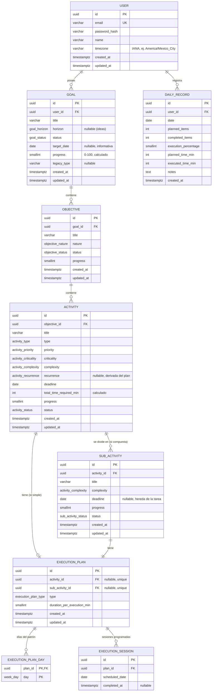

# Time Planner — Análisis de Entidades, Reglas de Negocio y Casos de Uso

> **Propósito:** servir como especificación base para construir el backend en NestJS (`timer-planner-backend`), a partir del comportamiento actual del frontend Angular (`timer-planner-frontend`), que hoy persiste todo en `localStorage`.
>
> **Fuente analizada:** `timer-planner-frontend/src/app` (modelos, `PlannerService`, `DateUtils`, formularios y vistas).
> **Estado del backend:** proyecto base de NestJS 11 sin módulos, sin ORM y sin base de datos.
> **Fecha del análisis:** 2026-10-17 · Última revisión: 2026-10-20 · Versión de la app analizada: "Planner V2" (`v2.0.0`).

---

## Índice

1. [Visión general del dominio](#1-visión-general-del-dominio)
2. [Arquitectura actual de datos (frontend)](#2-arquitectura-actual-de-datos-frontend)
3. [Entidades del dominio (estado actual)](#3-entidades-del-dominio-estado-actual)
4. [Catálogos / enumeraciones](#4-catálogos--enumeraciones)
5. [Reglas de negocio](#5-reglas-de-negocio)
6. [Casos de uso](#6-casos-de-uso)
7. [Inconsistencias y bugs detectados](#7-inconsistencias-y-bugs-detectados)
8. [Modelo de datos propuesto para la base de datos](#8-modelo-de-datos-propuesto-para-la-base-de-datos)
9. [Propuesta de API REST](#9-propuesta-de-api-rest)
10. [Decisiones pendientes](#10-decisiones-pendientes)
11. [Apéndice: referencias al código fuente](#11-apéndice-referencias-al-código-fuente)

---

## 1. Visión general del dominio

Time Planner es un planificador personal jerárquico. El usuario define **metas** de vida/carrera, las descompone en **objetivos**, y cada objetivo en **tareas** que se planifican en el calendario. Cada día, el usuario ve su **agenda de hoy**, marca lo que ejecutó y al final **cierra el día**, generando un registro histórico.

### Jerarquía (4 niveles + ejecución)

```
Meta (Goal)                       ← "Qué quiero lograr" (corto/mediano/largo plazo)
 └── Objetivo (Objective)         ← "En qué área/naturaleza" (salud, finanzas, ...)
      └── Tarea (Activity)        ← Trabajo planificable
           ├── [simple]    → tiene su propio Plan de Ejecución
           └── [compuesta] → se divide en Pasos
                └── Paso (SubActivity) → siempre tiene Plan de Ejecución

Plan de Ejecución (ExecutionPlan) ← Fechas en que se trabaja + duración por sesión
Registro Diario (DailyRecord)     ← Snapshot de métricas al cerrar el día
```

### Glosario (nombres de UI ↔ nombres en código)

| UI (español)        | Código          | Descripción |
|---------------------|-----------------|-------------|
| Meta                | `Goal`          | Nivel superior. Agrupa objetivos. Puede ser una idea sin plazo (`IDEA`). |
| Objetivo            | `Objective`     | Área de la meta, clasificada por *naturaleza*. |
| Tarea               | `Activity`      | Trabajo planificable. Puede ser simple o compuesta. |
| Paso                | `SubActivity`   | Unidad ejecutable de una tarea compuesta. |
| Plan de Ejecución   | `ExecutionPlan` | Calendario de sesiones + duración por sesión. |
| Sesión / Ejecución  | (fecha en `dates`) | Un día concreto en que se debe trabajar un ítem. |
| Agenda de Hoy       | `todaysTasks`   | Ítems ejecutables con sesión programada hoy. |
| Cierre de día       | `DailyRecord`   | Registro histórico de métricas del día. |

> **Unidad ejecutable**: solo las **tareas simples** y los **pasos** se agendan y se marcan como hechos. Las tareas compuestas, objetivos y metas obtienen su progreso por **agregación**.

---

## 2. Arquitectura actual de datos (frontend)

- **Contrato de persistencia:** `DataProvider` (clase abstracta) con pares `getX()` / `saveX(lista completa)` para 5 colecciones.
- **Implementación actual:** `LocalStorageService`, inyectado en `app.config.ts` como `{ provide: DataProvider, useClass: LocalStorageService }`.
- **Claves de `localStorage`:** `planner_goals`, `planner_objectives`, `planner_activities`, `planner_sub_activities`, `planner_records`.
- **Estado en memoria:** `PlannerService` mantiene una `signal` por colección. **Toda la lógica de negocio vive aquí** (cascadas, cálculo de progreso, agenda, cierre de día).
- **Estrategia de guardado:** cada mutación llama a `saveAll()`, que reescribe **las 4 colecciones completas** (no los registros) en cada cambio.
- **IDs:** generados en el cliente con `crypto.randomUUID()`.
- **SSR:** en servidor, `load()` devuelve `[]`; solo se lee/escribe en el navegador.
- **Ya existe** `provideHttpClient(withFetch())`, por lo que cambiar a un `HttpDataProvider` es directo.

**Implicación para el backend:** el contrato actual es "guardar la lista completa". Para una API real conviene migrar a operaciones granulares (CRUD por entidad) y **mover al backend** la lógica de cascadas, progreso y generación de fechas, para que el frontend no sea la fuente de verdad.

---

## 3. Entidades del dominio (estado actual)

### 3.1 Goal (Meta)

`core/models/goal.model.ts`

| Campo       | Tipo          | Requerido | Origen / Regla |
|-------------|---------------|-----------|----------------|
| `id`        | `string` (UUID) | Sí | Generado al crear. |
| `title`     | `string`      | Sí | Mínimo 3 caracteres. |
| `horizon`   | `GoalHorizon` | No (`null` si es `IDEA`) | Default `MEDIUM_TERM`. |
| `progress`  | `number` 0–100 | Sí | **Calculado** (promedio de objetivos). Inicia en 0. |
| `status`    | `GoalStatus`  | Sí | Inicia en `ACTIVE` o `IDEA`. Cambia con pausa (RN-55, RN-57). |
| `createdAt` | `Date`        | Sí | Fecha de creación; se preserva al editar. |
| `targetDate` | `string` `YYYY-MM-DD` | No | Fecha objetivo informativa. No genera sesiones (RN-56). |
| `type`      | `string`      | No | **Legacy V1**. Solo se conserva al editar. |

### 3.2 Objective (Objetivo)

`core/models/objective.model.ts`

| Campo       | Tipo              | Requerido | Origen / Regla |
|-------------|-------------------|-----------|----------------|
| `id`        | UUID              | Sí | Generado al crear. |
| `goalId`    | UUID → Goal       | Sí | Fijado por la ruta; no se puede mover a otra meta. |
| `title`     | `string`          | Sí | Mínimo 3 caracteres. |
| `nature`    | `ObjectiveNature` | Sí | Default `OTHER`. |
| `progress`  | `number` 0–100    | Sí | **Calculado** (promedio de tareas). |
| `status`    | `ObjectiveStatus` | Sí | Inicia en `ACTIVE`. Pasa a `COMPLETED` solo por cierre manual con progreso 100% (RN-63). |
| `createdAt` | `Date`            | Sí | Se preserva al editar. |

### 3.3 Activity (Tarea)

`core/models/activity.model.ts`

| Campo                  | Tipo                  | Requerido | Origen / Regla |
|------------------------|-----------------------|-----------|----------------|
| `id`                   | UUID                  | Sí | |
| `objectiveId`          | UUID → Objective      | Sí | Fijado por la ruta. |
| `title`                | `string`              | Sí | Mínimo 3 caracteres. |
| `type`                 | `ActivityType`        | Sí | `SIMPLE` o `COMPOSITE`. Default `SIMPLE`. |
| `priority`             | `ActivityPriority`    | Sí | Default `MEDIUM`. |
| `criticality`          | `ActivityCriticality` | Sí | Default `FLEXIBLE`. |
| `complexity`           | `ActivityComplexity`  | Sí | Default `MEDIUM`. |
| `recurrence`           | `ActivityRecurrence`  | Condicional | Calculado desde `executionPlan` (RN-47). `null` en compuestas. |
| `deadline`             | `string` `YYYY-MM-DD` | Sí | En UI no puede ser anterior a hoy. |
| `executionPlan`        | `ExecutionPlan`       | Condicional | **Solo si `type = SIMPLE`**. `null` si es compuesta. |
| `totalTimeRequiredMin` | `number`              | No | Solo simple: `dates.length × durationPerExecutionMin`. |
| `progress`             | `number` 0–100        | Sí | Calculado (ver §5.4). |
| `status`               | `ActivityStatus`      | Sí | Inicia `PENDING`; luego derivado del progreso. |

### 3.4 SubActivity (Paso)

| Campo           | Tipo                  | Requerido | Origen / Regla |
|-----------------|-----------------------|-----------|----------------|
| `id`            | UUID                  | Sí | |
| `activityId`    | UUID → Activity       | Sí | La tarea padre debe ser `COMPOSITE`. |
| `title`         | `string`              | Sí | Mínimo 3 caracteres (RN-13). |
| `deadline`      | `string` `YYYY-MM-DD` | No | Si se omite, hereda el deadline efectivo de la tarea padre (RN-14). No puede ser anterior a hoy. |
| `complexity`    | `ActivityComplexity`  | Sí | Default `MEDIUM`. |
| `status`        | `SubActivityStatus`   | Sí | Inicia `PENDING`; luego derivado del progreso. |
| `executionPlan` | `ExecutionPlan`       | **Siempre** | Unidad ejecutable de la compuesta. |
| `progress`      | `number` 0–100        | Sí | `completedDates / dates`. |

> No tiene `priority`, `criticality` ni `recurrence`: los hereda conceptualmente de la tarea padre.

### 3.5 ExecutionPlan (Plan de Ejecución) — objeto embebido

| Campo                     | Tipo                 | Regla |
|---------------------------|----------------------|-------|
| `type`                    | `ExecutionPlanType`  | `WEEKLY_PATTERN` (default) o `SPECIFIC_DATES`. |
| `dates`                   | `string[]` ISO       | **Lista materializada** de todas las sesiones programadas. Ordenada. |
| `patternDays`             | `WeekDay[]`          | Solo si `type = WEEKLY_PATTERN`. |
| `durationPerExecutionMin` | `number`             | Mínimo 5. Default 60 (tarea) / 45 (paso). |
| `completedDates`          | `string[]` ISO       | Fechas en que la sesión se marcó como hecha. |

> Hoy está embebido dentro de `Activity` y `SubActivity`. En BD se recomienda normalizarlo (ver §8).

### 3.6 DailyRecord (Registro Diario)

`core/models/daily-record.model.ts`

| Campo                 | Tipo   | Regla |
|-----------------------|--------|-------|
| `id`                  | UUID   | |
| `date`                | ISO    | Fecha local del cierre. |
| `plannedItems`        | number | Total de ítems en la agenda del día. |
| `completedItems`      | number | Ítems marcados como hechos. |
| `executionPercentage` | number | `round(completed / planned × 100)`; 0 si no hay ítems. |
| `plannedTimeMin`      | number | Suma de duración de todos los ítems del día. |
| `executedTimeMin`     | number | Suma de duración de los ítems completados. |
| `notes`               | string | Opcional. Reflexión del usuario. |
| `createdAt`           | Date   | Momento del cierre. |

> Es un **snapshot inmutable**: no referencia a qué ítems se planificaron. Hoy no hay pantalla para consultarlos ("Historial (Pronto)").

### 3.7 Entidad derivada: TodayTask (no persistida)

Proyección calculada por `todaysTasks`:

```ts
{ id, title, estimatedDurationMin, isCompleted, sourceType: TaskSourceType, parentId }
```

---

## 4. Catálogos / enumeraciones

### 4.1 Convención de nombres

| Elemento | Convención | Ejemplo |
|----------|------------|---------|
| Clases, tipos y enums | PascalCase, en inglés | `ActivityStatus` |
| Campos, variables y funciones | camelCase, en inglés | `completedDates`, `targetDate` |
| Valores de enum (código, API, BD) | UPPER_SNAKE_CASE, en inglés | `IN_PROGRESS` |
| Columnas y tablas de BD | snake_case, en inglés | `completed_at` |
| Textos de interfaz | Español, fuera del código | `"En progreso"` |

**Regla:** el código, la API y la BD solo manejan el valor en inglés. La etiqueta en español vive en un diccionario de UI indexado por el valor, por ejemplo `ActivityStatus.IN_PROGRESS → "En progreso"`.

**Datos existentes:** `localStorage` guarda los valores en español y minúscula (`en_progreso`, `patron_repetitivo`). La importación (§9) debe mapearlos a los valores nuevos de la tabla 4.2.

### 4.2 Valores

| Enum | Valor (código) | Etiqueta UI | Valor anterior (localStorage) |
|------|----------------|-------------|-------------------------------|
| `GoalHorizon` | `SHORT_TERM` | Corto plazo | `corto` |
| `GoalHorizon` | `MEDIUM_TERM` | Mediano plazo | `mediano` |
| `GoalHorizon` | `LONG_TERM` | Largo plazo | `largo` |
| `GoalStatus` | `IDEA` | Idea | *nuevo (RN-55)* |
| `GoalStatus` | `ACTIVE` | Activa | `activa` |
| `GoalStatus` | `PAUSED` | Pausada | `pausada` |
| `ObjectiveNature` | `PERSONAL` | Personal | `personal` |
| `ObjectiveNature` | `PROFESSIONAL` | Profesional | `profesional` |
| `ObjectiveNature` | `HEALTH` | Salud | `salud` |
| `ObjectiveNature` | `FINANCE` | Finanzas | `finanzas` |
| `ObjectiveNature` | `LEARNING` | Aprendizaje | `aprendizaje` |
| `ObjectiveNature` | `HABIT` | Hábito | `habito` |
| `ObjectiveNature` | `WELLBEING` | Bienestar | `bienestar` |
| `ObjectiveNature` | `OTHER` | Otro | `otro` |
| `ObjectiveStatus` | `ACTIVE` | Activo | `activa` |
| `ObjectiveStatus` | `PAUSED` | Pausado | `pausada` |
| `ObjectiveStatus` | `COMPLETED` | Completado | `completada` |
| `ActivityType` | `SIMPLE` | Simple | `simple` |
| `ActivityType` | `COMPOSITE` | Compuesta | `compuesta` |
| `ActivityStatus` | `PENDING` | Pendiente | `pendiente` |
| `ActivityStatus` | `IN_PROGRESS` | En progreso | `en_progreso` |
| `ActivityStatus` | `COMPLETED` | Completada | `completada` |
| `ActivityStatus` | `PAUSED` | Pausada | `pausada` |
| `ActivityStatus` | `OVERDUE` | Vencida | *derivado, no se almacena (RN-58)* |
| `SubActivityStatus` | `PENDING` | Pendiente | `pendiente` |
| `SubActivityStatus` | `IN_PROGRESS` | En progreso | `en_progreso` |
| `SubActivityStatus` | `COMPLETED` | Completada | `completada` |
| `ActivityPriority` | `HIGH` | Alta | `alta` |
| `ActivityPriority` | `MEDIUM` | Media | `media` |
| `ActivityPriority` | `LOW` | Baja | `baja` |
| `ActivityCriticality` | `VITAL` | Vital | `vital` |
| `ActivityCriticality` | `ESSENTIAL_RECURRING` | Esencial recurrente | `esencial_recurrente` |
| `ActivityCriticality` | `FLEXIBLE` | Flexible | `flexible` |
| `ActivityComplexity` | `LOW` | Baja | `baja` |
| `ActivityComplexity` | `MEDIUM` | Media | `media` |
| `ActivityComplexity` | `HIGH` | Alta | `alta` |
| `ActivityRecurrence` | `SINGLE` | Única | `unica` |
| `ActivityRecurrence` | `WEEKLY_PATTERN` | Patrón semanal | `patron_semanal` |
| `ActivityRecurrence` | `SPECIFIC_DATES` | Fechas específicas | `fechas_especificas` |
| `ExecutionPlanType` | `WEEKLY_PATTERN` | Patrón repetitivo | `patron_repetitivo` |
| `ExecutionPlanType` | `SPECIFIC_DATES` | Fechas específicas | `fechas_especificas` |
| `WeekDay` | `MONDAY` | Lun | `L` |
| `WeekDay` | `TUESDAY` | Mar | `M` |
| `WeekDay` | `WEDNESDAY` | Mié | `X` |
| `WeekDay` | `THURSDAY` | Jue | `J` |
| `WeekDay` | `FRIDAY` | Vie | `V` |
| `WeekDay` | `SATURDAY` | Sáb | `S` |
| `WeekDay` | `SUNDAY` | Dom | `D` |
| `TaskSourceType` | `ACTIVITY` | Tarea | *nuevo (antes `activity`)* |
| `TaskSourceType` | `SUBACTIVITY` | Paso | *nuevo (antes `subactivity`)* |

> **Nota:** las etiquetas de UI son una propuesta y se pueden ajustar sin tocar el código. `WeekDay` pasa de letras a nombres completos porque en inglés las letras se repiten (`T` sirve para Tuesday y Thursday, `S` para Saturday y Sunday).

### 4.3 Persistencia

En la BD se usa `enum` nativo (PostgreSQL) o `varchar` con `CHECK`. En NestJS, `enum` de TypeScript con `@IsEnum()` en los DTOs. Los valores de la API son los del código, nunca las etiquetas.

---

## 5. Reglas de negocio

Se numeran para poder referenciarlas desde tests, DTOs e issues. **[UI]** = hoy solo se valida en el formulario; **[SVC]** = se aplica en `PlannerService`/`DateUtils`. En el backend **todas** deben validarse del lado del servidor.

### 5.1 Jerarquía e integridad

| ID | Regla |
|----|-------|
| RN-01 | Un **Objetivo** pertenece a exactamente una **Meta** (`goalId` obligatorio). |
| RN-02 | Una **Tarea** pertenece a exactamente un **Objetivo** (`objectiveId` obligatorio). |
| RN-03 | Un **Paso** pertenece a exactamente una **Tarea**, y esa tarea debe ser de tipo `COMPOSITE`. [UI: el botón "Añadir Paso" solo aparece en compuestas] |
| RN-04 | Una tarea **simple** debe tener un Plan de Ejecución; una tarea **compuesta** no lo tiene (`executionPlan = null`). [SVC] |
| RN-05 | Un **Paso** siempre tiene Plan de Ejecución. |
| RN-06 | No se puede reasignar un objetivo a otra meta ni una tarea a otro objetivo (el padre se toma de la ruta y no es editable). |

### 5.2 Eliminación en cascada

| ID | Regla |
|----|-------|
| RN-07 | Eliminar una **Meta** elimina todos sus Objetivos, y en cascada sus Tareas y Pasos. Requiere confirmación escrita (RN-62). [SVC `deleteGoal`] |
| RN-08 | Eliminar un **Objetivo** elimina todas sus Tareas y sus Pasos. Requiere confirmación escrita (RN-62). [SVC `deleteObjective`] |
| RN-09 | Eliminar una **Tarea** elimina todos sus Pasos. Requiere confirmación escrita (RN-62). [SVC `deleteActivity`] |
| RN-10 | Tras cualquier eliminación se **recalcula el progreso** de los ancestros. |
| RN-11 | Los **Registros Diarios** no se ven afectados por eliminaciones (son snapshots independientes). |

> Es **eliminación física** (hard delete). Los respaldos y el soft delete quedan fuera del MVP (§10).

### 5.3 Validaciones de campos

| ID | Regla |
|----|-------|
| RN-12 | Título de Meta, Objetivo y Tarea: requerido, **mínimo 3 caracteres**. [UI] |
| RN-13 | Título de Paso: requerido, **mínimo 3 caracteres** (unificado con el resto). [UI] |
| RN-14 | `deadline` es **obligatorio** en Tarea. En Paso es opcional: si se omite, **hereda el deadline efectivo de su tarea padre**. Ningún deadline puede ser anterior a hoy al crear o editar. [UI `min=today`] |
| RN-15 | `durationPerExecutionMin` ≥ **5** minutos. Requerido en pasos y en tareas simples. [UI] |
| RN-16 | Duración por defecto: **60 min** (tarea simple), **45 min** (paso). |
| RN-17 | Si el plan es `WEEKLY_PATTERN`, se debe seleccionar **al menos un día** de la semana. ("Selecciona al menos un día.") |
| RN-18 | Si el plan es `SPECIFIC_DATES`, se debe agregar **al menos una fecha**. ("Añade fechas específicas.") |
| RN-19 | Las fechas específicas no se pueden repetir y no pueden ser anteriores a hoy. Se guardan **ordenadas** ascendentemente. [UI] |
| RN-20 | El plan debe generar **al menos una sesión**; si el patrón no produce fechas antes del deadline se rechaza ("El plan no genera ninguna fecha de ejecución válida antes del deadline."). |

### 5.4 Generación del calendario (Plan de Ejecución)

| ID | Regla |
|----|-------|
| RN-21 | **Patrón repetitivo:** al guardar, se generan todas las fechas desde **hoy** hasta el **deadline** (inclusive) cuyo día de la semana esté en `patternDays`. Las fechas quedan **materializadas** en `dates`. [SVC `generateDatesFromPattern`] |
| RN-22 | **Fechas específicas:** `dates` = lista elegida por el usuario, ordenada. |
| RN-23 | *(Superada por RN-51.)* Al **editar** un plan, solo se regeneran las sesiones futuras; las pasadas se conservan. |
| RN-24 | `totalTimeRequiredMin` de tarea simple = `dates.length × durationPerExecutionMin`. En compuesta = Σ de sus pasos (B-14). |

### 5.5 Ejecución diaria

| ID | Regla |
|----|-------|
| RN-25 | La **Agenda de Hoy** contiene: tareas simples cuyo `executionPlan.dates` incluye hoy + pasos cuyo `executionPlan.dates` incluye hoy. [SVC `todaysTasks`] |
| RN-26 | Un ítem de la agenda está completado si `completedDates` incluye hoy. |
| RN-27 | Marcar/desmarcar (toggle) solo aplica a la **fecha de hoy**: agrega o quita hoy de `completedDates`. No es posible marcar días pasados ni futuros. |
| RN-28 | "Hoy" se calcula en la **zona horaria local** del usuario (`getTodayISO`). |
| RN-29 | La agenda excluye los ítems de metas `PAUSED` o `IDEA` y de tareas `PAUSED` (RN-57, RN-59). No filtra por otros estados. |

### 5.6 Cálculo de progreso y estados (cascada ascendente)

| ID | Regla |
|----|-------|
| RN-30 | **Progreso de ítem ejecutable** (tarea simple / paso) = `min(100, round(completedDates.length / dates.length × 100))`; 0 si `dates` está vacío. [SVC `calculateProgress`] |
| RN-31 | **Estado de ítem ejecutable:** `PENDING` si progreso = 0, `COMPLETED` si progreso = 100 y `IN_PROGRESS` en otro caso. Se recalcula en cada cambio. |
| RN-32 | **Progreso de tarea compuesta** = promedio simple (redondeado) del progreso de sus pasos; 0 si no tiene pasos. Estado: `PENDING` si progreso = 0, `COMPLETED` si es 100 y `IN_PROGRESS` en otro caso. |
| RN-33 | **Progreso de objetivo** = promedio simple del progreso de sus tareas; 0 si no tiene. |
| RN-34 | **Progreso de meta** = promedio simple del progreso de sus objetivos; 0 si no tiene. |
| RN-35 | Los promedios son **no ponderados**: no consideran duración, complejidad, prioridad ni número de sesiones. |
| RN-36 | El progreso se recalcula hacia arriba (paso → tarea → objetivo → meta) al: crear, editar, eliminar o hacer toggle de cualquier hijo. |
| RN-37 | El progreso y el estado **no son editables** por el usuario; al editar una entidad se conservan los valores originales. |
| RN-38 | *(Comportamiento actual, superado.)* Hoy los estados de meta, objetivo y tarea no tienen flujo para cambiarlos. Ver RN-55, RN-57, RN-59 y B-09. |

### 5.7 Cambio de tipo de tarea

| ID | Regla |
|----|-------|
| RN-39 | **Compuesta → Simple:** si la tarea tiene pasos, se pide confirmación ("Al convertirla en simple, estos pasos se eliminarán"). Si se confirma, se **eliminan todos los pasos** y se crea el plan propio. Si se cancela, no se guarda nada. |
| RN-40 | **Simple → Compuesta:** `executionPlan` y `recurrence` pasan a `null`. Si el plan tenía fechas o sesiones completadas, se requiere confirmación previa porque se pierde esa información. Sin datos asociados, no hace falta confirmar. |

### 5.8 Cierre del día

| ID | Regla |
|----|-------|
| RN-41 | Al "Cerrar Día y Guardar" se crea un `DailyRecord` con las métricas actuales de la agenda de hoy y las notas opcionales. |
| RN-42 | `plannedTimeMin` = Σ duración de todos los ítems de hoy; `executedTimeMin` = Σ duración de los completados. |
| RN-43 | **Un registro por fecha.** Cerrar un día que ya tiene registro reemplaza ese registro (upsert por `userId` + `date`). El historial conserva una sola fila por día con el cierre más reciente. |
| RN-44 | Cerrar el día no bloquea ni modifica las tareas (se pueden seguir marcando después). |

### 5.9 Migración V1 → V2 (legado)

| ID | Regla |
|----|-------|
| RN-45 | Al cargar, por cada meta **sin objetivos** se crea un objetivo `"General"` (naturaleza `OTHER`, estado `ACTIVE`). |
| RN-46 | Las tareas V1 con `goalId` se reasignan a ese objetivo y se mapean campos legacy: |

| `level` (V1)         | `priority` | `criticality` |
|----------------------|------------|---------------|
| `urgente_directo`    | `HIGH`     | `VITAL` |
| `urgente_sistemico`  | `HIGH`     | `ESSENTIAL_RECURRING` |
| `sistema`            | `MEDIUM`   | `ESSENTIAL_RECURRING` |
| `progreso`           | `MEDIUM`   | `FLEXIBLE` |
| otro / vacío         | `LOW`      | `FLEXIBLE` |

`executionPlan.type` (V1) → `recurrence` (V2): `patron_repetitivo` → `WEEKLY_PATTERN`, `fechas_especificas` → `SPECIFIC_DATES`, otro → `SINGLE`. `complexity` faltante → `MEDIUM`.

> **Nota:** RN-45 se ejecuta también en datos V2: cualquier meta que quede sin objetivos (p. ej. al borrar el último) recibe un objetivo "General" en la siguiente recarga. **No replicar en el backend**; solo relevante para un endpoint de importación de datos locales.

---

### 5.10 Recurrencia, planificación y deadlines (actualizadas)

Estas reglas reemplazan a RN-21 a RN-24 y RN-40 en lo que se opongan. Regla principal: **el plan define cuándo se trabaja, la recurrencia clasifica esa programación y el deadline fija el límite de todas las ejecuciones.**

| ID | Regla |
|----|-------|
| RN-47 | **Recurrencia calculada, no elegida.** Se deriva del `executionPlan`: plan con `patternDays` → `WEEKLY_PATTERN`; plan de fechas específicas con **1** fecha → `SINGLE`; con **2 o más** fechas → `SPECIFIC_DATES`. Se recalcula en cada escritura. En compuestas es `null`. |
| RN-48 | **Límite de deadlines.** Toda ejecución debe ser ≤ `deadline` de su tarea. Un paso puede tener deadline propio, que nunca puede superar el de su tarea padre; cada ejecución de un paso debe ser ≤ su deadline efectivo. |
| RN-49 | **Cambio de deadline.** Al modificar el deadline de una tarea o de un paso se validan todas las ejecuciones y pasos afectados. Si alguno incumple, el guardado se rechaza y se listan las fechas en conflicto. No se recortan fechas en silencio. Un paso con deadline heredado no entra en conflicto: su deadline efectivo es el de la tarea y se actualiza solo. |
| RN-50 | **Tarea compuesta.** `executionPlan` y `recurrence` son `null`. Su progreso sale de sus pasos (RN-32). Cada paso tiene su propio plan obligatorio, con programación independiente de los demás pasos. |
| RN-51 | **Editar un plan.** Las sesiones con fecha anterior a hoy se conservan, estén completadas o no. Solo se regeneran las sesiones futuras. El historial no se pierde. |
| RN-52 | **Borrado con historial.** Cualquier elemento (meta, objetivo, tarea o paso) se puede borrar, aunque esté completado o tenga hijos. El borrado es en cascada (RN-07 a RN-09) y exige confirmación escrita (RN-62). Los respaldos quedan fuera del MVP. |
| RN-53 | **Agregar hijos.** Se pueden agregar pasos, tareas u objetivos a un padre existente, aunque ya tenga progreso. El progreso del padre se recalcula sobre todos sus hijos, así que puede bajar. |
| RN-54 | **Borrar hijos no completados.** Es posible borrar un elemento que no está completado. Solo se recalcula el progreso de sus ancestros. |
| RN-55 | **Idea.** Una meta puede existir en estado `IDEA`: sin tareas programadas, sin agenda y sin horizonte obligatorio. Pasa a `ACTIVE` cuando se le asigna horizonte y se crean sus tareas con deadline. |
| RN-56 | **Fecha objetivo de meta.** `targetDate` es un campo opcional e informativo. No genera sesiones ni bloquea nada. Los deadlines que obligan siguen siendo los de las tareas (RN-14, RN-48). |
| RN-57 | **Pausa de meta.** Pausar una meta cambia solo su estado a `PAUSED`. Se oculta su agenda, pero no se modifican deadlines, sesiones ni progreso de sus hijos. |
| RN-58 | **Tareas vencidas.** Una tarea no completada con deadline ya pasado se muestra como `OVERDUE`. Es un estado derivado, no se almacena. Al reanudar la meta, el usuario replanifica esas tareas. |
| RN-59 | **Pausa de tarea (MVP).** Igual que la pausa de meta: solo oculta la tarea de la agenda. No cambia su deadline, sus sesiones ni su progreso. |
| RN-60 | **Postergar sin penalización.** El usuario puede editar el deadline de cualquier elemento no completado sin restricciones de tiempo, salvo las de RN-48 y RN-49. Postergar no reduce el progreso ni borra historial. Las tareas `OVERDUE` son solo una etiqueta visual. |
| RN-61 | **Historial para estadísticas.** Los elementos no completados, pausados o vencidos se conservan, salvo borrado explícito (RN-52). Esto permitirá analizar a futuro qué metas se terminaron y cuáles no (fuera del MVP). |
| RN-63 | **Cierre de objetivo.** `COMPLETED` no es automático. El usuario decide cuándo cerrar el objetivo, y solo se permite si su progreso es 100%. Llegar a 100% no lo cierra: queda `ACTIVE` hasta que el usuario lo cierre. Un objetivo cerrado puede seguir recibiendo tareas o pasos mientras los deadlines lo permitan (RN-53). |
| RN-64 | **Reapertura automática.** Si un objetivo `COMPLETED` baja de 100% porque recibe tareas, pasos o se borra un hijo completado, vuelve a `ACTIVE` automáticamente. Su progreso lo mantiene por debajo de 100%, así que no puede seguir cerrado. |
| RN-62 | **Confirmación de borrado.** Borrar exige escribir el título exacto del elemento. Aplica a meta, objetivo, tarea y paso. Antes de confirmar se muestra qué se va a borrar: cuántos hijos y cuántos elementos completados. |

> **Nota:** la clasificación depende del tipo de plan y no del número de fechas generadas. Un patrón semanal que produce una sola fecha sigue siendo `WEEKLY_PATTERN`.

---

## 6. Casos de uso

**Actor único:** Usuario (hoy no hay autenticación ni multiusuario).

### Mapa de casos de uso

| ID | Caso de uso | Pantalla / ruta |
|----|-------------|-----------------|
| CU-01 | Listar metas | `/goals` |
| CU-02 | Crear meta | `/goals/new` |
| CU-03 | Ver detalle de meta | `/goals/:id` |
| CU-04 | Editar meta | `/goals/:id/edit` |
| CU-05 | Eliminar meta | `/goals` (tarjeta) |
| CU-06 | Crear objetivo | `/goals/:goalId/objectives/new` |
| CU-07 | Ver detalle de objetivo (tareas + pasos) | `/objectives/:id` |
| CU-08 | Editar objetivo | `/goals/:goalId/objectives/:id/edit` |
| CU-09 | Eliminar objetivo | `/goals/:id` |
| CU-10 | Crear tarea simple | `/objectives/:objectiveId/activities/new` |
| CU-11 | Crear tarea compuesta | idem |
| CU-12 | Editar tarea (incl. cambio de tipo) | `/objectives/:objectiveId/activities/:activityId/edit` |
| CU-13 | Eliminar tarea | `/objectives/:id` |
| CU-14 | Crear paso | `/objectives/:oid/activities/:aid/add-step` |
| CU-15 | Editar paso | `/objectives/:oid/activities/:aid/steps/:sid/edit` |
| CU-16 | Eliminar paso | `/objectives/:id` |
| CU-17 | Ver agenda de hoy | `/daily` |
| CU-18 | Marcar/desmarcar ejecución de hoy | `/daily` |
| CU-19 | Ver resumen y cerrar día | `/daily/summary` |
| CU-20 | Migrar datos V1 → V2 | automático al cargar |
| CU-21 | Consultar historial | *No implementado ("Pronto")* |
| CU-22 | Crear idea (meta sin horizonte) | `/goals/new` |
| CU-23 | Pausar y reanudar meta o tarea | `/goals/:id`, `/objectives/:id` |
| CU-24 | Postergar (editar deadline) | `/goals/:id/edit`, `/objectives/:id/activities/:id/edit` |
| CU-25 | Cerrar objetivo | `/objectives/:id` |

### Detalle de casos de uso principales

#### CU-02 — Crear meta
- **Entrada:** `title` (≥3), `horizon` (opcional; sin horizonte se crea como `IDEA`).
- **Flujo:** valida → crea con `progress=0`, `status=ACTIVE` (o `IDEA` si no tiene horizonte), `createdAt=now` → redirige a `/goals`.
- **Reglas:** RN-12.

#### CU-03 — Ver detalle de meta
- Muestra título, horizonte, estado, progreso y lista de objetivos (naturaleza, estado, progreso).
- Si la meta no existe → redirige a `/goals`.

#### CU-04 — Editar meta
- **Editable:** `title`, `horizon`, `status` (pausar o reactivar; RN-57). **No editable:** `progress`, `createdAt` (se preservan).
- **Reglas:** RN-12, RN-37.

#### CU-05 — Eliminar meta
- Confirmación: *"Esta acción eliminará TAMBIÉN todas sus actividades y pasos asociados."*
- **Reglas:** RN-07, RN-11, RN-52, RN-62. Exige escribir el título de la meta.

#### CU-06 / CU-08 — Crear / editar objetivo
- **Entrada:** `title` (≥3), `nature`. El `goalId` viene de la ruta.
- **Post:** se recalcula el progreso de la meta (RN-34) — al crear, el objetivo nuevo (0%) **baja** el promedio de la meta.
- Redirige a `/goals/:goalId`.

#### CU-09 — Eliminar objetivo
- Confirmación: *"Todas las tareas asociadas serán eliminadas."* → RN-08, RN-10, RN-52, RN-62. Exige escribir el título del objetivo.

#### CU-10 — Crear tarea simple
- **Entrada:** `title`, `priority`, `criticality`, `complexity`, `deadline`, `duration`, `planType`, y `patternDays` **o** `specificDates`. La recurrencia no es entrada: se calcula (RN-47).
- **Flujo:**
  1. Valida campos (RN-12, RN-14, RN-15).
  2. Si `WEEKLY_PATTERN`: exige ≥1 día (RN-17) y genera fechas hoy→deadline (RN-21).
  3. Si `SPECIFIC_DATES`: exige ≥1 fecha (RN-18), ordena (RN-19).
  4. Si no hay fechas resultantes → error (RN-20).
  5. Crea con `status=PENDING`, `progress=0`, `completedDates=[]`, `totalTimeRequiredMin` (RN-24).
  6. Recalcula progreso del objetivo y meta.
- **Redirige** a `/objectives/:objectiveId`.

#### CU-11 — Crear tarea compuesta
- Igual que CU-10 sin sección de plan: *"No defines tiempos ahora. Crearás sub-actividades (Pasos) después."*
- Se guarda sin `executionPlan` ni `totalTimeRequiredMin`.

#### CU-12 — Editar tarea
- Carga datos actuales; conserva `progress`, `status`, `completedDates`.
- Si es simple, regenera solo las sesiones futuras (RN-51).
- Si cambia **compuesta → simple** con pasos → RN-39. Si cambia **simple → compuesta** → RN-40.

#### CU-14 / CU-15 — Crear / editar paso
- **Entrada:** `title`, `complexity`, `deadline` (opcional; si se omite hereda el de la tarea), `duration` (≥5, default 45), `planType`, días o fechas.
- Mismo flujo de generación de fechas que CU-10 (RN-17 a RN-21).
- **Post:** recalcula tarea padre → objetivo → meta (RN-32 a RN-34).

#### CU-17 — Ver agenda de hoy
- Muestra fecha completa, métricas `completados / total` y `% ejecución`, y lista de ítems (título, minutos, checkbox).
- **Reglas:** RN-25, RN-26, RN-28, RN-29, RN-57, RN-59.

#### CU-18 — Marcar ejecución
- **Entrada:** `id`, `sourceType` (`ACTIVITY` | `SUBACTIVITY`).
- **Flujo:** toggle de hoy en `completedDates` → recalcula progreso y estado del ítem (RN-30, RN-31) → cascada a ancestros (RN-36).

#### CU-19 — Cerrar día
- Muestra métricas y un textarea de notas. Al confirmar crea el `DailyRecord` (RN-41 a RN-44), muestra alerta "¡Día registrado exitosamente!" y redirige a `/goals`.

#### CU-21 — Consultar historial (futuro)
- Ya existen los datos (`planner_records`), falta la vista. El backend debería exponer listado por rango de fechas.

#### CU-22 — Crear idea
- **Entrada:** `title` (≥3). `horizon` opcional.
- **Flujo:** sin horizonte, la meta se crea con `status=IDEA`. No tiene tareas ni agenda (RN-55).
- **Promoción:** al asignar horizonte y crear tareas con deadline, pasa a `ACTIVE`.

#### CU-23 — Pausar y reanudar
- **Meta:** cambia `status` a `PAUSED`. Se oculta su agenda; deadlines y progreso no cambian (RN-57).
- **Tarea:** cambia `status` a `PAUSED`. Se oculta de la agenda (RN-59).
- **Reanudar:** la meta o tarea vuelve a `ACTIVE`, o el estado de la tarea se recalcula desde su progreso (RN-31). Las tareas que vencieron durante la pausa quedan como `OVERDUE` y se replanifican (RN-58).

#### CU-25 — Cerrar objetivo
- **Precondición:** progreso del objetivo = 100% (RN-63).
- **Flujo:** el usuario pulsa "Cerrar objetivo" → `status=COMPLETED`. Si el progreso no es 100%, la acción se rechaza.
- Un objetivo cerrado sigue visible y editable. Si baja de 100% por agregar hijos, vuelve a `ACTIVE` automáticamente (RN-64).

#### CU-24 — Postergar
- Editar el deadline de un elemento no completado. No reduce progreso ni borra historial (RN-60). Respetan RN-48 y RN-49.

---

## 7. Inconsistencias y bugs — estado de resolución

Los hallazgos se resuelven con las reglas actualizadas (§5.10) o con decisiones de arquitectura. Los **pendientes** dependen de decisiones de negocio que se aclaran con las preguntas de la sección 10.

| # | Sev. | Hallazgo | Resolución | Estado |
|---|------|----------|------------|--------|
| B-01 | Alta | Desfase de un día en zonas horarias negativas. Verificado en `America/Mexico_City` con hoy 17-oct y deadline 24-oct: genera del 16 al 23, incluye ayer y excluye el deadline. | Fechas de calendario como `DATE`, generadas en el backend con aritmética sin hora (§8.2, punto 6). | ✅ Resuelto |
| B-02 | Media | `recurrence` tiene default `'especifica'`, valor inexistente en el enum. | `recurrence` ya no se elige: se calcula desde el plan (RN-47). Desaparece el default. | ✅ Resuelto |
| B-03 | Media | `recurrence` es redundante con `executionPlan.type`. | Derivada del plan (RN-47). No es entrada del usuario, así que no puede contradecirlo. | ✅ Resuelto |
| B-04 | Media | Al editar un plan se regeneran `dates` desde hoy pero se conservan `completedDates`, lo que distorsiona el progreso. | Se conservan las sesiones pasadas y solo se regeneran las futuras (RN-51). | ✅ Resuelto |
| B-05 | Media | El progreso no se recalcula al editar sesiones o fechas. | El backend recalcula la cascada (RN-36) en cada escritura. | ✅ Resuelto |
| B-06 | Media | Fechas y deadlines no se validan entre sí. | RN-48 y RN-49: toda ejecución ≤ deadline de la tarea o del paso; paso ≤ tarea; un cambio de deadline revalida y bloquea el guardado si hay conflicto. | ✅ Resuelto |
| B-07 | Baja | El resumen muestra `completados × 45` en lugar del tiempo real. | El resumen usa `executedTimeMin` del backend. | ✅ Resuelto |
| B-08 | Baja | Se pueden crear varios `DailyRecord` para la misma fecha. | Un registro por fecha con upsert (RN-43). Coincide con el índice único `(user_id, date)` de §8.3. | ✅ Resuelto |
| B-09 | Baja | Los estados `PAUSED`, `ARCHIVED` y `COMPLETED` nunca se asignan y la agenda no los respeta. | Estados manuales: `IDEA` y `PAUSED` en metas (RN-55, RN-57). `COMPLETED` en objetivos por cierre manual con progreso 100% (RN-63). La agenda excluye metas pausadas e ideas. | ✅ Resuelto |
| B-10 | Baja | Un ítem desmarcado a 0% queda `IN_PROGRESS`. | Progreso 0 → `PENDING`; 1–99 → `IN_PROGRESS`; 100 → `COMPLETED` (RN-31 y RN-32). | ✅ Resuelto |
| B-11 | Baja | La agenda usa `task.status` para la clase `completed`, pero ese campo no existe en el objeto. | El frontend usa `task.isCompleted`. | ✅ Resuelto |
| B-12 | Baja | `min(5)` en la duración solo se aplica si el usuario cambia el tipo. | `@Min(5)` siempre en el backend (RN-15). | ✅ Resuelto |
| B-13 | Info | La migración crea un objetivo "General" en cada carga, no solo para datos V1. | No se replica en el backend. | ✅ Resuelto |
| B-14 | Info | `totalTimeRequiredMin` no existe para compuestas. | Simple: `dates × duración`. Compuesta: Σ de los pasos. Lo calcula el backend y no es entrada del usuario. | ✅ Resuelto |

---

## 8. Modelo de datos propuesto para la base de datos

Se propone un modelo **relacional** (recomendado: PostgreSQL), ya que el dominio es estrictamente jerárquico, con cascadas y agregaciones. El modelo es agnóstico del ORM (TypeORM, Prisma o MikroORM).

### 8.1 Diagrama entidad-relación



### 8.2 Decisiones clave del modelo

1. **`USER` (nuevo):** el frontend no tiene usuarios, pero un backend con BD lo necesita para aislar datos. `timezone` es indispensable para calcular "hoy" (RN-28) en el servidor. Si inicialmente es monousuario, igual se recomienda la columna `user_id` para no migrar después.
2. **`EXECUTION_PLAN` como tabla propia** con FK exclusiva: `CHECK ((activity_id IS NULL) <> (sub_activity_id IS NULL))` + `UNIQUE` en cada FK. Alternativa válida: columnas del plan directamente en `activity` y `sub_activity` (más simple, algo de duplicación).
3. **`EXECUTION_SESSION` normaliza `dates` + `completedDates`** en una sola tabla:
   - Cada fecha programada es una fila; `completed_at IS NOT NULL` = hecha.
   - `UNIQUE (plan_id, scheduled_date)`.
   - Índice en `scheduled_date` → la Agenda de Hoy es un `SELECT … WHERE scheduled_date = :today`.
   - Resuelve B-04: al regenerar el plan se borran solo sesiones **futuras no completadas** y se conservan las pasadas.
   - Progreso = `COUNT(completed_at) / COUNT(*)`.
4. **`EXECUTION_PLAN_DAY`** guarda `patternDays` (necesario para re-generar y para editar el formulario).
5. **Progreso como columna denormalizada** en goal/objective/activity/sub_activity, recalculada en el servicio dentro de la **misma transacción** que la escritura que la origina. Alternativa: calcularlo al vuelo con vistas/consultas agregadas (más consistente, más costoso en lectura).
6. **Fechas de calendario** (`deadline`, `scheduled_date`, `daily_record.date`) como `DATE`, nunca `timestamp`, para evitar B-01.
7. **Cascadas:** `ON DELETE CASCADE` en `goal → objective → activity → sub_activity → execution_plan → execution_session / execution_plan_day`. El recálculo de progreso de ancestros se hace en el servicio.
8. **`DAILY_RECORD`:** `UNIQUE (user_id, date)`, un registro por día (RN-43).
9. **IDs:** UUID. Permitir que el cliente envíe el `id` facilita la importación desde `localStorage` y el uso offline.

### 8.3 Índices recomendados

| Tabla | Índice |
|-------|--------|
| `goal` | `(user_id)` |
| `objective` | `(goal_id)` |
| `activity` | `(objective_id)`, `(deadline)` |
| `sub_activity` | `(activity_id)` |
| `execution_plan` | `UNIQUE (activity_id)`, `UNIQUE (sub_activity_id)` |
| `execution_session` | `UNIQUE (plan_id, scheduled_date)`, `(scheduled_date)` |
| `daily_record` | `UNIQUE (user_id, date)` |

### 8.4 Sugerencia de módulos NestJS

| Módulo | Responsabilidad |
|--------|-----------------|
| `AuthModule` / `UsersModule` | Registro, login (JWT), zona horaria del usuario. |
| `GoalsModule` | CRUD de metas. |
| `ObjectivesModule` | CRUD de objetivos. |
| `ActivitiesModule` | CRUD de tareas, cambio de tipo (RN-39/40). |
| `SubActivitiesModule` | CRUD de pasos. |
| `ExecutionPlansModule` | Generación de sesiones (RN-21, RN-22, RN-47 a RN-51), servicio de fechas. |
| `ProgressModule` (servicio) | Recalcular progreso/estado en cascada (RN-30 a RN-36). Usado por los demás módulos. |
| `DailyModule` | Agenda de hoy, toggle de ejecución, cierre de día, historial. |
| `ImportModule` (opcional) | Importar el JSON de `localStorage` (incluye migración V1→V2, RN-45/46). |

---

## 9. Propuesta de API REST

Rutas anidadas solo para **creación/listado** por padre; operaciones sobre un recurso por su id directo (coherente con el frontend, que ya navega `/objectives/:id`).

### Metas
| Método | Ruta | Caso de uso | Notas |
|--------|------|-------------|-------|
| GET | `/goals` | CU-01 | Lista con `progress`, `status`. |
| POST | `/goals` | CU-02, CU-22 | `{ title, horizon?, status? }`. Sin horizonte se crea como `IDEA`. |
| GET | `/goals/:id` | CU-03 | Incluye objetivos (o usar endpoint de abajo). |
| PATCH | `/goals/:id` | CU-04, CU-23, CU-24 | `{ title?, horizon?, status?, targetDate? }` |
| DELETE | `/goals/:id` | CU-05 | Cascada. |

### Objetivos
| Método | Ruta | Caso de uso |
|--------|------|-------------|
| GET | `/goals/:goalId/objectives` | CU-03 |
| POST | `/goals/:goalId/objectives` | CU-06 — `{ title, nature }` |
| GET | `/objectives/:id` | CU-07 — incluye tareas y pasos |
| PATCH | `/objectives/:id` | CU-08 |
| DELETE | `/objectives/:id` | CU-09 |

### Tareas
| Método | Ruta | Caso de uso |
|--------|------|-------------|
| GET | `/objectives/:objectiveId/activities` | CU-07 |
| POST | `/objectives/:objectiveId/activities` | CU-10 / CU-11 |
| GET | `/activities/:id` | — |
| PATCH | `/activities/:id` | CU-12, CU-23, CU-24. Pausar: `status: PAUSED`; reanudar: el estado se recalcula desde el progreso (RN-31). Si hay pérdida de datos (compuesta→simple con pasos, o simple→compuesta con sesiones), exige `confirmDataLoss: true` o responde `409` (RN-39, RN-40). |
| DELETE | `/activities/:id` | CU-13 |

Ejemplo de cuerpo (tarea simple):
```json
{
  "title": "Correr 5km",
  "type": "SIMPLE",
  "priority": "HIGH",
  "criticality": "ESSENTIAL_RECURRING",
  "complexity": "MEDIUM",
  "deadline": "2026-12-31",
  "executionPlan": {
    "type": "WEEKLY_PATTERN",
    "patternDays": ["MONDAY", "WEDNESDAY", "FRIDAY"],
    "durationPerExecutionMin": 45
  }
}
```
> El cliente **no** envía `dates`, `completedDates`, `progress`, `status` ni `totalTimeRequiredMin` ni `recurrence`: los calcula el servidor. Para `SPECIFIC_DATES` se envía `executionPlan.dates`.

### Pasos
| Método | Ruta | Caso de uso |
|--------|------|-------------|
| GET | `/activities/:activityId/sub-activities` | CU-07 |
| POST | `/activities/:activityId/sub-activities` | CU-14 (400/422 si la tarea no es compuesta) |
| PATCH | `/sub-activities/:id` | CU-15 |
| DELETE | `/sub-activities/:id` | CU-16 |

### Agenda y registros
| Método | Ruta | Caso de uso | Notas |
|--------|------|-------------|-------|
| GET | `/daily/today` | CU-17 | Devuelve `tasks[]` + `metrics`. "Hoy" según `user.timezone` (o `?date=`). |
| POST | `/daily/executions/toggle` | CU-18 | `{ sourceType: ACTIVITY | SUBACTIVITY, id, date? }` → devuelve ítem y ancestros actualizados. Alternativa REST: `PUT/DELETE /executions/:sessionId/completion`. |
| POST | `/daily/records` | CU-19 | `{ notes? }` → el servidor calcula las métricas. Upsert por fecha (RN-43). |
| GET | `/daily/records?from=&to=` | CU-21 | Historial. |

### Importación (opcional)
| Método | Ruta | Uso |
|--------|------|-----|
| POST | `/import/local-storage` | Recibe las 5 colecciones de `localStorage`, aplica migración V1→V2 y las persiste. |

### Validación (DTOs con `class-validator`)
- `title`: `@IsString() @MinLength(3)`
- enums: `@IsEnum(...)`
- `deadline`, fechas: `@IsDateString()` (solo fecha) + validación "≥ hoy" en servicio.
- `durationPerExecutionMin`: `@IsInt() @Min(5)`
- `patternDays`: `@ArrayMinSize(1)` cuando `type = WEEKLY_PATTERN` (`@ValidateIf`).
- `dates`: `@ArrayMinSize(1) @ArrayUnique()` cuando `type = SPECIFIC_DATES`.
- `deadline` de paso: `@IsOptional()`. Si se envía, debe ser ≤ deadline de la tarea (RN-48).

---

## 10. Decisiones pendientes

Puntos que el código actual no define y que conviene decidir antes de implementar:

1. **Autenticación / multiusuario.** ¿Se implementa desde el inicio (JWT) o se arranca monousuario?
2. **Motor de base de datos y ORM.** Recomendado PostgreSQL + TypeORM o Prisma.
3. ~~**`recurrence` vs `executionPlan.type`** (B-03)~~ **Resuelto:** la recurrencia se deriva del plan (RN-47).
4. ~~**Estado `ARCHIVED`**~~ **Resuelto:** se elimina del MVP porque no tiene uso definido.
   ~~**Cierre de objetivo**~~ **Resuelto:** es manual y solo se permite con progreso 100% (RN-63).
5. **Progreso ponderado** (RN-35): ¿mantener promedio simple o ponderar por número de sesiones / minutos totales?
6. **Marcar días pasados** (RN-27): ¿permitir registrar retroactivamente una sesión no marcada?
7. **Detalle del cierre:** ¿guardar qué ítems se planificaron o completaron ese día, o solo las métricas? (El registro por fecha ya está resuelto, RN-43.)
8. ~~**Borrar con historial**~~ **Resuelto:** se puede borrar en cascada, incluso con elementos completados, con confirmación escrita (RN-52, RN-62).
9. **Mínimo de título de paso** (RN-13): ¿unificar a 3 caracteres como el resto?
10. **Respaldos y soft delete:** fuera del MVP. Se decidirá cuando se quiera recuperar datos borrados.
11. **Orden manual** de objetivos, tareas y pasos (hoy: orden de inserción). ¿Agregar columna `position`?
12. **Importación de datos existentes** desde `localStorage` (endpoint de §9).
13. ~~**Objetivo cerrado con hijos nuevos**~~ **Resuelto:** vuelve a `ACTIVE` automáticamente al bajar de 100% (RN-64).

---

## 11. Apéndice: referencias al código fuente

| Tema | Archivo |
|------|---------|
| Modelos | `timer-planner-frontend/src/app/core/models/{goal,objective,activity,daily-record}.model.ts` |
| Contrato de persistencia | `timer-planner-frontend/src/app/core/providers/data.provider.ts` |
| Persistencia actual | `timer-planner-frontend/src/app/core/providers/local-storage.service.ts` |
| Lógica de negocio central | `timer-planner-frontend/src/app/core/services/planner.service.ts` |
| Fechas y progreso | `timer-planner-frontend/src/app/core/utils/date.utils.ts` |
| Rutas | `timer-planner-frontend/src/app/app.routes.ts` |
| Inyección del provider | `timer-planner-frontend/src/app/app.config.ts` |
| Formulario de meta | `timer-planner-frontend/src/app/features/goals/goals-form/` |
| Formulario de objetivo | `timer-planner-frontend/src/app/features/objectives/objective-form/` |
| Formulario de tarea | `timer-planner-frontend/src/app/features/activities/activity-form/` |
| Formulario de paso | `timer-planner-frontend/src/app/features/activities/structure-form/` |
| Agenda de hoy | `timer-planner-frontend/src/app/features/daily/daily-dashboard/` |
| Cierre de día | `timer-planner-frontend/src/app/features/daily/daily-summary/` |
