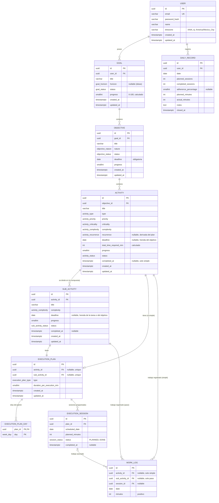

# Time Planner — Análisis de Entidades, Reglas de Negocio y Casos de Uso

> **Propósito:** definir el dominio, las reglas de negocio y los casos de uso de Time Planner. Este documento expresa el comportamiento requerido, independientemente de la tecnología o del estado de implementación.

---

## Índice

1. [Visión general del dominio](#1-visión-general-del-dominio)
2. [Principios de datos](#2-principios-de-datos)
3. [Entidades del dominio](#3-entidades-del-dominio)
4. [Catálogos / enumeraciones](#4-catálogos--enumeraciones)
5. [Reglas de negocio](#5-reglas-de-negocio)
6. [Casos de uso](#6-casos-de-uso)
7. [Modelo de datos propuesto para la base de datos](#7-modelo-de-datos-propuesto-para-la-base-de-datos)
8. [Propuesta de API REST](#8-propuesta-de-api-rest)

---

## 1. Visión general del dominio

Time Planner es un planificador personal jerárquico. El usuario define **metas** de vida/carrera, las descompone en **objetivos**, y cada objetivo en **tareas** que se planifican en el calendario. Cada día, el usuario ve su **agenda de hoy**, marca lo que ejecutó y al final **cierra el día**, generando un registro histórico.

### Jerarquía

```text
Meta (Goal)
 └── Objetivo (Objective)
      └── Tarea (Activity)
           ├── simple → Plan de ejecución → Sesiones programadas
           └── compuesta → Pasos (SubActivity) → Plan de ejecución → Sesiones

Registro de trabajo (WorkLog) → minutos realmente trabajados en una tarea simple o paso
Registro diario (DailyRecord) → resumen del cierre de cada fecha
```

Solo las tareas simples y los pasos son **ítems ejecutables**. Sus sesiones realizadas dan el avance y la constancia; sus registros de trabajo miden el tiempo real. La tarea compuesta, el objetivo y la meta agregan el avance de sus hijos.

---

## 2. Principios de datos

- **Avance:** proporción de sesiones realizadas de una tarea simple o un paso sobre todas las de su plan. Lo calcula la aplicación al marcar o desmarcar; los minutos trabajados no lo cambian.
- **Constancia:** proporción de sesiones exigibles (las que ya llegaron) realizadas. Se calcula con sesiones; no se almacena en la meta, el objetivo o la tarea.
- **Tiempo real:** suma de los minutos de `WorkLog`, incluidos los trabajos sin sesión programada. Nunca se deduce de la duración prevista.
- **Fechas:** `YYYY-MM-DD` en la zona local del usuario; las fechas de calendario no son marcas de tiempo.
- **Cierre diario:** un resumen por fecha. El detalle de sesiones y minutos permanece en `ExecutionSession` y `WorkLog`; al volver a cerrar la misma fecha se actualiza el resumen.

**Ejemplo:** hay cuatro lunes planeados de 60 minutos. Ya pasaron dos: el primero no se realizó y el segundo sí, con 90 minutos reales. La tarea va al **25 % de avance** (1 de 4 sesiones), con **50 % de constancia** (1 de 2 sesiones exigibles) y **90 minutos reales**. Si después marca los lunes que faltan, llega al 100 %.

---

## 3. Entidades del dominio

### 3.1 Goal (Meta)

| Campo | Tipo | Regla |
|-------|------|-------|
| `id`, `title`, `createdAt` | UUID, texto, fecha/hora | Identidad y título de al menos 3 caracteres. |
| `horizon` | `GoalHorizon` o `null` | Sin horizonte, la meta se crea como `IDEA` (RN-55). |
| `progress` | entero 0–100 | Promedio simple del avance de sus objetivos; 0 si no hay. |
| `status` | `GoalStatus` | `IDEA`, `ACTIVE` o `PAUSED`. |

La meta no tiene deadline, constancia almacenada ni minutos reales propios.

### 3.2 Objective (Objetivo)

| Campo | Tipo | Regla |
|-------|------|-------|
| `id`, `goalId`, `title`, `createdAt` | UUID, UUID, texto, fecha/hora | Pertenece a una meta; título de al menos 3 caracteres. |
| `nature` | `ObjectiveNature` | Por defecto `OTHER`. |
| `deadline` | fecha local | Obligatorio; limita tareas, pasos y sesiones. |
| `progress` | entero 0–100 | Promedio simple del avance de sus tareas; 0 si no hay. |
| `status` | `ObjectiveStatus` | El cierre `COMPLETED` es manual y exige 100 %. |

No almacena constancia ni minutos reales; se consultan desde sus ítems ejecutables.

### 3.3 Activity (Tarea)

| Campo | Tipo | Regla |
|-------|------|-------|
| `id`, `objectiveId`, `title` | UUID, UUID, texto | Pertenece a un objetivo; título de al menos 3 caracteres. |
| `type` | `ActivityType` | `SIMPLE` o `COMPOSITE`. |
| `priority`, `criticality`, `complexity` | catálogos | Clasificación de la tarea. |
| `recurrence` | `ActivityRecurrence` o `null` | Derivada del plan; `null` en compuestas. |
| `deadline` | fecha local opcional | Si falta, hereda el del objetivo; nunca lo supera. |
| `executionPlan` | `ExecutionPlan` o `null` | Obligatorio en simple; `null` en compuesta. |
| `totalTimeRequiredMin` | entero calculado | Simple: suma de `plannedMinutes` de sus sesiones. Compuesta: suma de `plannedMinutes` de las sesiones de sus pasos (RN-24). |
| `progress` | entero 0–100 | Simple: calculado con sus sesiones (RN-30). Compuesta: promedio de pasos. |
| `completedAt` | fecha/hora opcional | En simple se almacena: se fija al llegar a 100 % y se limpia si baja. En compuesta no se almacena: se calcula como el `completedAt` más reciente de sus pasos cuando todos están al 100 %. |
| `status` | `ActivityStatus` | Derivado del avance, salvo pausa manual; `OVERDUE` es visual. |

### 3.4 SubActivity (Paso)

| Campo | Tipo | Regla |
|-------|------|-------|
| `id`, `activityId`, `title` | UUID, UUID, texto | Pertenece a una tarea compuesta; título de al menos 3 caracteres. |
| `deadline` | fecha local opcional | Hereda el efectivo de la tarea; nunca lo supera. |
| `complexity` | `ActivityComplexity` | Por defecto `MEDIUM`. |
| `executionPlan` | `ExecutionPlan` | Obligatorio. |
| `progress` | entero 0–100 | Calculado con sus sesiones (RN-30); los minutos no lo cambian. |
| `completedAt` | fecha/hora opcional | Se fija al llegar a 100 % y se limpia si baja. |
| `status` | `SubActivityStatus` | Derivado del avance. |

### 3.5 ExecutionPlan (Plan de ejecución)

| Campo | Tipo | Regla |
|-------|------|-------|
| `id` | UUID | Identificador del plan. |
| `type` | `ExecutionPlanType` | `WEEKLY_PATTERN` o `SPECIFIC_DATES`. |
| `patternDays` | `WeekDay[]` opcional | Obligatorio si el plan es semanal. |
| `durationPerExecutionMin` | entero | Duración prevista por defecto, mínimo 5. |

Un plan pertenece a una tarea simple o a un paso. Sus fechas materializadas viven en `ExecutionSession`; el plan no guarda una lista paralela de fechas completadas.

### 3.6 ExecutionSession (Sesión programada)

| Campo | Tipo | Regla |
|-------|------|-------|
| `id`, `planId` | UUID | Una sesión pertenece a un plan; fecha única por plan. |
| `scheduledDate` | fecha local | Día programado. |
| `plannedMinutes` | entero | Minutos previstos para esa sesión. |
| `status` | `SessionStatus` | `PLANNED` o `DONE`. |
| `completedAt` | fecha/hora opcional | Solo cuando está `DONE`. |

Una `PLANNED` de fecha pasada es **no realizada**; no hace falta almacenar un estado `MISSED`.

### 3.7 WorkLog (Registro de trabajo)

| Campo | Tipo | Regla |
|-------|------|-------|
| `id` | UUID | Identificador del bloque de trabajo. |
| `sourceType`, `sourceId` | `ACTIVITY` o `SUBACTIVITY`, UUID | Solo tarea simple o paso. |
| `date` | fecha local | Día en que se trabajó. |
| `minutes` | entero positivo | Tiempo real; puede haber varios bloques en un día. |
| `sessionId` | UUID opcional | Si se vincula, la sesión corresponde al mismo ítem y fecha. |

Se puede registrar trabajo sin sesión programada. Una sesión `DONE` exige al menos un bloque de trabajo vinculado en su fecha; desmarcarla elimina sus bloques vinculados (RN-27). Un bloque solo puede vincularse a una sesión que esté `DONE`.

### 3.8 DailyRecord (Registro diario)

| Campo | Tipo | Regla |
|-------|------|-------|
| `id`, `date` | UUID, fecha local | Un registro por fecha. |
| `plannedSessions`, `completedSessions` | enteros | Conteos de la agenda del día. |
| `adherencePercentage` | entero 0–100 o `null` | Sesiones realizadas / planeadas; `null` si no hubo sesiones. |
| `plannedMinutes` | entero | Suma de minutos previstos de la agenda. |
| `actualMinutes` | entero | Suma de `WorkLog.minutes` del día, incluso sin sesión. |
| `notes` | texto opcional | Reflexión del usuario. |
| `closedAt` | fecha/hora | Momento del cierre más reciente. |

Guarda un resumen, no duplica el detalle de sesiones y bloques de trabajo. Si se vuelve a cerrar la fecha, conserva el `id` y reemplaza el resumen, las notas y `closedAt`. Borrar una tarea conserva este resumen, aunque elimina el detalle de la tarea.

### 3.9 Proyecciones de agenda y calendario

La **agenda** muestra las sesiones de la fecha elegida (hoy por defecto) que cumplen la visibilidad de RN-29, con minutos previstos y estado; permite registrar minutos reales y marcar la sesión realizada en hoy y en fechas pasadas (RN-27, RN-75). El **calendario** muestra esas sesiones en sus fechas programadas, incluidas las pasadas, y su jerarquía; es solo de consulta. La constancia y el tiempo real se calculan desde sesiones y `WorkLog`, respectivamente.

## 4. Catálogos / enumeraciones

### 4.1 Convención de nombres

| Elemento | Convención | Ejemplo |
|----------|------------|---------|
| Clases, tipos y enums | PascalCase, en inglés | `ActivityStatus` |
| Campos, variables y funciones | camelCase, en inglés | `scheduledDate`, `actualMinutes` |
| Valores de enum (código, API, BD) | UPPER_SNAKE_CASE, en inglés | `IN_PROGRESS` |
| Columnas y tablas de BD | snake_case, en inglés | `completed_at` |
| Textos de interfaz | Español, fuera del código | `"En progreso"` |

**Regla:** el código, la API y la BD solo manejan el valor en inglés. La etiqueta en español vive en un diccionario de UI indexado por el valor, por ejemplo `ActivityStatus.IN_PROGRESS → "En progreso"`.

### 4.2 Valores

| Enum | Valor (código) | Etiqueta UI |
|------|----------------|-------------|
| `GoalHorizon` | `SHORT_TERM` | Corto plazo |
| `GoalHorizon` | `MEDIUM_TERM` | Mediano plazo |
| `GoalHorizon` | `LONG_TERM` | Largo plazo |
| `GoalStatus` | `IDEA` | Idea |
| `GoalStatus` | `ACTIVE` | Activa |
| `GoalStatus` | `PAUSED` | Pausada |
| `ObjectiveNature` | `PERSONAL` | Personal |
| `ObjectiveNature` | `PROFESSIONAL` | Profesional |
| `ObjectiveNature` | `HEALTH` | Salud |
| `ObjectiveNature` | `FINANCE` | Finanzas |
| `ObjectiveNature` | `LEARNING` | Aprendizaje |
| `ObjectiveNature` | `HABIT` | Hábito |
| `ObjectiveNature` | `WELLBEING` | Bienestar |
| `ObjectiveNature` | `OTHER` | Otro |
| `ObjectiveStatus` | `ACTIVE` | Activo |
| `ObjectiveStatus` | `COMPLETED` | Completado |
| `ActivityType` | `SIMPLE` | Simple |
| `ActivityType` | `COMPOSITE` | Compuesta |
| `ActivityStatus` | `PENDING` | Pendiente |
| `ActivityStatus` | `IN_PROGRESS` | En progreso |
| `ActivityStatus` | `COMPLETED` | Completada |
| `ActivityStatus` | `PAUSED` | Pausada |
| `ActivityStatus` | `OVERDUE` | Vencida (derivado, no se almacena) |
| `SubActivityStatus` | `PENDING` | Pendiente |
| `SubActivityStatus` | `IN_PROGRESS` | En progreso |
| `SubActivityStatus` | `COMPLETED` | Completada |
| `ActivityPriority` | `HIGH` | Alta |
| `ActivityPriority` | `MEDIUM` | Media |
| `ActivityPriority` | `LOW` | Baja |
| `ActivityCriticality` | `VITAL` | Vital |
| `ActivityCriticality` | `ESSENTIAL_RECURRING` | Esencial recurrente |
| `ActivityCriticality` | `FLEXIBLE` | Flexible |
| `ActivityComplexity` | `LOW` | Baja |
| `ActivityComplexity` | `MEDIUM` | Media |
| `ActivityComplexity` | `HIGH` | Alta |
| `ActivityRecurrence` | `SINGLE` | Única |
| `ActivityRecurrence` | `WEEKLY_PATTERN` | Patrón semanal |
| `ActivityRecurrence` | `SPECIFIC_DATES` | Fechas específicas |
| `ExecutionPlanType` | `WEEKLY_PATTERN` | Patrón repetitivo |
| `ExecutionPlanType` | `SPECIFIC_DATES` | Fechas específicas |
| `WeekDay` | `MONDAY` | Lun |
| `WeekDay` | `TUESDAY` | Mar |
| `WeekDay` | `WEDNESDAY` | Mié |
| `WeekDay` | `THURSDAY` | Jue |
| `WeekDay` | `FRIDAY` | Vie |
| `WeekDay` | `SATURDAY` | Sáb |
| `WeekDay` | `SUNDAY` | Dom |
| `TaskSourceType` | `ACTIVITY` | Tarea |
| `TaskSourceType` | `SUBACTIVITY` | Paso |
| `SessionStatus` | `PLANNED` | Programada |
| `SessionStatus` | `DONE` | Realizada |

> **Nota:** las etiquetas de UI se pueden ajustar sin cambiar los valores del dominio.

### 4.3 Persistencia

En la BD se usa `enum` nativo (PostgreSQL) o `varchar` con `CHECK`. En NestJS, `enum` de TypeScript con `@IsEnum()` en los DTOs. Los valores de la API son los del código, nunca las etiquetas.

---

## 5. Reglas de negocio

Se numeran para referenciarlas desde la implementación y las pruebas.

### 5.1 Jerarquía e integridad

| ID | Regla |
|----|-------|
| RN-01 | Un **Objetivo** pertenece a exactamente una **Meta** (`goalId` obligatorio). |
| RN-02 | Una **Tarea** pertenece a exactamente un **Objetivo** (`objectiveId` obligatorio). |
| RN-03 | Un **Paso** pertenece a exactamente una **Tarea**, y esa tarea debe ser de tipo `COMPOSITE`. |
| RN-04 | Una tarea **simple** debe tener un Plan de Ejecución; una tarea **compuesta** no lo tiene (`executionPlan = null`). |
| RN-05 | Un **Paso** siempre tiene Plan de Ejecución. |
| RN-06 | No se puede reasignar un objetivo a otra meta ni una tarea a otro objetivo (el padre se toma de la ruta y no es editable). |

### 5.2 Eliminación en cascada

| ID | Regla |
|----|-------|
| RN-07 | Eliminar una **Meta** elimina todos sus Objetivos, y en cascada sus Tareas y Pasos. Requiere confirmación escrita (RN-62). |
| RN-08 | Eliminar un **Objetivo** elimina todas sus Tareas y sus Pasos. Requiere confirmación escrita (RN-62). |
| RN-09 | Eliminar una **Tarea** elimina todos sus Pasos. Requiere confirmación escrita (RN-62). |
| RN-10 | Tras cualquier eliminación se **recalcula el progreso** de los ancestros. |
| RN-11 | Los **Registros Diarios** no se ven afectados por eliminaciones (son snapshots independientes). |

> Es eliminación física. El resumen diario conserva sus cifras, pero el detalle de un ítem borrado se elimina.

### 5.3 Validaciones de campos

| ID | Regla |
|----|-------|
| RN-12 | Título de Meta, Objetivo y Tarea: requerido, **mínimo 3 caracteres**. |
| RN-13 | Título de Paso: requerido, **mínimo 3 caracteres**. |
| RN-14 | `deadline` es **obligatorio en el Objetivo** (RN-65). En Tarea y en Paso es opcional: la tarea, si se omite, hereda el deadline del objetivo; el paso, el efectivo de su tarea. Ningún deadline nuevo o modificado puede ser anterior a hoy. |
| RN-15 | `durationPerExecutionMin` ≥ **5** minutos. Requerido en pasos y en tareas simples. |
| RN-16 | Duración por defecto: **60 min** (tarea simple), **45 min** (paso). |
| RN-17 | Si el plan es `WEEKLY_PATTERN`, se debe seleccionar **al menos un día** de la semana. ("Selecciona al menos un día.") |
| RN-18 | Si el plan es `SPECIFIC_DATES`, se debe agregar **al menos una fecha**. ("Añade fechas específicas.") |
| RN-19 | Las fechas específicas no se pueden repetir y no pueden ser anteriores a hoy. Se guardan **ordenadas** ascendentemente. |
| RN-20 | El plan debe generar **al menos una sesión**; si el patrón no produce fechas antes del deadline se rechaza ("El plan no genera ninguna fecha de ejecución válida antes del deadline."). |

### 5.4 Generación del calendario (Plan de Ejecución)

| ID | Regla |
|----|-------|
| RN-21 | **Patrón repetitivo:** se genera una `ExecutionSession` por cada día seleccionado desde hoy hasta el deadline efectivo, inclusive. |
| RN-22 | **Fechas específicas:** se genera una `ExecutionSession` por cada fecha elegida, en orden ascendente. |
| RN-24 | `totalTimeRequiredMin` de una tarea simple es la suma de `plannedMinutes` de todas las sesiones de su plan; en compuesta es la suma de `plannedMinutes` de todas las sesiones de sus pasos. El paso no almacena este total. No representa tiempo real. |

### 5.5 Ejecución diaria

| ID | Regla |
|----|-------|
| RN-25 | La **agenda** de una fecha contiene las sesiones de esa fecha de tareas simples y pasos, según la visibilidad de RN-29. Por defecto se muestra la de hoy (RN-75). |
| RN-26 | Una sesión de la agenda está realizada cuando su estado es `DONE`; eso no implica que la tarea o el paso estén terminados. |
| RN-27 | Se puede marcar o desmarcar una sesión de hoy o de una fecha pasada, sin límite hacia atrás. Las sesiones futuras no se marcan. Al marcarla se registran minutos en `WorkLog` de la fecha de la sesión: hoy se registran los minutos previstos sin preguntar; en una fecha pasada se piden los minutos reales, con los previstos como valor inicial. Desmarcarla elimina los minutos registrados con ella; volver a marcarla los registra de nuevo. |
| RN-28 | "Hoy" se calcula en la **zona horaria local** del usuario. |
| RN-75 | **Navegar entre fechas.** La agenda permite ir al día anterior o siguiente, elegir una fecha y volver a hoy. Se puede consultar cualquier fecha; las futuras son de solo lectura (RN-27). La fecha elegida forma parte de la dirección de la pantalla, por lo que se puede abrir y compartir. |
| RN-76 | **Corregir tiempo real.** Los bloques de `WorkLog` se pueden editar (minutos) o borrar en hoy y en fechas pasadas. Borrar el último bloque vinculado a una sesión `DONE` la devuelve a `PLANNED`. |
| RN-29 | La agenda excluye los ítems de metas `PAUSED` o `IDEA` y de tareas `PAUSED` (RN-57, RN-59). No filtra por otros estados. |

### 5.6 Cálculo de progreso y estados (cascada ascendente)

| ID | Regla |
|----|-------|
| RN-30 | **Progreso de tarea simple o paso** = `round(sesiones DONE / sesiones del plan × 100)`; 0 si no tiene sesiones. Cambia al marcar o desmarcar una sesión, de cualquier fecha; los minutos no lo cambian. La aplicación no juzga qué tan bien se hizo cada sesión: eso queda en el usuario. |
| RN-31 | **Estado de ítem ejecutable:** `PENDING` si progreso = 0, `COMPLETED` si progreso = 100 y `IN_PROGRESS` en otro caso; se respeta una pausa manual de tarea. |
| RN-32 | **Progreso de tarea compuesta** = promedio simple (redondeado) del progreso de sus pasos; 0 si no tiene pasos. Estado: `PENDING` si progreso = 0, `COMPLETED` si es 100 y `IN_PROGRESS` en otro caso. |
| RN-33 | **Progreso de objetivo** = promedio simple del progreso de sus tareas; 0 si no tiene. |
| RN-34 | **Progreso de meta** = promedio simple del progreso de sus objetivos; 0 si no tiene. |
| RN-35 | Los promedios son **no ponderados**: no consideran duración, complejidad, prioridad ni número de sesiones. |
| RN-36 | El progreso agregado se recalcula hacia arriba (paso → tarea → objetivo → meta) al marcar o desmarcar una sesión o al crear, editar o eliminar hijos. |
| RN-37 | Ningún avance se edita a mano: el de tareas simples y pasos sale de sus sesiones (RN-30) y el de sus padres se agrega. Los estados de pausa y cierre siguen sus reglas propias. |

### 5.7 Cambio de tipo de tarea

| ID | Regla |
|----|-------|
| RN-39 | **Compuesta → Simple:** si tiene pasos, sesiones o `WorkLog`, se confirma la pérdida de esos datos. Al aceptar se eliminan los pasos y su detalle, y se crea el plan propio; al cancelar no se guarda nada. |
| RN-40 | **Simple → Compuesta:** `executionPlan` y `recurrence` pasan a `null`. Si existen sesiones o `WorkLog` de la tarea simple, se confirma su eliminación antes de convertirla. |

### 5.8 Cierre del día

| ID | Regla |
|----|-------|
| RN-41 | Al cerrar el día se guarda un `DailyRecord` con el resumen de sesiones, minutos previstos, minutos reales y notas opcionales. |
| RN-42 | `plannedMinutes` suma los minutos previstos de las sesiones visibles de la fecha cerrada; `actualMinutes` suma los `WorkLog.minutes` de esa fecha, incluidos los trabajos sin sesión programada. |
| RN-43 | **Un registro por fecha.** Cerrar un día que ya tiene registro reemplaza sus métricas, notas y fecha de cierre; conserva el mismo `id`. El historial conserva una sola fila por día con el cierre más reciente. |
| RN-44 | **Cerrar un día** se puede hacer con hoy o con cualquier fecha pasada. No bloquea ni modifica las tareas: sus sesiones se pueden seguir marcando después. Si cambian, el cierre no se actualiza solo: al volver a cerrar ese día se recalcula y se sobrescribe (RN-43). |

### 5.9 Recurrencia, planificación y deadlines

El plan define cuándo se trabaja, la recurrencia clasifica esa programación y el deadline fija el límite de todas las ejecuciones. RN-47 a RN-51 precisan RN-21 a RN-24 y RN-40.

> **Nota (RN-47):** la clasificación depende del tipo de plan y no del número de fechas generadas. Un patrón semanal que produce una sola fecha sigue siendo `WEEKLY_PATTERN`.

| ID | Regla |
|----|-------|
| RN-47 | **Recurrencia calculada, no elegida.** Se deriva del `executionPlan`: plan con `patternDays` → `WEEKLY_PATTERN`; plan de fechas específicas con **1** fecha → `SINGLE`; con **2 o más** fechas → `SPECIFIC_DATES`. Se recalcula en cada escritura. En compuestas es `null`. |
| RN-48 | **Límite de deadlines.** Cadena de topes: objetivo → tarea → paso. Una tarea puede tener deadline propio, que nunca puede superar el del objetivo; toda ejecución de una tarea debe ser ≤ su deadline efectivo. Un paso puede tener deadline propio, que nunca puede superar el efectivo de su tarea; cada ejecución de un paso debe ser ≤ su deadline efectivo. |
| RN-49 | **Cambio de deadline.** Al modificar el deadline de un objetivo, una tarea o un paso se validan todas las ejecuciones, tareas y pasos afectados. Si alguno incumple, el guardado se rechaza y se listan las fechas en conflicto. No se recortan fechas en silencio. Una tarea o un paso con deadline heredado no entra en conflicto: su deadline efectivo es el del padre y se actualiza solo. |
| RN-50 | **Tarea compuesta.** `executionPlan` y `recurrence` son `null`. Su progreso sale de sus pasos (RN-32). Cada paso tiene su propio plan obligatorio, con programación independiente de los demás pasos. |
| RN-51 | **Editar un plan.** Se conservan las sesiones pasadas, las `DONE` y los `WorkLog`. Se sustituyen las sesiones `PLANNED` de hoy y futuras (el plan nuevo se genera desde hoy, RN-21), así que el avance se recalcula sobre el plan nuevo (RN-30). |
| RN-52 | **Borrado con historial.** Cualquier elemento (meta, objetivo, tarea o paso) se puede borrar, aunque esté completado o tenga hijos. El borrado es en cascada (RN-07 a RN-09) y exige confirmación escrita (RN-62). Los respaldos quedan fuera del MVP. |
| RN-53 | **Agregar hijos.** Se pueden agregar pasos, tareas u objetivos a un padre existente, aunque ya tenga progreso. El progreso del padre se recalcula sobre todos sus hijos, así que puede bajar. |
| RN-54 | **Borrar hijos no completados.** Es posible borrar un elemento que no está completado. Solo se recalcula el progreso de sus ancestros. |
| RN-55 | **Idea.** Una meta puede existir en estado `IDEA`: sin tareas programadas, sin agenda y sin horizonte obligatorio. Pasa a `ACTIVE` cuando se le asigna horizonte y se crean sus tareas con deadline. |
| RN-56 | **La meta no tiene fecha.** Una meta no lleva deadline ni fecha objetivo; solo se clasifica por `horizon` (corto, mediano o largo plazo). Los deadlines que obligan son los del objetivo y, dentro de él, los de tareas y pasos (RN-14, RN-48, RN-65). |
| RN-57 | **Pausa de meta.** Pausar una meta cambia solo su estado a `PAUSED`. Se oculta su agenda, pero no se modifican deadlines, sesiones ni progreso de sus hijos. |
| RN-58 | **Tareas vencidas.** Una tarea no completada con deadline efectivo ya pasado se muestra como `OVERDUE`. Es un estado derivado, no se almacena. Al reanudar la meta, el usuario replanifica esas tareas. |
| RN-59 | **Pausa de tarea (MVP).** Igual que la pausa de meta: solo oculta la tarea de la agenda. No cambia su deadline, sus sesiones ni su progreso. |
| RN-60 | **Postergar sin penalización.** El usuario puede editar el deadline de cualquier elemento no completado sin restricciones de tiempo, salvo las de RN-48 y RN-49. Postergar no reduce el progreso ni borra historial. Las tareas `OVERDUE` son solo una etiqueta visual. |
| RN-61 | **Historial para estadísticas.** Los elementos no completados, pausados o vencidos se conservan, salvo borrado explícito (RN-52). Esto permitirá analizar a futuro qué metas se terminaron y cuáles no (fuera del MVP). |
| RN-62 | **Confirmación de borrado.** Borrar exige escribir el título exacto del elemento. Aplica a meta, objetivo, tarea y paso. Antes de confirmar se muestra qué se va a borrar: cuántos hijos y cuántos elementos completados. |
| RN-63 | **Cierre de objetivo.** `COMPLETED` no es automático. El usuario decide cuándo cerrar el objetivo, y solo se permite si su progreso es 100%. Llegar a 100% no lo cierra: queda `ACTIVE` hasta que el usuario lo cierre. Un objetivo cerrado puede seguir recibiendo tareas o pasos mientras los deadlines lo permitan (RN-53). |
| RN-64 | **Reapertura automática.** Si un objetivo `COMPLETED` baja de 100% porque recibe tareas o pasos, se borra un hijo completado o se desmarca una sesión, vuelve a `ACTIVE` automáticamente. Su progreso lo mantiene por debajo de 100%, así que no puede seguir cerrado. |
| RN-65 | **Deadline del objetivo.** Cada objetivo tiene un `deadline` obligatorio, porque una meta puede tener varios objetivos y cada uno con su propio plazo. Es el tope de todas sus tareas y pasos (RN-48). Se puede postergar o adelantar sin restricciones de tiempo (RN-60), salvo que el guardado se rechaza si alguna tarea, paso o ejecución quedaría fuera del nuevo límite (RN-49). |
| RN-66 | **Calendario.** Muestra las `ExecutionSession` programadas de tareas simples y pasos, pasadas y futuras. Aplica la visibilidad de RN-29. Es solo de consulta: no se marca ejecución desde el calendario. Al pasar el cursor, enfocar o tocar una sesión se muestra su jerarquía y los deadlines del objetivo y del ítem. Permite navegar por mes y año sin límite. |

### 5.10 Avance, constancia y tiempo real

| ID | Regla |
|----|-------|
| RN-67 | **Finalización del resultado.** Cuando el avance de una tarea simple o paso llega a 100 %, se fija `completedAt`; si baja, se borra. En tarea compuesta se calcula desde sus pasos y no se almacena (§3.3). |
| RN-68 | **Medidas separadas.** El avance cuenta las sesiones realizadas sobre todas las del plan; la constancia, sobre las exigibles (RN-70); el tiempo real suma minutos (RN-71). Registrar minutos sin sesión no marca ninguna sesión ni cambia el avance. El objetivo conserva su cierre manual al llegar al 100 % (RN-63). |
| RN-69 | **Estado de sesión.** Cada fecha programada tiene una `ExecutionSession` única. `PLANNED` es la inicial; `DONE` significa que se trabajó ese día y tiene `completedAt`. Una `PLANNED` pasada, o de hoy tras cerrar el día, se muestra como no realizada. |
| RN-70 | **Constancia.** `round(DONE / (DONE + no realizadas) × 100)` sobre las sesiones exigibles del ítem; devuelve `null` si no hay ninguna. Incluye las `DONE` hasta hoy y las `PLANNED` de fechas pasadas; una `PLANNED` de hoy cuenta al cerrar el día. Excluye sesiones futuras. En padres puede calcularse con todas las sesiones de sus descendientes ejecutables, sin promediar porcentajes. |
| RN-71 | **Tiempo real.** Cada `WorkLog` guarda minutos enteros positivos trabajados en una fecha, hoy o pasada pero nunca futura, para una tarea simple o un paso. Puede no estar ligado a una sesión. Si se vincula, la sesión debe estar `DONE` y deben coincidir ítem y fecha. Marcar una sesión `DONE` crea al menos un `WorkLog` vinculado; varios bloques del mismo día se suman. El tiempo planeado nunca sustituye al real. |
| RN-72 | **Cierre diario.** `DailyRecord` guarda sesiones planeadas y realizadas, porcentaje de constancia del día, minutos planeados, suma de `WorkLog.minutes`, notas y `closedAt`. El porcentaje es `null` si no hubo sesiones planeadas. Se toma de las sesiones visibles de la agenda de ese día; los minutos reales incluyen también trabajo sin sesión programada. Un nuevo cierre en la misma fecha reemplaza el resumen y conserva el `id` (RN-43); los cambios posteriores se reflejan al volver a cerrar ese día (RN-44). |
| RN-74 | **Historial y borrado.** Editar un plan conserva las sesiones pasadas y los `WorkLog` ya registrados; solo reemplaza las sesiones `PLANNED` de hoy y futuras (RN-51). Borrar un ítem elimina sus sesiones y `WorkLog` asociados, pero no modifica los resúmenes `DailyRecord` ya cerrados (RN-11, RN-52). |

---

## 6. Casos de uso

**Actor:** Usuario.

### Mapa de casos de uso

| ID | Caso de uso | Pantalla / ruta |
|----|-------------|-----------------|
| CU-01 | Listar metas | `/goals` |
| CU-02 | Crear meta | `/goals/new` |
| CU-03 | Ver detalle de meta | `/goals/:id` |
| CU-04 | Editar meta | `/goals/:id/edit` |
| CU-05 | Eliminar meta | `/goals` (tarjeta) |
| CU-06 | Crear objetivo | `/goals/:goalId/objectives/new` |
| CU-07 | Ver detalle de objetivo (tareas + pasos) | `/objectives/:id` |
| CU-08 | Editar objetivo | `/goals/:goalId/objectives/:id/edit` |
| CU-09 | Eliminar objetivo | `/goals/:id` |
| CU-10 | Crear tarea simple | `/objectives/:objectiveId/activities/new` |
| CU-11 | Crear tarea compuesta | misma ruta que CU-10 |
| CU-12 | Editar tarea (incl. cambio de tipo) | `/objectives/:objectiveId/activities/:activityId/edit` |
| CU-13 | Eliminar tarea | `/objectives/:id` |
| CU-14 | Crear paso | `/objectives/:oid/activities/:aid/add-step` |
| CU-15 | Editar paso | `/objectives/:oid/activities/:aid/steps/:sid/edit` |
| CU-16 | Eliminar paso | `/objectives/:id` |
| CU-17 | Ver agenda de una fecha (hoy por defecto) | `/daily` y `/daily?date=YYYY-MM-DD` |
| CU-18 | Marcar/desmarcar ejecución de hoy o de un día pasado | `/daily` |
| CU-19 | Ver resumen y cerrar día (hoy o pasado) | `/daily/summary` y `/daily/summary?date=YYYY-MM-DD` |
| CU-21 | Consultar historial | `/history` |
| CU-22 | Crear idea (meta sin horizonte) | `/goals/new` |
| CU-23 | Pausar y reanudar meta o tarea | `/goals/:id`, `/objectives/:id` |
| CU-24 | Postergar (editar deadline) | `/goals/:goalId/objectives/:id/edit`, `/objectives/:id/activities/:id/edit` |
| CU-25 | Cerrar objetivo | `/objectives/:id` |
| CU-26 | Ver calendario | `/calendar` |
| CU-27 | Registrar tiempo real sin sesión | Agenda o detalle del ítem ejecutable |
| CU-28 | Consultar constancia | Detalle del ítem o historial |

### Detalle de casos de uso principales

#### CU-02 — Crear meta
- **Entrada:** `title` (≥3), `horizon` (opcional; sin horizonte se crea como `IDEA`).
- **Flujo:** valida → crea con `progress=0`, `status=ACTIVE` (o `IDEA` si no tiene horizonte), `createdAt=now` → redirige a `/goals`.
- **Reglas:** RN-12.

#### CU-03 — Ver detalle de meta
- Muestra título, horizonte, estado, progreso y lista de objetivos (naturaleza, estado, progreso).
- Si la meta no existe → redirige a `/goals`.

#### CU-04 — Editar meta
- **Editable:** `title`, `horizon` y pausa/reanudación (RN-57). El avance agregado y `createdAt` no se editan.
- **Reglas:** RN-12, RN-37.

#### CU-05 — Eliminar meta
- Confirmación: *"Esta acción eliminará TAMBIÉN todos sus objetivos, tareas y pasos asociados."*
- **Reglas:** RN-07, RN-11, RN-52, RN-62. Exige escribir el título de la meta.

#### CU-06 / CU-08 — Crear / editar objetivo
- **Entrada:** `title` (≥3), `nature`, `deadline` (obligatorio, ≥ hoy). El `goalId` viene de la ruta.
- **Reglas:** RN-65. Al editar, si el nuevo `deadline` deja tareas, pasos o ejecuciones fuera del límite, se rechaza y se listan las fechas (RN-49).
- **Post:** se recalcula el progreso de la meta (RN-34) — al crear, el objetivo nuevo (0%) **baja** el promedio de la meta.
- Redirige a `/goals/:goalId`.

#### CU-09 — Eliminar objetivo
- Confirmación: *"Todas las tareas asociadas serán eliminadas."* → RN-08, RN-10, RN-52, RN-62. Exige escribir el título del objetivo.

#### CU-10 — Crear tarea simple
- **Entrada:** `title`, `priority`, `criticality`, `complexity`, `deadline` (opcional; si se omite hereda el del objetivo), `duration`, `planType`, y `patternDays` **o** `specificDates`. La recurrencia no es entrada: se calcula (RN-47).
- **Flujo:**
  1. Valida campos (RN-12, RN-14, RN-15).
  2. Si `WEEKLY_PATTERN`: exige ≥1 día (RN-17) y genera fechas hoy→deadline efectivo (RN-21).
  3. Si `SPECIFIC_DATES`: exige ≥1 fecha (RN-18), ordena (RN-19).
  4. Si no hay fechas resultantes → error (RN-20).
  5. Crea con `status=PENDING`, `progress=0`, sesiones `PLANNED` y `totalTimeRequiredMin` calculado (RN-24).
  6. Recalcula progreso del objetivo y meta.
- **Redirige** a `/objectives/:objectiveId`.

#### CU-11 — Crear tarea compuesta
- Igual que CU-10 sin sección de plan: *"No defines tiempos ahora. Crearás sub-actividades (Pasos) después."*
- Se guarda sin `executionPlan`; `totalTimeRequiredMin` se calcula con sus pasos (RN-24).

#### CU-12 — Editar tarea
- Carga los datos existentes y conserva el avance, las sesiones pasadas y los registros de trabajo.
- Si es simple, regenera solo las sesiones futuras (RN-51).
- Si cambia **compuesta → simple** con pasos → RN-39. Si cambia **simple → compuesta** → RN-40.

#### CU-14 / CU-15 — Crear / editar paso
- **Entrada:** `title`, `complexity`, `deadline` (opcional; si se omite hereda el de la tarea), `duration` (≥5, default 45), `planType`, días o fechas.
- Mismo flujo de generación de fechas que CU-10 (RN-17 a RN-21).
- **Post:** recalcula tarea padre → objetivo → meta (RN-32 a RN-34).

#### CU-17 — Ver agenda de una fecha
- Muestra la fecha completa, sus sesiones, minutos previstos y constancia del día. Una barra permite ir al día anterior o siguiente, elegir una fecha y volver a hoy. Cada sesión permite registrar minutos reales al marcarla `DONE`; en fechas futuras solo se consulta.
- **Reglas:** RN-25, RN-26, RN-28, RN-29, RN-57, RN-59, RN-75.

#### CU-18 — Marcar ejecución
- **Entrada:** `sessionId` (sesión de hoy o pasada); en una fecha pasada también `minutes` (entero positivo, con los minutos previstos como valor inicial). Hoy se usan los minutos previstos.
- **Flujo:** al marcar la sesión se registran los minutos en `WorkLog` de su fecha y su estado pasa a `DONE`; al desmarcarla vuelve a `PLANNED` y se eliminan esos minutos. Si ese día ya estaba cerrado, el cambio se refleja al volver a cerrarlo (RN-44). El avance del ítem y de sus padres se recalcula (RN-30, RN-36).

#### CU-19 — Cerrar día
- Muestra sesiones planeadas y realizadas, constancia del día, minutos previstos y reales y un campo de notas. Se abre con la fecha de la agenda que se estaba viendo. Al confirmar guarda o actualiza el `DailyRecord` de esa fecha (RN-41 a RN-44, RN-72).

#### CU-21 — Consultar historial
- Lista los resúmenes diarios por fecha. El detalle de una fecha se consulta desde sus sesiones y registros de trabajo; si se borró un ítem, permanece el resumen diario (RN-11, RN-74).

#### CU-22 — Crear idea
- **Entrada:** `title` (≥3). `horizon` opcional.
- **Flujo:** sin horizonte, la meta se crea con `status=IDEA`. No tiene tareas ni agenda (RN-55).
- **Promoción:** al asignar horizonte y crear tareas con deadline, pasa a `ACTIVE`.

#### CU-23 — Pausar y reanudar
- **Meta:** cambia `status` a `PAUSED`. Se oculta su agenda; deadlines y progreso no cambian (RN-57).
- **Tarea:** cambia `status` a `PAUSED`. Se oculta de la agenda (RN-59).
- **Reanudar:** la meta vuelve a `ACTIVE`; la tarea recalcula su estado desde su avance (RN-31). Las tareas que vencieron durante la pausa quedan como `OVERDUE` y se replanifican (RN-58).

#### CU-25 — Cerrar objetivo
- **Precondición:** progreso del objetivo = 100% (RN-63).
- **Flujo:** el usuario pulsa "Cerrar objetivo" → `status=COMPLETED`. Si el progreso no es 100%, la acción se rechaza.
- Un objetivo cerrado sigue visible y puede recibir tareas o pasos (RN-63). Si baja de 100%, vuelve a `ACTIVE` automáticamente (RN-64).

#### CU-24 — Postergar
- Editar el deadline de un elemento no completado. No reduce progreso ni borra historial (RN-60). Respetan RN-48 y RN-49.

#### CU-26 — Ver calendario
- **Entrada:** mes y año a mostrar (por defecto el actual). Navegación: mes anterior/siguiente, año anterior/siguiente y "Hoy".
- **Flujo:** muestra la cuadrícula del mes (semana desde el lunes) con las sesiones de cada día (tareas simples y pasos). Al pasar el cursor, enfocar o tocar una sesión se ve su detalle: meta, objetivo (con su deadline), tarea y paso, con el deadline efectivo de la tarea o del paso. Al elegir un día se lista el detalle de todas sus sesiones.
- **Reglas:** RN-25, RN-26, RN-29, RN-48, RN-66, RN-69. Solo consulta.

#### CU-27 y CU-28 — Tiempo real y constancia
- El usuario puede registrar minutos trabajados en hoy o en un día pasado aun sin sesión programada. La constancia muestra sesiones exigibles realizadas / exigibles totales; si no hay ninguna, se muestra «sin datos» (RN-70, RN-71).
- Cada bloque de tiempo registrado se puede corregir o borrar; el resumen de un día cerrado se actualiza al volver a cerrarlo (RN-44, RN-76).

---

## 7. Modelo de datos propuesto para la base de datos

Se propone un modelo **relacional** (recomendado: PostgreSQL), ya que el dominio es estrictamente jerárquico, con cascadas y agregaciones. El modelo es agnóstico del ORM (TypeORM, Prisma o MikroORM).

### 7.1 Diagrama entidad-relación



### 7.2 Decisiones clave del modelo

1. **`USER`:** identifica al dueño de los datos y su zona horaria para calcular "hoy" (RN-28). La decisión de autenticación pertenece al diseño de implementación.
2. **`EXECUTION_PLAN` como tabla propia** con FK exclusiva: `CHECK ((activity_id IS NULL) <> (sub_activity_id IS NULL))` + `UNIQUE` en cada FK. Alternativa válida: columnas del plan directamente en `activity` y `sub_activity` (más simple, algo de duplicación).
3. **`EXECUTION_SESSION`** guarda cada sesión programada y su estado en una sola fila:
   - Cada fecha programada es una fila con minutos previstos y estado `PLANNED` o `DONE`. `completed_at` solo existe en `DONE`.
   - `UNIQUE (plan_id, scheduled_date)`.
   - Índice en `scheduled_date` → la Agenda de Hoy es un `SELECT … WHERE scheduled_date = :today`.
   - Al editar el plan se conservan sesiones pasadas y realizadas; solo se regeneran las futuras `PLANNED` (RN-51, RN-74).
   - El avance se calcula con todas las sesiones del plan (RN-30) y la constancia con las exigibles (RN-70).
4. **`EXECUTION_PLAN_DAY`** guarda `patternDays` (necesario para re-generar y para editar el formulario).
5. **`WORK_LOG`** guarda trabajo real de una tarea simple o un paso: `CHECK ((activity_id IS NULL) <> (sub_activity_id IS NULL))`, `minutes > 0`; `session_id` opcional. Al ligarlo a una sesión, servicio y transacción comprueban el mismo ítem y fecha. Borrar un ítem borra sus registros de trabajo.
6. **Progreso:** en tarea simple y paso se recalcula con sus sesiones al marcar o desmarcar; en tarea compuesta, objetivo y meta se recalcula el promedio de hijos en la misma transacción (RN-30 a RN-36). `completed_at` pertenece al resultado, no a la constancia.
7. **Fechas de calendario** (`deadline`, `scheduled_date`, `work_log.date`, `daily_record.date`) como `DATE`, nunca `timestamp`, para respetar el día local (RN-28).
8. **Cascadas:** `ON DELETE CASCADE` en `goal → objective → activity → sub_activity → execution_plan → execution_session / execution_plan_day` y en los `WORK_LOG` de un ítem. El recálculo de progreso de ancestros se hace en el servicio.
9. **`DAILY_RECORD`:** `UNIQUE (user_id, date)`, un resumen por día; los `WORK_LOG` y las sesiones guardan el detalle. `closed_at` se actualiza al volver a cerrar el mismo día (RN-43, RN-72).
10. **IDs:** UUID. Definir si los genera el cliente o el servidor al diseñar la API.
11. **Calendario (RN-66):** se resuelve con `EXECUTION_SESSION` filtrada por rango de `scheduled_date` y los joins de la jerarquía (meta › objetivo › tarea › paso), excluyendo metas `PAUSED`/`IDEA` y tareas `PAUSED` igual que la agenda. El índice `(scheduled_date)` lo cubre.

### 7.3 Índices recomendados

| Tabla | Índice |
|-------|--------|
| `goal` | `(user_id)` |
| `objective` | `(goal_id)` |
| `activity` | `(objective_id)`, `(deadline)` |
| `sub_activity` | `(activity_id)` |
| `execution_plan` | `UNIQUE (activity_id)`, `UNIQUE (sub_activity_id)` |
| `execution_session` | `UNIQUE (plan_id, scheduled_date)`, `(scheduled_date)` |
| `work_log` | `(activity_id, date)`, `(sub_activity_id, date)`, `(session_id)` |
| `daily_record` | `UNIQUE (user_id, date)` |

### 7.4 Sugerencia de módulos NestJS

| Módulo | Responsabilidad |
|--------|-----------------|
| `AuthModule` / `UsersModule` | Registro, login (JWT), zona horaria del usuario. |
| `GoalsModule` | CRUD de metas. |
| `ObjectivesModule` | CRUD de objetivos. |
| `ActivitiesModule` | CRUD de tareas, cambio de tipo (RN-39/40). |
| `SubActivitiesModule` | CRUD de pasos. |
| `ExecutionPlansModule` | Generación de sesiones (RN-21, RN-22, RN-47 a RN-51), servicio de fechas. |
| `ProgressModule` (servicio) | Calcular el avance desde las sesiones y recalcular ancestros (RN-30 a RN-37). |
| `WorkLogsModule` | Registrar minutos reales y vincularlos opcionalmente a sesiones (RN-71). |
| `DailyModule` | Agenda, constancia, cierre del día e historial (RN-69 a RN-72). |

---

## 8. Propuesta de API REST

Esta API expresa las operaciones que exige el modelo de avance, sesiones y tiempo real.

Rutas anidadas para creación y listado por padre; operaciones sobre un recurso por su identificador directo.

### Metas
| Método | Ruta | Caso de uso | Notas |
|--------|------|-------------|-------|
| GET | `/goals` | CU-01 | Lista con `progress`, `status`. |
| POST | `/goals` | CU-02, CU-22 | `{ title, horizon?, status? }`. Sin horizonte se crea como `IDEA`. |
| GET | `/goals/:id` | CU-03 | Incluye objetivos (o usar endpoint de abajo). |
| PATCH | `/goals/:id` | CU-04, CU-23 | `{ title?, horizon?, status? }` |
| DELETE | `/goals/:id` | CU-05 | Cascada. |

### Objetivos
| Método | Ruta | Caso de uso |
|--------|------|-------------|
| GET | `/goals/:goalId/objectives` | CU-03 |
| POST | `/goals/:goalId/objectives` | CU-06 — `{ title, nature, deadline }` |
| GET | `/objectives/:id` | CU-07 — incluye tareas y pasos |
| PATCH | `/objectives/:id` | CU-08, CU-24 — si `deadline` deja hijos fuera del límite, responde con la lista de fechas en conflicto (RN-49) |
| DELETE | `/objectives/:id` | CU-09 |

### Tareas
| Método | Ruta | Caso de uso |
|--------|------|-------------|
| GET | `/objectives/:objectiveId/activities` | CU-07 |
| POST | `/objectives/:objectiveId/activities` | CU-10 / CU-11 |
| GET | `/activities/:id` | — |
| PATCH | `/activities/:id` | CU-12, CU-23, CU-24. Pausar: `status: PAUSED`; reanudar: el estado se recalcula desde el progreso (RN-31). Si hay pérdida de datos (compuesta→simple con pasos, o simple→compuesta con sesiones o `WorkLog`), exige `confirmDataLoss: true` o responde `409` (RN-39, RN-40). |
| DELETE | `/activities/:id` | CU-13 |

Ejemplo de cuerpo (tarea simple):
```json
{
  "title": "Correr 5km",
  "type": "SIMPLE",
  "priority": "HIGH",
  "criticality": "ESSENTIAL_RECURRING",
  "complexity": "MEDIUM",
  "deadline": "2026-12-31",
  "executionPlan": {
    "type": "WEEKLY_PATTERN",
    "patternDays": ["MONDAY", "WEDNESDAY", "FRIDAY"],
    "durationPerExecutionMin": 45
  }
}
```
> Al crear una tarea, el servidor genera las sesiones y calcula `recurrence` y `totalTimeRequiredMin`. El avance se calcula al marcar sesiones. Para `SPECIFIC_DATES` el cliente envía las fechas solicitadas en `executionPlan.specificDates`; el plan persistido no duplica las sesiones.

### Pasos
| Método | Ruta | Caso de uso |
|--------|------|-------------|
| GET | `/activities/:activityId/sub-activities` | CU-07 |
| POST | `/activities/:activityId/sub-activities` | CU-14 (400/422 si la tarea no es compuesta) |
| PATCH | `/sub-activities/:id` | CU-15 |
| DELETE | `/sub-activities/:id` | CU-16 |

### Sesiones, tiempo real y cierre diario
| Método | Ruta | Caso de uso | Notas |
|--------|------|-------------|-------|
| GET | `/daily?date=` | CU-17 | Devuelve sesiones visibles de la fecha (hoy si se omite), sus estados, trabajo registrado y métricas. "Hoy" según `user.timezone`. |
| POST | `/execution-sessions/:id/complete` | CU-18, RN-27/69/71 | `{ minutes? }`: obligatorio en fecha pasada; hoy se usan los previstos. Sesión de hoy o pasada (`422` si es futura): crea `WorkLog` en la fecha de la sesión, marca `DONE` y recalcula `progress` en una transacción (RN-30). |
| DELETE | `/execution-sessions/:id/completion` | CU-18 | Vuelve a `PLANNED`, elimina los `WorkLog` vinculados a la sesión (RN-27) y recalcula `progress`. |
| POST | `/work-logs` | RN-71 | `{ sourceType, sourceId, minutes, sessionId?, date? }`; `date` es hoy si se omite y nunca futura. Registra trabajo con o sin sesión. |
| GET | `/work-logs?date=` | RN-71 | Detalle del tiempo real de la fecha. |
| PATCH | `/work-logs/:id` | RN-76 | `{ minutes }`. Corrige los minutos de un bloque. |
| DELETE | `/work-logs/:id` | RN-76 | Borra el bloque; si era el último de una sesión `DONE`, la devuelve a `PLANNED`. |
| POST | `/daily/records` | CU-19 | `{ date?, notes? }` (hoy si se omite; no futura) → calcula el resumen con sesiones y `WorkLog`. Upsert por fecha (RN-43, RN-72). |
| GET | `/daily/records?from=&to=` | CU-21 | Historial. |

### Validación (DTOs con `class-validator`)
- `title`: `@IsString() @MinLength(3)`
- enums: `@IsEnum(...)`
- `deadline`, fechas: `@IsDateString()` (solo fecha) + validación "≥ hoy" en servicio.
- `durationPerExecutionMin`: `@IsInt() @Min(5)`
- `patternDays`: `@ArrayMinSize(1)` cuando `type = WEEKLY_PATTERN` (`@ValidateIf`).
- `specificDates`: `@ArrayMinSize(1) @ArrayUnique()` cuando `type = SPECIFIC_DATES`.
- `deadline` de objetivo: obligatorio. `deadline` de tarea y de paso: `@IsOptional()`; si se envía, debe ser ≤ el efectivo de su padre (RN-48).
- `progress`: no se recibe en ningún DTO; siempre se calcula desde las sesiones (RN-30, RN-37).
- `WorkLog.minutes`: entero positivo; `sessionId`, si existe, debe referir a una sesión `DONE` del mismo ítem y de la misma fecha, que no sea futura (RN-71).

---
