# Time Planner — Análisis de Entidades, Reglas de Negocio y Casos de Uso

> **Propósito:** definir el dominio, las reglas de negocio y los casos de uso de Time Planner. Este documento expresa el comportamiento requerido, independientemente de la tecnología o del estado de implementación.

---

## Índice

1. [Visión general del dominio](#1-visión-general-del-dominio)
2. [Principios de datos](#2-principios-de-datos)
3. [Entidades del dominio](#3-entidades-del-dominio)
4. [Catálogos / enumeraciones](#4-catálogos--enumeraciones)
5. [Reglas de negocio](#5-reglas-de-negocio)
6. [Casos de uso](#6-casos-de-uso)
7. [Modelo de datos propuesto para la base de datos](#7-modelo-de-datos-propuesto-para-la-base-de-datos)
8. [Propuesta de API REST](#8-propuesta-de-api-rest)

---

## 1. Visión general del dominio

Time Planner es un planificador personal jerárquico. El usuario define **metas** con su fecha límite, las descompone en **objetivos**, y cada objetivo en **tareas** que se planifican en el calendario con **sesiones**. Cada día, el usuario ve su **agenda**, marca las sesiones que hizo con su tiempo realizado y al final **cierra el día** (si no lo hace, se cierra solo al día siguiente), generando un registro diario. Cada elemento tiene tres propiedades independientes: su **estado** (**abierto**, **pausado** o **cerrado**; la meta puede ser además una **idea**), su **resultado** (**completo** o **incompleto**) y si está **vencido**. Se puede pausar y cerrar a mano, y lo cerrado se puede **reabrir**. Metas, objetivos, tareas y pasos se cierran solos al día siguiente de su fecha límite; tareas y pasos, también al quedar completos; y un padre se cierra cuando se cierran todos sus hijos. Cerrar no cambia los números: el avance, la constancia y la productividad siempre muestran lo que de verdad se hizo.

### Jerarquía

```text
Meta (Goal)
 └── Objetivo (Objective)
      └── Tarea (Activity)
           ├── simple → Plan de ejecución → Sesiones
           └── compuesta → Pasos (SubActivity) → Plan de ejecución → Sesiones

Sesión (ExecutionSession) → fecha, tiempo previsto, tiempo realizado y nota
Registro diario (DailyRecord) → sesiones y resumen del cierre de cada fecha
```

Solo las tareas simples y los pasos son **ítems ejecutables**. Sus sesiones dan la constancia (cuántas se hicieron) y la productividad (cuánto tiempo se trabajó); el avance es el promedio de las dos. La tarea compuesta, el objetivo y la meta suman las sesiones y los minutos de todos sus ítems ejecutables.

---

## 2. Principios de datos

- **Constancia:** sesiones realizadas sobre todas las sesiones, también las futuras (RN-70). La sesión no tiene constancia.
- **Tiempo realizado:** minutos que el usuario trabajó en una sesión; se guardan en la sesión al marcarla (RN-71). Nunca se deduce del tiempo previsto.
- **Productividad:** tiempo realizado sobre el tiempo previsto de todas las sesiones (RN-73). Puede pasar de 100 %.
- **Avance:** promedio de la constancia y la productividad, con la productividad topada en 100 % (RN-30). Lo calcula la aplicación; no se edita.
- **Resultado:** completo cuando el avance llega a 100 %; si no, incompleto (RN-84).
- **Vencido:** pasó su fecha límite con 0 % de avance, es decir, sin hacer nada (RN-85).
- **Fechas:** `YYYY-MM-DD` en la zona local del usuario; las fechas de calendario no son marcas de tiempo.
- **Cierre diario:** un registro por fecha con sus sesiones, su resumen y la nota del día. El tiempo realizado y la nota de cada sesión viven en la sesión; al volver a cerrar la misma fecha se actualiza el registro.
- **Estados:** los cuatro niveles y la sesión usan el mismo catálogo: abierto, pausado y cerrado; la meta tiene además idea. El estado dice si el elemento sigue en curso; el resultado y los números dicen cuánto se hizo. Estado, resultado y vencido son independientes entre sí. Cerrar nunca cambia el avance, la constancia ni la productividad, y el motivo del cierre es solo informativo (RN-31, RN-77).

**Ejemplo:** hay cuatro lunes planeados de 60 minutos. Ya pasaron dos: el primero no se realizó y el segundo sí, con 90 minutos realizados. La tarea tiene **25 % de constancia** (1 de 4 sesiones), **38 % de productividad** (90 de 240 minutos) y **31 % de avance** ((25 + 37,5) ÷ 2); su resultado es incompleto. Si el usuario la cierra ese día, queda «Cerrada · a mano» con esos mismos números; si después marca los cuatro lunes y llega a 240 minutos, el avance sube a 100 %: queda completa y se cierra sola.

---

## 3. Entidades del dominio

### 3.1 Goal (Meta)

| Campo | Tipo | Regla |
|-------|------|-------|
| `id`, `title`, `createdAt` | UUID, texto, fecha/hora | Identidad y título de al menos 3 caracteres. |
| `horizon` | `GoalHorizon` o `null` | Sin horizonte, la meta se crea como `IDEA` (RN-55). |
| `deadline` | fecha local opcional | Obligatorio si tiene horizonte; la idea no tiene (RN-56). Tope de sus objetivos (RN-48). |
| `progress` | entero 0–100 | Avance con las sesiones de todos sus ítems ejecutables (RN-30, RN-34); 0 si no hay. |
| `status` | `GoalStatus` | `IDEA` o el estado calculado de RN-31: `OPEN`, `PAUSED` o `CLOSED`. |
| `closure` | `{ type: ClosureType, closedOn }` opcional | Cierre guardado: motivo informativo y fecha (RN-77). |
| `pauses` | lista de periodos `{ from, to? }` | Historial de pausas; `to` falta mientras sigue pausada (RN-57). |

La meta no almacena constancia, productividad, resultado ni vencido: se calculan con sus ítems ejecutables.

### 3.2 Objective (Objetivo)

| Campo | Tipo | Regla |
|-------|------|-------|
| `id`, `goalId`, `title`, `createdAt` | UUID, UUID, texto, fecha/hora | Pertenece a una meta; título de al menos 3 caracteres. |
| `nature` | `ObjectiveNature` | Por defecto `OTHER`. |
| `deadline` | fecha local | Obligatorio; nunca supera el de su meta. Limita tareas, pasos y sesiones (RN-48, RN-65). |
| `progress` | entero 0–100 | Avance con las sesiones de todos sus ítems ejecutables (RN-30, RN-33); 0 si no hay. |
| `status` | `ObjectiveStatus` | Calculado (RN-31): `OPEN`, `PAUSED` o `CLOSED`. |
| `closure` | `{ type: ClosureType, closedOn }` opcional | Cierre guardado: motivo informativo y fecha (RN-77). |
| `pauses` | lista de periodos `{ from, to? }` | Historial de pausas del objetivo (RN-57). |

No almacena constancia, productividad, resultado ni vencido; se calculan con sus ítems ejecutables.

### 3.3 Activity (Tarea)

| Campo | Tipo | Regla |
|-------|------|-------|
| `id`, `objectiveId`, `title` | UUID, UUID, texto | Pertenece a un objetivo; título de al menos 3 caracteres. |
| `type` | `ActivityType` | `SIMPLE` o `COMPOSITE`. |
| `priority`, `criticality`, `complexity` | catálogos | Clasificación de la tarea. |
| `recurrence` | `ActivityRecurrence` o `null` | Derivada del plan; `null` en compuestas. |
| `deadline` | fecha local opcional | Si falta, hereda el del objetivo; nunca lo supera. |
| `executionPlan` | `ExecutionPlan` o `null` | Obligatorio en simple; `null` en compuesta. |
| `totalTimeRequiredMin` | entero calculado | Simple: suma de `plannedMinutes` de sus sesiones. Compuesta: suma de `plannedMinutes` de las sesiones de sus pasos (RN-24). |
| `progress` | entero 0–100 | Avance (RN-30). Simple: con sus sesiones. Compuesta: con las sesiones de todos sus pasos (RN-32). |
| `completedAt` | fecha/hora opcional | En simple se almacena: se fija al quedar completa y se limpia si deja de estarlo. En compuesta no se almacena: se calcula como el `completedAt` más reciente de sus pasos cuando todos están completos. |
| `status` | `ActivityStatus` | Calculado (RN-31): `OPEN`, `PAUSED` o `CLOSED`. |
| `closure` | `{ type: ClosureType, closedOn }` opcional | Cierre guardado: motivo informativo y fecha (RN-77). |
| `pauses` | lista de periodos `{ from, to? }` | Historial de pausas de la tarea; `to` falta mientras sigue pausada (RN-57). |

### 3.4 SubActivity (Paso)

| Campo | Tipo | Regla |
|-------|------|-------|
| `id`, `activityId`, `title` | UUID, UUID, texto | Pertenece a una tarea compuesta; título de al menos 3 caracteres. |
| `deadline` | fecha local opcional | Hereda el efectivo de la tarea; nunca lo supera. |
| `complexity` | `ActivityComplexity` | Por defecto `MEDIUM`. |
| `executionPlan` | `ExecutionPlan` | Obligatorio. |
| `progress` | entero 0–100 | Avance con sus sesiones (RN-30). |
| `completedAt` | fecha/hora opcional | Se fija al quedar completo y se limpia si deja de estarlo. |
| `status` | `SubActivityStatus` | Calculado (RN-31): `OPEN`, `PAUSED` o `CLOSED`. |
| `closure` | `{ type: ClosureType, closedOn }` opcional | Cierre guardado: motivo informativo y fecha (RN-77). |
| `pauses` | lista de periodos `{ from, to? }` | Historial de pausas del paso (RN-57). |

### 3.5 ExecutionPlan (Plan de ejecución)

| Campo | Tipo | Regla |
|-------|------|-------|
| `id` | UUID | Identificador del plan. |
| `type` | `ExecutionPlanType` | `WEEKLY_PATTERN` o `SPECIFIC_DATES`. |
| `patternDays` | `WeekDay[]` opcional | Obligatorio si el plan es semanal. |
| `durationPerExecutionMin` | entero | Tiempo previsto por defecto de cada sesión, mínimo 5. |

Un plan pertenece a una tarea simple o a un paso. Sus fechas viven en `ExecutionSession`; el plan no guarda una lista paralela de fechas.

### 3.6 ExecutionSession (Sesión)

| Campo | Tipo | Regla |
|-------|------|-------|
| `id`, `planId` | UUID | Una sesión pertenece a un plan. El plan genera una por fecha; una sesión movida o agregada puede compartir día con otra del mismo plan (RN-82, RN-83). |
| `scheduledDate` | fecha local | Día programado; en una sesión hecha, el día en que se hizo. Es su fecha límite. |
| `rescheduledFrom` | fecha local opcional | Fecha que generó el plan, si la sesión se movió (RN-82). |
| `manual` | booleano opcional | Agregada a mano, fuera del plan (RN-83). |
| `plannedMinutes` | entero | Tiempo previsto de esa sesión; al crearla, el del plan. |
| `status` | `SessionStatus` | `PLANNED` o `DONE` (hecha). |
| `actualMinutes` | entero positivo opcional | Tiempo realizado; solo cuando está `DONE` (RN-71). |
| `notes` | texto opcional | Nota de la sesión. |
| `completedAt` | fecha/hora opcional | Solo cuando está `DONE`. |

Una `PLANNED` de fecha pasada es **no realizada**; no hace falta almacenar un estado `MISSED`. El estado (`SessionState`), el resultado y si está vencida se calculan (RN-69); no se almacenan.

### 3.7 DailyRecord (Registro diario)

| Campo | Tipo | Regla |
|-------|------|-------|
| `id`, `date` | UUID, fecha local | Un registro por fecha. |
| `sessionIds` | lista de UUID | Sesiones visibles de la agenda de esa fecha (RN-72). |
| `plannedSessions`, `completedSessions` | enteros | Cuántas se planearon y cuántas se hicieron. |
| `adherencePercentage` | entero 0–100 o `null` | Constancia del día: realizadas / planeadas; `null` si no hubo sesiones. |
| `plannedMinutes` | entero | Suma del tiempo previsto de esas sesiones. |
| `actualMinutes` | entero | Suma de su tiempo realizado. |
| `notes` | texto opcional | Nota del día. |
| `closedAt` | fecha/hora | Momento del cierre más reciente. |

Guarda las sesiones del día y su resumen; el tiempo realizado y la nota de cada sesión viven en la sesión. Si se vuelve a cerrar la fecha, conserva el `id` y reemplaza las sesiones, el resumen, la nota y `closedAt`. Borrar una tarea conserva el resumen, aunque elimina sus sesiones.

### 3.8 Proyecciones de agenda y calendario

La **agenda** muestra las sesiones de la fecha elegida (hoy por defecto) que cumplen la visibilidad de RN-29, con su tiempo previsto, su tiempo realizado y su estado, y el registro diario de esa fecha si ya se cerró. Permite marcar la sesión hecha en hoy y en fechas pasadas, con su tiempo realizado y su nota (RN-27, RN-75). De un elemento cerrado no muestra las sesiones no realizadas desde el día de su cierre (RN-79). El **calendario** muestra esas sesiones en sus fechas, incluidas las pasadas, y su jerarquía; es solo de consulta.

## 4. Catálogos / enumeraciones

### 4.1 Convención de nombres

| Elemento | Convención | Ejemplo |
|----------|------------|---------|
| Clases, tipos y enums | PascalCase, en inglés | `ActivityStatus` |
| Campos, variables y funciones | camelCase, en inglés | `scheduledDate`, `actualMinutes` |
| Valores de enum (código, API, BD) | UPPER_SNAKE_CASE, en inglés | `WEEKLY_PATTERN` |
| Columnas y tablas de BD | snake_case, en inglés | `completed_at` |
| Textos de interfaz | Español, fuera del código | `"Patrón repetitivo"` |

**Regla:** el código, la API y la BD solo manejan el valor en inglés. La etiqueta en español vive en un diccionario de UI indexado por el valor, por ejemplo `ExecutionPlanType.WEEKLY_PATTERN → "Patrón repetitivo"`. Las etiquetas de estado concuerdan en género con su nivel: meta y tarea en femenino, objetivo y paso en masculino.

### 4.2 Valores

| Enum | Valor (código) | Etiqueta UI |
|------|----------------|-------------|
| `GoalHorizon` | `SHORT_TERM` | Corto plazo |
| `GoalHorizon` | `MEDIUM_TERM` | Mediano plazo |
| `GoalHorizon` | `LONG_TERM` | Largo plazo |
| `GoalStatus` | `IDEA` | Idea |
| `GoalStatus` | `OPEN` | Abierta |
| `GoalStatus` | `PAUSED` | Pausada |
| `GoalStatus` | `CLOSED` | Cerrada |
| `ObjectiveNature` | `PERSONAL` | Personal |
| `ObjectiveNature` | `PROFESSIONAL` | Profesional |
| `ObjectiveNature` | `HEALTH` | Salud |
| `ObjectiveNature` | `FINANCE` | Finanzas |
| `ObjectiveNature` | `LEARNING` | Aprendizaje |
| `ObjectiveNature` | `HABIT` | Hábito |
| `ObjectiveNature` | `WELLBEING` | Bienestar |
| `ObjectiveNature` | `OTHER` | Otro |
| `ObjectiveStatus` | `OPEN` | Abierto |
| `ObjectiveStatus` | `PAUSED` | Pausado |
| `ObjectiveStatus` | `CLOSED` | Cerrado |
| `ActivityType` | `SIMPLE` | Simple |
| `ActivityType` | `COMPOSITE` | Compuesta |
| `ActivityStatus` | `OPEN` | Abierta |
| `ActivityStatus` | `PAUSED` | Pausada |
| `ActivityStatus` | `CLOSED` | Cerrada |
| `SubActivityStatus` | `OPEN` | Abierto |
| `SubActivityStatus` | `PAUSED` | Pausado |
| `SubActivityStatus` | `CLOSED` | Cerrado |
| `ClosureType` | `MANUAL` | a mano |
| `ClosureType` | `DEADLINE` | por fecha límite |
| `ClosureType` | `COMPLETED` | al completarse |
| `ClosureType` | `CHILDREN_CLOSED` | por cierre de sus hijos |
| `ActivityPriority` | `HIGH` | Alta |
| `ActivityPriority` | `MEDIUM` | Media |
| `ActivityPriority` | `LOW` | Baja |
| `ActivityCriticality` | `VITAL` | Vital |
| `ActivityCriticality` | `ESSENTIAL_RECURRING` | Esencial recurrente |
| `ActivityCriticality` | `FLEXIBLE` | Flexible |
| `ActivityComplexity` | `LOW` | Baja |
| `ActivityComplexity` | `MEDIUM` | Media |
| `ActivityComplexity` | `HIGH` | Alta |
| `ActivityRecurrence` | `SINGLE` | Única |
| `ActivityRecurrence` | `WEEKLY_PATTERN` | Patrón semanal |
| `ActivityRecurrence` | `SPECIFIC_DATES` | Fechas específicas |
| `ExecutionPlanType` | `WEEKLY_PATTERN` | Patrón repetitivo |
| `ExecutionPlanType` | `SPECIFIC_DATES` | Fechas específicas |
| `WeekDay` | `MONDAY` | Lun |
| `WeekDay` | `TUESDAY` | Mar |
| `WeekDay` | `WEDNESDAY` | Mié |
| `WeekDay` | `THURSDAY` | Jue |
| `WeekDay` | `FRIDAY` | Vie |
| `WeekDay` | `SATURDAY` | Sáb |
| `WeekDay` | `SUNDAY` | Dom |
| `TaskSourceType` | `ACTIVITY` | Tarea |
| `TaskSourceType` | `SUBACTIVITY` | Paso |
| `SessionStatus` | `PLANNED` | Programada |
| `SessionStatus` | `DONE` | Realizada |
| `SessionState` | `OPEN` | Abierta |
| `SessionState` | `PAUSED` | Pausada |
| `SessionState` | `CLOSED` | Cerrada |

> **Nota:** las etiquetas de UI se pueden ajustar sin cambiar los valores del dominio.

### 4.3 Persistencia

En la BD se usa `enum` nativo (PostgreSQL) o `varchar` con `CHECK`. En NestJS, `enum` de TypeScript con `@IsEnum()` en los DTOs. Los valores de la API son los del código, nunca las etiquetas.

---

## 5. Reglas de negocio

Se numeran para referenciarlas desde la implementación y las pruebas.

### 5.1 Jerarquía e integridad

| ID | Regla |
|----|-------|
| RN-01 | Un **Objetivo** pertenece a exactamente una **Meta** (`goalId` obligatorio). |
| RN-02 | Una **Tarea** pertenece a exactamente un **Objetivo** (`objectiveId` obligatorio). |
| RN-03 | Un **Paso** pertenece a exactamente una **Tarea**, y esa tarea debe ser de tipo `COMPOSITE`. |
| RN-04 | Una tarea **simple** debe tener un Plan de Ejecución; una tarea **compuesta** no lo tiene (`executionPlan = null`). |
| RN-05 | Un **Paso** siempre tiene Plan de Ejecución. |
| RN-06 | No se puede reasignar un objetivo a otra meta ni una tarea a otro objetivo (el padre se toma de la ruta y no es editable). |

### 5.2 Eliminación en cascada

| ID | Regla |
|----|-------|
| RN-07 | Eliminar una **Meta** elimina todos sus Objetivos, y en cascada sus Tareas y Pasos. Requiere confirmación escrita (RN-62). |
| RN-08 | Eliminar un **Objetivo** elimina todas sus Tareas y sus Pasos. Requiere confirmación escrita (RN-62). |
| RN-09 | Eliminar una **Tarea** elimina todos sus Pasos. Requiere confirmación escrita (RN-62). |
| RN-10 | Tras cualquier eliminación se **recalcula el avance** de los ancestros. |
| RN-11 | Los **Registros Diarios** no se ven afectados por eliminaciones (son snapshots independientes). |

> Es eliminación física. El resumen diario conserva sus cifras, pero el detalle de un ítem borrado se elimina.

### 5.3 Validaciones de campos

| ID | Regla |
|----|-------|
| RN-12 | Título de Meta, Objetivo y Tarea: requerido, **mínimo 3 caracteres**. |
| RN-13 | Título de Paso: requerido, **mínimo 3 caracteres**. |
| RN-14 | `deadline` es **obligatorio en el Objetivo** (RN-65) **y en la Meta con horizonte** (RN-56). En Tarea y en Paso es opcional: la tarea, si se omite, hereda el deadline del objetivo; el paso, el efectivo de su tarea. Ningún deadline nuevo o modificado puede ser anterior a hoy. |
| RN-15 | `durationPerExecutionMin` ≥ **5** minutos. Requerido en pasos y en tareas simples. |
| RN-16 | Duración por defecto: **60 min** (tarea simple), **45 min** (paso). |
| RN-17 | Si el plan es `WEEKLY_PATTERN`, se debe seleccionar **al menos un día** de la semana. ("Selecciona al menos un día.") |
| RN-18 | Si el plan es `SPECIFIC_DATES`, se debe agregar **al menos una fecha**. ("Añade fechas específicas.") |
| RN-19 | Las fechas específicas no se pueden repetir y no pueden ser anteriores a hoy. Se guardan **ordenadas** ascendentemente. |
| RN-20 | El plan debe generar **al menos una sesión**; si el patrón no produce fechas antes del deadline se rechaza ("El plan no genera ninguna fecha de ejecución válida antes del deadline."). |

### 5.4 Generación del calendario (Plan de Ejecución)

| ID | Regla |
|----|-------|
| RN-21 | **Patrón repetitivo:** se genera una `ExecutionSession` por cada día seleccionado desde hoy hasta el deadline efectivo, inclusive. |
| RN-22 | **Fechas específicas:** se genera una `ExecutionSession` por cada fecha elegida, en orden ascendente. |
| RN-24 | `totalTimeRequiredMin` de una tarea simple es la suma de `plannedMinutes` de todas las sesiones de su plan; en compuesta es la suma de `plannedMinutes` de todas las sesiones de sus pasos. El paso no almacena este total. No representa tiempo realizado. |

### 5.5 Ejecución diaria

| ID | Regla |
|----|-------|
| RN-25 | La **agenda** de una fecha contiene las sesiones de esa fecha de tareas simples y pasos, según la visibilidad de RN-29. Por defecto se muestra la de hoy (RN-75). |
| RN-26 | Una sesión de la agenda está realizada cuando su estado es `DONE`; eso no implica que la tarea o el paso estén terminados. |
| RN-27 | Se puede marcar o desmarcar una sesión de hoy o de una fecha pasada, sin límite hacia atrás. Las sesiones futuras no se marcan, pero se pueden editar (RN-82). Al marcarla se piden su tiempo realizado, con el previsto como valor inicial, y una nota opcional (RN-71). Desmarcarla borra su tiempo realizado; su nota se conserva. |
| RN-28 | "Hoy" se calcula en la **zona horaria local** del usuario. |
| RN-75 | **Navegar entre fechas.** La agenda permite ir al día anterior o siguiente, elegir una fecha en el calendario y volver a hoy. Se puede consultar cualquier fecha y, si ya se cerró, su registro diario (RN-72); en las futuras no se marcan sesiones (RN-27), pero sus sesiones se pueden editar (RN-82). La fecha elegida forma parte de la dirección de la pantalla, por lo que se puede abrir y compartir. |
| RN-76 | **Corregir una sesión hecha.** En hoy y en fechas pasadas se pueden editar el tiempo realizado y la nota de una sesión hecha. |
| RN-29 | La agenda excluye los ítems de metas `IDEA` y los que están en pausa efectiva: pausados ellos mismos o alguno de sus padres (RN-57). De un elemento cerrado excluye solo las sesiones no realizadas desde el día de su cierre (RN-79). No filtra por otros estados. |
| RN-82 | **Editar una sesión.** De una tarea simple o un paso no cerrado se puede cambiar la fecha y el tiempo previsto de una sola sesión, aunque esté hecha o vencida, sin tocar el resto del plan. La fecha nunca pasa el deadline efectivo del ítem (RN-48): una sesión no hecha va de hoy en adelante; una hecha, hasta hoy, porque es el día en que se hizo. Ese día puede tener ya otra sesión del mismo ítem. No se editan sesiones de elementos cerrados (RN-80). Ejemplo: «Correr» es cada lunes; este lunes no se puede y esa sesión pasa al domingo. |
| RN-83 | **Agregar y borrar una sesión.** A una tarea simple o un paso no cerrado se le puede agregar una sesión suelta, de hoy hasta su deadline efectivo, con el tiempo previsto del plan como valor inicial, o borrar una de sus sesiones. Siempre debe quedarle al menos una (RN-20). La sesión agregada se conserva al editar el plan (RN-51). |

### 5.6 Cálculo del avance y estados (cascada ascendente)

| ID | Regla |
|----|-------|
| RN-30 | **Avance de tarea simple o paso** = `round((constancia + min(productividad, 100)) ÷ 2)`, con la constancia de RN-70 y la productividad de RN-73 sin redondear; 0 si no tiene sesiones. Cuenta todas las sesiones del plan, también las futuras y las posteriores a un cierre: cerrar no lo cambia. Cambia al marcar o desmarcar una sesión, al editar su tiempo realizado o al cambiar las sesiones del plan. El tope de la productividad hace que el tiempo de más no compense sesiones sin hacer. Ejemplo: 3 de 4 sesiones de 60 minutos hechas con 180 minutos: (75 + 75) ÷ 2 = 75 %; con 300 minutos: (75 + 100) ÷ 2 = 88 %, todavía incompleta. |
| RN-31 | **Estado.** Solo dice si el elemento sigue en curso; cómo le fue lo dicen el resultado (RN-84) y las medidas. Se calcula igual en los cuatro niveles, en este orden: **(1)** `CLOSED` si tiene un cierre guardado (RN-77); **(2)** `PAUSED` si está en pausa efectiva: tiene una pausa abierta él o alguno de sus padres (RN-57); **(3)** `OPEN`. Una meta `IDEA` sigue siendo idea hasta su promoción (RN-55). La sesión tiene su propio estado (RN-69). El estado no se edita: cambia al pausar, reanudar, cerrar o reabrir. Ejemplos: «Cerrada · a mano · avance 50 %»; «Cerrada · al completarse · avance 100 %»; «Abierta · avance 100 %» si se reabrió tras completarse. |
| RN-32 | **Avance de tarea compuesta**: la fórmula de RN-30 con las sesiones y los minutos de todos sus pasos; 0 si no hay sesiones. |
| RN-33 | **Avance de objetivo**: la fórmula de RN-30 con las sesiones y los minutos de todos sus ítems ejecutables; 0 si no hay. |
| RN-34 | **Avance de meta**: la fórmula de RN-30 con las sesiones y los minutos de todos sus ítems ejecutables; 0 si no hay. |
| RN-35 | Los padres **suman sesiones y minutos**, no promedian porcentajes: un hijo con más sesiones pesa más. Ejemplo: tarea A con 1 de 1 sesión hecha y tarea B con 0 de 9 dan al objetivo 10 % de constancia (1 de 10), no 50 %. La productividad (RN-73) y el avance (RN-30) usan la misma base. |
| RN-36 | El avance se recalcula hacia arriba (paso → tarea → objetivo → meta) al marcar o desmarcar una sesión, al editar su tiempo realizado o al crear, editar o eliminar hijos y sesiones. |
| RN-37 | Ningún avance se edita a mano: sale de las sesiones (RN-30 a RN-34). Los estados de pausa y cierre siguen sus reglas propias. |

### 5.7 Cambio de tipo de tarea

| ID | Regla |
|----|-------|
| RN-39 | **Compuesta → Simple:** si tiene pasos, se confirma la pérdida de esos datos. Al aceptar se eliminan los pasos con sus sesiones, y se crea el plan propio; al cancelar no se guarda nada. |
| RN-40 | **Simple → Compuesta:** `executionPlan` y `recurrence` pasan a `null`. Si existen sesiones de la tarea simple, se confirma su eliminación antes de convertirla. |

### 5.8 Cierre del día

| ID | Regla |
|----|-------|
| RN-41 | Al cerrar el día se guarda un `DailyRecord` con las sesiones del día, su resumen y una nota del día opcional. |
| RN-42 | `plannedMinutes` suma el tiempo previsto de las sesiones visibles de la fecha cerrada; `actualMinutes`, su tiempo realizado. |
| RN-43 | **Un registro por fecha.** Cerrar un día que ya tiene registro reemplaza sus sesiones, su resumen, su nota y su fecha de cierre; conserva el mismo `id`. Cada día tiene un solo registro, con el cierre más reciente. |
| RN-44 | **Cerrar un día** se puede hacer con hoy o con cualquier fecha pasada; si no se cierra, se cierra solo al día siguiente (RN-81). No bloquea ni modifica las tareas: sus sesiones se pueden seguir marcando después. Si cambian, el cierre no se actualiza solo: al volver a cerrar ese día se recalcula y se sobrescribe (RN-43). |

### 5.9 Recurrencia, planificación y deadlines

El plan define cuándo se trabaja, la recurrencia clasifica esa programación y el deadline fija el límite de todas las ejecuciones. RN-47 a RN-51 precisan RN-21 a RN-24 y RN-40.

> **Nota (RN-47):** la clasificación depende del tipo de plan y no del número de fechas generadas. Un patrón semanal que produce una sola fecha sigue siendo `WEEKLY_PATTERN`.

| ID | Regla |
|----|-------|
| RN-47 | **Recurrencia calculada, no elegida.** Se deriva del `executionPlan`: plan con `patternDays` → `WEEKLY_PATTERN`; plan de fechas específicas con **1** fecha → `SINGLE`; con **2 o más** fechas → `SPECIFIC_DATES`. Se recalcula en cada escritura. En compuestas es `null`. |
| RN-48 | **Límite de deadlines.** Cadena de topes: meta → objetivo → tarea → paso → sesión; el de cada hijo puede ser igual o menor que el de su padre. El deadline de un objetivo nunca supera el de su meta, si la meta lo tiene. Una tarea puede tener deadline propio, que nunca puede superar el del objetivo; toda sesión de una tarea debe ser ≤ su deadline efectivo. Un paso puede tener deadline propio, que nunca puede superar el efectivo de su tarea; cada sesión de un paso debe ser ≤ su deadline efectivo. La fecha de una sesión es su propia fecha límite. |
| RN-49 | **Cambio de deadline.** Al modificar el deadline de una meta, un objetivo, una tarea o un paso se validan todos los objetivos, tareas, pasos y sesiones afectados. Si alguno incumple, el guardado se rechaza y se listan las fechas en conflicto. No se recortan fechas en silencio. Una tarea o un paso con deadline heredado no entra en conflicto: su deadline efectivo es el del padre y se actualiza solo. |
| RN-50 | **Tarea compuesta.** `executionPlan` y `recurrence` son `null`. Su avance sale de sus pasos (RN-32). Cada paso tiene su propio plan obligatorio, con programación independiente de los demás pasos. |
| RN-51 | **Editar un plan.** Se conservan las sesiones pasadas, las `DONE` con su tiempo realizado y las agregadas a mano (RN-83). Se sustituyen las demás sesiones `PLANNED` de hoy y futuras (el plan nuevo se genera desde hoy, RN-21), así que el avance se recalcula sobre el plan nuevo (RN-30). Las sesiones movidas se conservan en su nueva fecha y su fecha original no se vuelve a generar (RN-82). |
| RN-52 | **Borrado con historial.** Cualquier elemento (meta, objetivo, tarea o paso) se puede borrar, aunque esté cerrado o tenga hijos. El borrado es en cascada (RN-07 a RN-09) y exige confirmación escrita (RN-62). Los respaldos quedan fuera del MVP. |
| RN-53 | **Agregar hijos.** Se pueden agregar pasos, tareas u objetivos a un padre existente, aunque ya tenga avance o esté cerrado; un padre cerrado se reabre, igual que sus padres cerrados, sin reabrir a sus otros hijos (RN-64). El avance del padre se recalcula sobre todos sus hijos, así que puede bajar. |
| RN-54 | **Borrar hijos abiertos.** Es posible borrar un elemento que sigue abierto. Solo se recalcula el avance de sus ancestros. |
| RN-55 | **Idea.** Una meta puede existir en estado `IDEA`: sin tareas programadas, sin agenda, sin horizonte ni fecha límite. Pasa a `OPEN` cuando se le asigna horizonte, con su fecha límite, y se crean sus tareas con deadline. |
| RN-56 | **Fecha límite de la meta.** Una meta con horizonte (corto, mediano o largo plazo) tiene `deadline` obligatorio, desde hoy: es el tope de sus objetivos (RN-48). La idea no tiene. Una meta con horizonte que todavía no tiene deadline lo pide al editarla y, mientras tanto, no limita a sus objetivos. |
| RN-57 | **Pausa heredada.** Meta, objetivo, tarea y paso se pueden pausar y reanudar si no están cerrados. Pausar abre un periodo en su historial de pausas y reanudar lo termina el día anterior. La pausa no se copia a los hijos: cada elemento guarda solo sus propios periodos de pausa, y está en **pausa efectiva** si él o alguno de sus padres tiene una pausa abierta. Lo que está en pausa efectiva y no está cerrado tiene estado `PAUSED` (RN-31), y sus sesiones también (RN-69); sale de la agenda y del calendario (RN-29). No se modifican deadlines, sesiones ni avance. Ejemplo: pausas la tarea «Correr», luego pausas su meta y la reanudas; «Correr» sigue pausada. |
| RN-58 | **Cierre por fecha límite.** Una meta, un objetivo, una tarea o un paso que sigue abierto al día siguiente de su deadline efectivo se cierra solo, también si estaba pausado (RN-77); su motivo de cierre es «por fecha límite». Lo que se hizo se puede marcar en su día pasado (RN-27) y el avance se recalcula, sin reabrirlo. Para seguir trabajando en él hay que reabrirlo con un deadline nuevo (RN-64). |
| RN-59 | **Pausa de tarea (MVP).** Igual que en los demás niveles (RN-57): no cambia su deadline, sus sesiones ni su avance. |
| RN-60 | **Postergar sin penalización.** El usuario puede editar el deadline de cualquier elemento no cerrado sin restricciones de tiempo, salvo las de RN-48 y RN-49. Postergar no reduce el avance ni borra historial. Un elemento cerrado se posterga al reabrirlo (RN-64, RN-80). |
| RN-61 | **Historial para estadísticas.** Los elementos abiertos, pausados o cerrados se conservan, salvo borrado explícito (RN-52). Con ellos se calculan las métricas (RN-86). |
| RN-62 | **Confirmación de borrado.** Borrar exige escribir el título exacto del elemento. Aplica a meta, objetivo, tarea y paso. Antes de confirmar se muestra qué se va a borrar: cuántos hijos y cuántos de ellos ya están cerrados. |
| RN-63 | **Cierre de objetivo y de meta.** Un objetivo o una meta se cierran solos cuando se cierra su último hijo abierto (RN-78) y al vencer su deadline (RN-58). El usuario los puede cerrar a mano en cualquier momento (RN-77). Una meta `IDEA` no se cierra. Un objetivo o una meta cerrados pueden seguir recibiendo hijos mientras los deadlines lo permitan (RN-53). |
| RN-64 | **Reabrir.** Cualquier elemento cerrado se puede reabrir, sin importar cómo se cerró: solo se borra su cierre. Al reabrirlo: **(1)** se reabren todos sus descendientes cerrados cuyo deadline efectivo no haya pasado, salvo los que ya están completos; los que tienen un deadline propio vencido siguen cerrados y se reabren uno por uno; **(2)** se reabren sus padres cerrados, sin reabrir a sus otros hijos. Si su deadline efectivo ya pasó, reabrir exige un deadline nuevo desde hoy (RN-14, RN-48); si el de su padre también pasó, se reabre primero el padre. Sus descendientes sin deadline propio heredan el nuevo. Ejemplo: se reabre el objetivo vencido «Aprender inglés» con deadline al 30 de noviembre; sus tareas sin deadline propio se reabren con ese plazo. Al reabrir, todo vuelve como si no se hubiera cerrado: sus sesiones no realizadas desde el día del cierre vuelven a la agenda y al calendario, las pasadas sin marcar cuentan como no realizadas y se pueden marcar (RN-27), y si tenía una pausa abierta vuelve pausado. Un padre también se reabre al recibir un hijo nuevo (RN-53). Reabrir no vuelve a cerrar nada solo: los cierres al completarse y por hijos cerrados ocurren solo en el momento que los causa (RN-77). |
| RN-65 | **Deadline del objetivo.** Cada objetivo tiene un `deadline` obligatorio, porque una meta puede tener varios objetivos y cada uno con su propio plazo; nunca supera el de su meta (RN-56). Es el tope de todas sus tareas y pasos (RN-48). Se puede postergar o adelantar sin restricciones de tiempo (RN-60), salvo que el guardado se rechaza si alguna tarea, paso o ejecución quedaría fuera del nuevo límite (RN-49). |
| RN-66 | **Calendario.** Muestra las `ExecutionSession` programadas de tareas simples y pasos, pasadas y futuras. Aplica la visibilidad de RN-29. Es solo de consulta: no se marca ejecución desde el calendario. Al pasar el cursor, enfocar o tocar una sesión se muestra su jerarquía y los deadlines del objetivo y del ítem. Permite navegar por mes y año sin límite. |

### 5.10 Medidas, resultado y vencido

| ID | Regla |
|----|-------|
| RN-67 | **Fecha de finalización.** Cuando una tarea simple o un paso queda completo (RN-84), se fija `completedAt`; si deja de estarlo, se borra. En tarea compuesta se calcula desde sus pasos y no se almacena (sección 3.3). |
| RN-68 | **Medidas separadas.** La constancia cuenta sesiones (RN-70); la productividad compara el tiempo realizado con el previsto (RN-73); el avance es su promedio (RN-30); el resultado y vencido salen del avance (RN-84, RN-85). El estado no cambia ninguna de estas medidas, ni ellas cambian el estado, salvo el cierre al completarse (RN-31, RN-77). |
| RN-69 | **Estado, resultado y vencido de la sesión.** Cada fecha programada genera una `ExecutionSession` `PLANNED`; `DONE` significa que se hizo y tiene tiempo realizado y `completedAt`. Su estado se calcula en este orden: **cerrada** si está hecha, si su fecha ya pasó o si su ítem está cerrado; **pausada** si su ítem está en pausa efectiva (RN-57); si no, **abierta**. Su avance es 0 % si no se hizo y, si se hizo, `round((100 + min(productividad, 100)) ÷ 2)`; es **completa** solo al llegar a 100 %, es decir, hecha con todo su tiempo. Está **vencida** si su fecha pasó y no se hizo. No tiene constancia. Ejemplos: una sesión futura está abierta, incompleta y no vencida; hecha con 30 de 45 minutos, cerrada, incompleta (83 %) y no vencida; de ayer sin hacer, cerrada, incompleta y vencida. |
| RN-70 | **Constancia.** `round(DONE / todas las sesiones × 100)` con todas las sesiones del ítem, también las futuras, las de fechas en pausa y las posteriores a un cierre; devuelve `null` si no tiene sesiones. Se muestra también en tarea compuesta, objetivo y meta, calculada con todas las sesiones de sus descendientes ejecutables, sin promediar porcentajes. La sesión no tiene constancia. |
| RN-71 | **Tiempo realizado.** Cada sesión hecha guarda en `actualMinutes` los minutos enteros positivos que se trabajaron; se piden al marcarla, con el tiempo previsto como valor inicial (RN-27). Solo existe en sesiones hechas, de hoy o pasadas. No hay tiempo sin sesión. El tiempo previsto nunca sustituye al realizado. |
| RN-72 | **Cierre diario.** `DailyRecord` guarda las sesiones visibles de la agenda de ese día (RN-29), cuántas se planearon y cuántas se hicieron, la constancia del día, su tiempo previsto y su tiempo realizado, la nota del día y `closedAt`. La constancia del día es `null` si no hubo sesiones. Un nuevo cierre en la misma fecha reemplaza todo y conserva el `id` (RN-43); los cambios posteriores se reflejan al volver a cerrar ese día (RN-44). |
| RN-73 | **Productividad.** `round(tiempo realizado / tiempo previsto × 100)` con todas las sesiones del ítem, también las futuras y las posteriores a un cierre, es decir, sobre `totalTimeRequiredMin` (RN-24); devuelve `null` si no hay tiempo previsto. Puede pasar de 100 % si se trabajó más de lo previsto; en el avance cuenta como máximo 100 % (RN-30). En la sesión es su tiempo realizado sobre su tiempo previsto. En tarea compuesta, objetivo y meta suma los minutos de todos sus ítems ejecutables, sin promediar porcentajes. Ejemplo: plan de 5 sesiones de 60 minutos; el usuario hace una sola con 300 minutos: productividad 100 % (300 de 300), constancia 20 % y avance 60 %. |
| RN-74 | **Historial y borrado.** Editar un plan conserva las sesiones pasadas, las hechas, las movidas y las agregadas (RN-51). Borrar un ítem elimina sus sesiones, pero no modifica los `DailyRecord` ya cerrados (RN-11, RN-52). |
| RN-84 | **Resultado.** Meta, objetivo, tarea, paso y sesión están **completos** cuando su avance llega a 100 % e **incompletos** mientras no. Se calcula siempre con el avance; no se elige ni se guarda. Es independiente del estado: «Abierta · completa» si ya se logró pero aún no se cierra; «Cerrada · incompleta» si se cerró sin lograrlo. |
| RN-85 | **Vencido.** Meta, objetivo, tarea, paso y sesión están **vencidos** cuando su deadline efectivo ya pasó y su avance es 0 %: no se hizo nada. Si se hizo algo, al pasar la fecha queda cerrado e incompleto, pero no vencido. Una meta sin deadline no se vence. Se calcula: deja de estar vencido al reabrirlo con un deadline nuevo (RN-64) o al hacer algo. Ejemplo: «Leer» vencía el 10 de junio sin ninguna sesión hecha; el 11 queda «Cerrada · por fecha límite · vencida». |
| RN-86 | **Métricas.** Para cada nivel (metas, objetivos, tareas, pasos y sesiones) se cuenta cuántos elementos hay completos, incompletos, cerrados y vencidos, y se muestra el promedio de su constancia y de su productividad entre los que tienen dato; las sesiones solo tienen productividad. Ejemplo: de 5 metas, 2 completas, 3 incompletas, 4 cerradas y 1 vencida. |

### 5.11 Cierre de elementos y de días

| ID | Regla |
|----|-------|
| RN-77 | **Formas de cerrar.** Cerrar solo cambia el estado a `CLOSED`: **nunca cambia el avance, la constancia ni la productividad**. Cada cierre guarda su motivo (`ClosureType`, solo informativo) y su fecha (`closedOn`). **A mano** (`MANUAL`): el usuario cierra cuando quiera cualquier elemento abierto o pausado, salvo una meta `IDEA`; `closedOn` es hoy. **Solo**, en estos casos: **(1)** por fecha límite (`DEADLINE`): una meta, un objetivo, una tarea o un paso abierto o pausado al día siguiente de su deadline efectivo; `closedOn` es ese día; **(2)** al completarse (`COMPLETED`): una tarea simple o un paso cuyo avance llega a 100 % al marcar una sesión, al editar su tiempo realizado o al cambiar sus sesiones; **(3)** por hijos cerrados (`CHILDREN_CLOSED`): un padre cuando se cierra o se borra su último hijo abierto (RN-78). Los cierres al completarse y por hijos cerrados ocurren solo en el momento que los causa (marcar una sesión, editar su tiempo o sus sesiones, cerrar o borrar un hijo), no al recalcular. Un cierre al completarse se deshace solo si su avance baja de 100 % (al desmarcar una sesión o al bajar su tiempo realizado): el elemento se reabre y también sus padres cerrados por cierre de sus hijos; si algún padre sigue cerrado a mano o por fecha límite, el elemento sigue cerrado. Los cierres a mano y por fecha límite no se deshacen solos. Si la productividad llega a 100 % y todavía quedan sesiones pendientes, no se cierra solo: la aplicación sugiere cerrarlo. Ejemplo: «Correr» tiene 4 lunes y el usuario la cierra tras hacer 2 con todo su tiempo: queda «Cerrada · a mano» con 50 % de avance. |
| RN-78 | **Cierre en cascada.** Hacia abajo: cerrar a mano una meta, un objetivo o una tarea compuesta cierra a mano a todos sus descendientes abiertos; cerrar un paso o una tarea simple solo lo cierra a él. Hacia arriba: cuando se cierra o se borra el último hijo abierto de un padre abierto, el padre se cierra solo, y así hacia arriba. Un padre sin hijos solo se cierra a mano o por su deadline. |
| RN-79 | **Sesiones de un elemento cerrado.** Las sesiones no realizadas desde el día de su cierre (`closedOn`), incluido ese día, no aparecen en la agenda ni en el calendario, no se marcan, no se editan y no cuentan para el cierre del día. Nunca se muestran como realizadas. Siguen contando para la constancia, la productividad y el avance (RN-30, RN-70, RN-73). Al reabrir el elemento vuelven (RN-64). |
| RN-80 | **Editar algo cerrado.** En un elemento cerrado se pueden editar el título, la clasificación y los textos. El tipo de tarea, el deadline, el plan y sus sesiones no: para cambiarlos hay que reabrirlo (RN-64). Las sesiones anteriores al día del cierre y las ya realizadas se pueden seguir marcando o desmarcando para corregir un olvido, con su tiempo realizado y su nota (RN-27, RN-76): el avance se recalcula y el padre se actualiza, sin reabrir nada, salvo que se deshaga un cierre al completarse (RN-77). |
| RN-81 | **Cierre automático del día.** Un día pasado con sesiones visibles que no se cerró se cierra solo al día siguiente, sin nota. Después se puede volver a cerrar desde su agenda para escribir la nota o recalcular (RN-43, RN-44). |

---

## 6. Casos de uso

**Actor:** Usuario.

### Mapa de casos de uso

| ID | Caso de uso | Pantalla / ruta |
|----|-------------|-----------------|
| CU-01 | Listar metas | `/goals` |
| CU-02 | Crear meta | `/goals/new` |
| CU-03 | Ver detalle de meta | `/goals/:id` |
| CU-04 | Editar meta | `/goals/:id/edit` |
| CU-05 | Eliminar meta | `/goals` (tarjeta) |
| CU-06 | Crear objetivo | `/goals/:goalId/objectives/new` |
| CU-07 | Ver detalle de objetivo (tareas + pasos) | `/objectives/:id` |
| CU-08 | Editar objetivo | `/goals/:goalId/objectives/:id/edit` |
| CU-09 | Eliminar objetivo | `/goals/:id` |
| CU-10 | Crear tarea simple | `/objectives/:objectiveId/activities/new` |
| CU-11 | Crear tarea compuesta | misma ruta que CU-10 |
| CU-12 | Editar tarea (incl. cambio de tipo) | `/objectives/:objectiveId/activities/:activityId/edit` |
| CU-13 | Eliminar tarea | `/objectives/:id` |
| CU-14 | Crear paso | `/objectives/:oid/activities/:aid/add-step` |
| CU-15 | Editar paso | `/objectives/:oid/activities/:aid/steps/:sid/edit` |
| CU-16 | Eliminar paso | `/objectives/:id` |
| CU-17 | Ver agenda y registro diario de una fecha (hoy por defecto) | `/daily` y `/daily?date=YYYY-MM-DD` |
| CU-18 | Marcar/desmarcar una sesión de hoy o de un día pasado | `/daily` |
| CU-19 | Ver resumen y cerrar día (hoy o pasado) | `/daily/summary` y `/daily/summary?date=YYYY-MM-DD` |
| CU-20 | Reabrir meta, objetivo, tarea o paso | `/goals/:id`, `/objectives/:id` |
| CU-22 | Crear idea (meta sin horizonte) | `/goals/new` |
| CU-23 | Pausar y reanudar meta, objetivo, tarea o paso | `/goals/:id`, `/objectives/:id` |
| CU-24 | Postergar (editar deadline) | `/goals/:id/edit`, `/goals/:goalId/objectives/:id/edit`, `/objectives/:id/activities/:id/edit` |
| CU-25 | Cerrar meta u objetivo | `/goals/:id`, `/objectives/:id` |
| CU-26 | Ver calendario | `/calendar` |
| CU-28 | Consultar avance, constancia, productividad, resultado y vencido | Listas y detalles de cada nivel |
| CU-29 | Cerrar tarea o paso | `/objectives/:id` |
| CU-30 | Editar una sesión | `/daily` y `/daily?date=YYYY-MM-DD` |
| CU-31 | Agregar o borrar una sesión | Formularios de tarea simple y de paso |
| CU-32 | Consultar métricas | `/metrics` |

### Detalle de casos de uso principales

#### CU-02 — Crear meta
- **Entrada:** `title` (≥3), `horizon` (opcional; sin horizonte se crea como `IDEA`) y `deadline` (obligatorio si tiene horizonte, ≥ hoy).
- **Flujo:** valida → crea con `progress=0`, `status=OPEN` (o `IDEA` si no tiene horizonte), `createdAt=now` → redirige a `/goals`.
- **Reglas:** RN-12, RN-14, RN-56.

#### CU-03 — Ver detalle de meta
- Muestra título, horizonte, fecha límite, estado, resultado, si está vencida, avance, constancia, productividad y lista de objetivos (naturaleza, estado y lo mismo).
- Si la meta no existe → redirige a `/goals`.

#### CU-04 — Editar meta
- **Editable:** `title`, `horizon`, `deadline` y pausa/reanudación (RN-57). El avance agregado y `createdAt` no se editan.
- Si el nuevo `deadline` deja objetivos, tareas, pasos o sesiones fuera del límite, se rechaza y se listan las fechas (RN-49). En una meta cerrada no cambia el `deadline` (RN-80).
- **Reglas:** RN-12, RN-37, RN-49, RN-56.

#### CU-05 — Eliminar meta
- Confirmación: *"Esta acción eliminará TAMBIÉN todos sus objetivos, tareas y pasos asociados."*
- **Reglas:** RN-07, RN-11, RN-52, RN-62. Exige escribir el título de la meta.

#### CU-06 / CU-08 — Crear / editar objetivo
- **Entrada:** `title` (≥3), `nature`, `deadline` (obligatorio, ≥ hoy y ≤ el de su meta). El `goalId` viene de la ruta.
- **Reglas:** RN-48, RN-65. Al editar, si el nuevo `deadline` deja tareas, pasos o sesiones fuera del límite, se rechaza y se listan las fechas (RN-49).
- **Post:** se recalcula el avance de la meta (RN-34). Un objetivo nuevo no lo cambia hasta tener sesiones; entonces sus sesiones pendientes lo **bajan**.
- Redirige a `/goals/:goalId`.

#### CU-09 — Eliminar objetivo
- Confirmación: *"Todas las tareas asociadas serán eliminadas."* → RN-08, RN-10, RN-52, RN-62. Exige escribir el título del objetivo.

#### CU-10 — Crear tarea simple
- **Entrada:** `title`, `priority`, `criticality`, `complexity`, `deadline` (opcional; si se omite hereda el del objetivo), `duration` (tiempo previsto de cada sesión), `planType`, y `patternDays` **o** `specificDates`. La recurrencia no es entrada: se calcula (RN-47). Con «mismo tiempo» desmarcado, el tiempo de cada sesión se ajusta por separado (CU-31).
- **Flujo:**
  1. Valida campos (RN-12, RN-14, RN-15).
  2. Si `WEEKLY_PATTERN`: exige ≥1 día (RN-17) y genera fechas hoy→deadline efectivo (RN-21).
  3. Si `SPECIFIC_DATES`: exige ≥1 fecha (RN-18), ordena (RN-19).
  4. Si no hay fechas resultantes → error (RN-20).
  5. Crea con `status=OPEN`, `progress=0`, sesiones `PLANNED` y `totalTimeRequiredMin` calculado (RN-24).
  6. Recalcula el avance del objetivo y la meta.
- **Redirige** a `/objectives/:objectiveId`.

#### CU-11 — Crear tarea compuesta
- Igual que CU-10 sin sección de plan: *"No defines tiempos ahora. Crearás sub-actividades (Pasos) después."*
- Se guarda sin `executionPlan`; `totalTimeRequiredMin` se calcula con sus pasos (RN-24).

#### CU-12 — Editar tarea
- Carga los datos existentes y conserva el avance, las sesiones pasadas y los registros de trabajo.
- Si es simple, regenera solo las sesiones futuras (RN-51).
- Si está cerrada, solo se editan título y clasificación; para cambiar tipo, deadline o plan hay que reabrirla (RN-64, RN-80).
- Si cambia **compuesta → simple** con pasos → RN-39. Si cambia **simple → compuesta** → RN-40.

#### CU-14 / CU-15 — Crear / editar paso
- **Entrada:** `title`, `complexity`, `deadline` (opcional; si se omite hereda el de la tarea), `duration` (≥5, default 45), `planType`, días o fechas.
- Mismo flujo de generación de fechas y de tiempo por sesión que CU-10 (RN-17 a RN-21).
- **Post:** recalcula tarea padre → objetivo → meta (RN-32 a RN-34). Un paso nuevo reabre su tarea y sus padres si estaban cerrados (RN-53, RN-64).
- Un paso cerrado solo edita nombre y complejidad; para cambiar deadline o plan hay que reabrirlo (RN-80).

#### CU-17 — Ver agenda y registro diario de una fecha
- Muestra la fecha completa, sus sesiones con su tiempo previsto y su tiempo realizado, la constancia del día y, si la fecha ya se cerró, su registro diario con la nota del día. Una barra permite ir al día anterior o siguiente, elegir una fecha en el calendario y volver a hoy. Cada sesión se marca `DONE` con su tiempo realizado y su nota; en fechas futuras no se marca, pero sus sesiones se pueden editar (CU-30).
- **Reglas:** RN-25, RN-26, RN-28, RN-29, RN-57, RN-72, RN-75, RN-79, RN-82.

#### CU-18 — Marcar una sesión
- **Entrada:** `sessionId` (sesión de hoy o pasada), `minutes` (tiempo realizado, entero positivo, con el previsto como valor inicial) y `notes` opcional.
- **Flujo:** al marcarla, la sesión pasa a `DONE` con su tiempo realizado y su nota; al desmarcarla vuelve a `PLANNED` y se borra su tiempo realizado. Si ese día ya estaba cerrado, el cambio se refleja al volver a cerrarlo (RN-44). El avance del ítem y de sus padres se recalcula (RN-30, RN-36).

#### CU-19 — Cerrar día
- Muestra sesiones planeadas y realizadas, constancia del día, tiempo previsto y realizado y un campo para la nota del día. Se abre con la fecha de la agenda que se estaba viendo. Al confirmar guarda o actualiza el `DailyRecord` de esa fecha con sus sesiones (RN-41 a RN-44, RN-72) y vuelve a la agenda de esa fecha.
- Los días pasados que no se cerraron se cierran solos, sin nota (RN-81); volver a cerrarlos permite escribirla.

#### CU-22 — Crear idea
- **Entrada:** `title` (≥3). `horizon` opcional.
- **Flujo:** sin horizonte, la meta se crea con `status=IDEA`, sin fecha límite. No tiene tareas ni agenda (RN-55).
- **Promoción:** al asignar horizonte, con su fecha límite, y crear tareas con deadline, pasa a `OPEN`.

#### CU-23 — Pausar y reanudar
- **Precondición:** el elemento (meta, objetivo, tarea o paso) no está cerrado.
- **Pausar:** abre un periodo de pausa. El elemento y todo lo que tiene debajo quedan en pausa efectiva: se ocultan de la agenda y del calendario y no cuentan para la constancia; deadlines, sesiones y avance no cambian (RN-57).
- **Reanudar:** termina el periodo el día anterior. Sus hijos vuelven a la agenda, salvo los que tengan su propia pausa o un padre aún pausado (RN-57). Lo que venció durante la pausa ya se cerró por fecha límite (RN-58, RN-77).

#### CU-25 — Cerrar meta u objetivo
- **Precondición:** el elemento está abierto o pausado. Una meta `IDEA` no se cierra.
- **Flujo:** el usuario pulsa «Cerrar» y confirma → queda `CLOSED` («a mano») y todos sus descendientes abiertos también, hasta los pasos (RN-77, RN-78). Nadie cambia de avance, constancia ni productividad.
- También se cierra solo cuando se cierra su último hijo abierto y al vencer su deadline (RN-58, RN-78).
- Sigue visible, puede recibir hijos (RN-53) y se puede reabrir (CU-20).

#### CU-29 — Cerrar tarea o paso
- **Precondición:** la tarea o el paso está abierto o pausado.
- **Flujo:** el usuario pulsa «Cerrar» y confirma → queda `CLOSED` («a mano») con sus números reales; una tarea compuesta cierra también sus pasos abiertos (RN-77, RN-78). Sus sesiones no realizadas desde el día del cierre salen de la agenda y del calendario (RN-79).
- También se cierra solo: al día siguiente de su deadline efectivo (RN-58) y, en tarea simple o paso, al quedar completo (RN-77). Si la productividad llega a 100 % con sesiones pendientes, la aplicación sugiere cerrarlo.

#### CU-20 — Reabrir
- **Precondición:** el elemento está `CLOSED`, sin importar cómo se cerró.
- **Entrada:** si su deadline efectivo ya pasó, un deadline nuevo desde hoy que respete el de su padre (RN-14, RN-48).
- **Flujo:** el usuario pulsa «Reabrir» y confirma → se borra su cierre, se reabren sus descendientes cerrados que sigan dentro de su deadline y estén incompletos, y se reabren sus padres cerrados (RN-64). Sus sesiones no realizadas desde el día del cierre vuelven a la agenda y al calendario (RN-79), y vuelve a poder editarse completo (RN-80).
- Ejemplo: el usuario cierra por error el objetivo «Aprender inglés», que aún tenía sesiones futuras; al reabrirlo, sus tareas vuelven como estaban y las sesiones futuras reaparecen.

#### CU-30 — Editar una sesión
- **Precondición:** su tarea simple o paso no está cerrado (RN-80). Una sesión hecha de un elemento cerrado solo corrige su tiempo realizado y su nota (RN-76).
- **Flujo:** en la agenda de la fecha de la sesión (también en fechas futuras) el usuario pulsa «Editar» y cambia la fecha o el tiempo previsto y, si está hecha, su tiempo realizado y su nota → solo cambia esa sesión y el resto del plan sigue igual. La fecha va de hoy hasta el deadline efectivo si no está hecha, y hasta hoy si está hecha.
- **Reglas:** RN-48, RN-51, RN-76, RN-82.

#### CU-31 — Agregar o borrar una sesión
- En el formulario de la tarea simple o del paso, la lista de sus sesiones permite agregar una sesión suelta (fecha y tiempo previsto) y borrar una. Con «mismo tiempo» marcado todas usan el tiempo del plan; sin marcar, cada una tiene el suyo.
- **Reglas:** RN-20, RN-48, RN-51, RN-83.

#### CU-32 — Consultar métricas
- Muestra, por nivel (metas, objetivos, tareas, pasos y sesiones), cuántos están completos, incompletos, cerrados y vencidos, y el promedio de su constancia y de su productividad (RN-86).

#### CU-24 — Postergar
- Editar el deadline de un elemento no cerrado. No reduce el avance ni borra historial (RN-60). Respetan RN-48 y RN-49.

#### CU-26 — Ver calendario
- **Entrada:** mes y año a mostrar (por defecto el actual). Navegación: mes anterior/siguiente, año anterior/siguiente y "Hoy".
- **Flujo:** muestra la cuadrícula del mes (semana desde el lunes) con las sesiones de cada día (tareas simples y pasos). Al pasar el cursor, enfocar o tocar una sesión se ve su detalle: meta, objetivo (con su deadline), tarea y paso, con el deadline efectivo de la tarea o del paso. Al elegir un día se lista el detalle de todas sus sesiones.
- **Reglas:** RN-25, RN-26, RN-29, RN-48, RN-66, RN-69. Solo consulta.

#### CU-28 — Medidas, resultado y vencido
- Cada nivel muestra sus tres medidas por separado: constancia (sesiones hechas / todas, RN-70), productividad (tiempo realizado / previsto, RN-73) y avance (su promedio, RN-30 a RN-34), además de su resultado (RN-84) y si está vencido (RN-85). Si la constancia o la productividad no tienen datos, se muestra «sin datos».

---

## 7. Modelo de datos propuesto para la base de datos

Se propone un modelo **relacional** (recomendado: PostgreSQL), ya que el dominio es estrictamente jerárquico, con cascadas y agregaciones. El modelo es agnóstico del ORM (TypeORM, Prisma o MikroORM).

### 7.1 Diagrama entidad-relación

```mermaid
erDiagram
    USER ||--o{ GOAL : "posee"
    USER ||--o{ DAILY_RECORD : "registra"
    GOAL ||--o{ OBJECTIVE : "contiene"
    OBJECTIVE ||--o{ ACTIVITY : "contiene"
    ACTIVITY ||--o{ SUB_ACTIVITY : "se divide en (si compuesta)"
    ACTIVITY ||--o| EXECUTION_PLAN : "tiene (si simple)"
    SUB_ACTIVITY ||--|| EXECUTION_PLAN : "tiene"
    EXECUTION_PLAN ||--o{ EXECUTION_PLAN_DAY : "días del patrón"
    EXECUTION_PLAN ||--o{ EXECUTION_SESSION : "sesiones"
    DAILY_RECORD ||--o{ DAILY_RECORD_SESSION : "sesiones del día"
    EXECUTION_SESSION ||--o{ DAILY_RECORD_SESSION : "aparece en"

    USER {
        uuid id PK
        varchar email UK
        varchar password_hash
        varchar name
        varchar timezone "IANA, ej. America/Mexico_City"
        timestamptz created_at
        timestamptz updated_at
    }
    GOAL {
        uuid id PK
        uuid user_id FK
        varchar title
        goal_horizon horizon "nullable (ideas)"
        date deadline "nullable (ideas)"
        goal_status status
        smallint progress "0-100, calculado"
        closure_type closure_type "nullable"
        date closed_on "nullable"
        timestamptz created_at
        timestamptz updated_at
    }
    OBJECTIVE {
        uuid id PK
        uuid goal_id FK
        varchar title
        objective_nature nature
        objective_status status
        date deadline "obligatoria"
        smallint progress
        closure_type closure_type "nullable"
        date closed_on "nullable"
        timestamptz created_at
        timestamptz updated_at
    }
    ACTIVITY {
        uuid id PK
        uuid objective_id FK
        varchar title
        activity_type type
        activity_priority priority
        activity_criticality criticality
        activity_complexity complexity
        activity_recurrence recurrence "nullable, derivada del plan"
        date deadline "nullable, hereda del objetivo"
        int total_time_required_min "calculado"
        smallint progress
        activity_status status
        closure_type closure_type "nullable"
        date closed_on "nullable"
        timestamptz completed_at "nullable, solo simple"
        timestamptz created_at
        timestamptz updated_at
    }
    SUB_ACTIVITY {
        uuid id PK
        uuid activity_id FK
        varchar title
        activity_complexity complexity
        date deadline "nullable, hereda de la tarea o del objetivo"
        smallint progress
        sub_activity_status status
        closure_type closure_type "nullable"
        date closed_on "nullable"
        timestamptz completed_at "nullable"
        timestamptz created_at
        timestamptz updated_at
    }
    EXECUTION_PLAN {
        uuid id PK
        uuid activity_id FK "nullable, unique"
        uuid sub_activity_id FK "nullable, unique"
        execution_plan_type type
        smallint duration_per_execution_min
        timestamptz created_at
        timestamptz updated_at
    }
    EXECUTION_PLAN_DAY {
        uuid plan_id PK,FK
        week_day day PK
    }
    EXECUTION_SESSION {
        uuid id PK
        uuid plan_id FK
        date scheduled_date
        int planned_minutes
        session_status status "PLANNED, DONE"
        int actual_minutes "nullable, solo DONE"
        text notes "nullable"
        boolean manual "agregada a mano"
        date rescheduled_from "nullable"
        timestamptz completed_at "nullable"
    }
    DAILY_RECORD_SESSION {
        uuid daily_record_id PK,FK
        uuid session_id PK,FK
    }
    DAILY_RECORD {
        uuid id PK
        uuid user_id FK
        date date
        int planned_sessions
        int completed_sessions
        smallint adherence_percentage "nullable"
        int planned_minutes
        int actual_minutes
        text notes
        timestamptz closed_at
    }
```



### 7.2 Decisiones clave del modelo

1. **`USER`:** identifica al dueño de los datos y su zona horaria para calcular "hoy" (RN-28). La decisión de autenticación pertenece al diseño de implementación.
2. **`EXECUTION_PLAN` como tabla propia** con FK exclusiva: `CHECK ((activity_id IS NULL) <> (sub_activity_id IS NULL))` + `UNIQUE` en cada FK. Alternativa válida: columnas del plan directamente en `activity` y `sub_activity` (más simple, algo de duplicación).
3. **`EXECUTION_SESSION`** guarda cada sesión y su detalle en una sola fila:
   - Cada fecha es una fila con su tiempo previsto y estado `PLANNED` o `DONE`. `actual_minutes` (`> 0`) y `completed_at` solo existen en `DONE`; `notes` es la nota de la sesión (RN-71).
   - Índice `(plan_id, scheduled_date)`, no único: una sesión movida o agregada puede compartir día con otra del mismo plan (RN-82, RN-83). `rescheduled_from` guarda la fecha generada y evita volver a generarla al editar el plan; `manual` marca las agregadas a mano.
   - Índice en `scheduled_date` → la Agenda de Hoy es un `SELECT … WHERE scheduled_date = :today`.
   - Al editar el plan se conservan sesiones pasadas, realizadas, movidas y agregadas; solo se regeneran las demás futuras `PLANNED` (RN-51, RN-74).
   - La constancia, la productividad y el avance se calculan con todas las sesiones del plan (RN-30, RN-70, RN-73).
4. **`EXECUTION_PLAN_DAY`** guarda `patternDays` (necesario para re-generar y para editar el formulario).
5. **Sin tabla de tiempo aparte:** el tiempo realizado vive en `execution_session` y no existe tiempo sin sesión (RN-71).
6. **Avance:** en tarea simple y paso se recalcula con sus sesiones al marcar, desmarcar o editar el tiempo realizado; en tarea compuesta, objetivo y meta se recalcula en la misma transacción sumando las sesiones y los minutos de sus ítems ejecutables (RN-30 a RN-36). `completed_at` pertenece al resultado (RN-67, RN-84).
7. **Fechas de calendario** (`deadline`, `scheduled_date`, `daily_record.date`) como `DATE`, nunca `timestamp`, para respetar el día local (RN-28).
8. **Cascadas:** `ON DELETE CASCADE` en `goal → objective → activity → sub_activity → execution_plan → execution_session / execution_plan_day` y en `daily_record_session` al borrar una sesión. El recálculo del avance de ancestros se hace en el servicio.
9. **`DAILY_RECORD`:** `UNIQUE (user_id, date)`, un registro por día con su resumen y su nota; `daily_record_session` enlaza sus sesiones. `closed_at` se actualiza al volver a cerrar el mismo día (RN-43, RN-72).
10. **IDs:** UUID. Definir si los genera el cliente o el servidor al diseñar la API.
11. **Calendario (RN-66):** se resuelve con `EXECUTION_SESSION` filtrada por rango de `scheduled_date` y los joins de la jerarquía (meta › objetivo › tarea › paso), con la misma visibilidad que la agenda (RN-29). El índice `(scheduled_date)` lo cubre.
12. **Cierre (RN-77 a RN-81, RN-64):** `closure_type` y `closed_on` se guardan en los cuatro niveles. `status` se recalcula en la misma transacción desde el cierre guardado y las pausas abiertas del elemento y de sus padres (RN-31). Cerrar o reabrir un padre recorre sus descendientes, y el cierre de su último hijo abierto lo cierra, en la misma transacción (RN-64, RN-78). El cierre automático de elementos con deadline pasado y de días sin `DAILY_RECORD` lo aplica el servicio al calcular "hoy" del usuario.
13. **Resultado y vencido (RN-69, RN-84, RN-85):** no se guardan; el servicio los calcula con el avance, el deadline efectivo y "hoy" del usuario, igual que el estado de cada sesión.

### 7.3 Índices recomendados

| Tabla | Índice |
|-------|--------|
| `goal` | `(user_id)`, `(deadline)` |
| `objective` | `(goal_id)` |
| `activity` | `(objective_id)`, `(deadline)` |
| `sub_activity` | `(activity_id)` |
| `execution_plan` | `UNIQUE (activity_id)`, `UNIQUE (sub_activity_id)` |
| `execution_session` | `(plan_id, scheduled_date)`, `(scheduled_date)` |
| `daily_record` | `UNIQUE (user_id, date)` |
| `daily_record_session` | `(session_id)` |

### 7.4 Sugerencia de módulos NestJS

| Módulo | Responsabilidad |
|--------|-----------------|
| `AuthModule` / `UsersModule` | Registro, login (JWT), zona horaria del usuario. |
| `GoalsModule` | CRUD de metas. |
| `ObjectivesModule` | CRUD de objetivos. |
| `ActivitiesModule` | CRUD de tareas, cambio de tipo (RN-39, RN-40). |
| `SubActivitiesModule` | CRUD de pasos. |
| `ExecutionPlansModule` | Generación de sesiones (RN-21, RN-22, RN-47 a RN-51), editar, agregar y borrar sesiones (RN-82, RN-83), servicio de fechas. |
| `ProgressModule` (servicio) | Calcular constancia, productividad, avance, resultado, vencido y estado desde sesiones y cierres, y recalcular ancestros (RN-30 a RN-37, RN-69 a RN-73, RN-84, RN-85). |
| `DailyModule` | Agenda, marcar sesiones con su tiempo realizado y cierre del día (RN-27, RN-71, RN-72). |
| `MetricsModule` | Conteos y promedios por nivel (RN-86). |

---

## 8. Propuesta de API REST

Esta API expresa las operaciones que exige el modelo de avance, sesiones y tiempo realizado.

Rutas anidadas para creación y listado por padre; operaciones sobre un recurso por su identificador directo.

### Metas
| Método | Ruta | Caso de uso | Notas |
|--------|------|-------------|-------|
| GET | `/goals` | CU-01 | Lista con `progress`, `status`. |
| POST | `/goals` | CU-02, CU-22 | `{ title, horizon?, deadline? }`. Sin horizonte se crea como `IDEA`; con horizonte, `deadline` es obligatorio (RN-56). El estado no se envía (RN-31). |
| GET | `/goals/:id` | CU-03 | Incluye objetivos (o usar endpoint de abajo). |
| PATCH | `/goals/:id` | CU-04, CU-24 | `{ title?, horizon?, deadline? }`. Si `deadline` deja hijos fuera del límite, responde con la lista de fechas en conflicto (RN-49); en una meta cerrada no cambia el `deadline` (RN-80). |
| POST | `/goals/:id/pause`, `/goals/:id/resume` | CU-23 | Abre o termina un periodo de pausa (RN-57). |
| POST | `/goals/:id/close` | CU-25 | Cierra a mano la meta y sus descendientes abiertos (RN-77, RN-78). |
| POST | `/goals/:id/reopen` | CU-20 | `{ deadline? }`, obligatorio si el actual ya pasó. Borra su cierre y reabre sus descendientes que sigan dentro de su deadline y estén incompletos (RN-64). |
| DELETE | `/goals/:id` | CU-05 | Cascada. |

### Objetivos
| Método | Ruta | Caso de uso |
|--------|------|-------------|
| GET | `/goals/:goalId/objectives` | CU-03 |
| POST | `/goals/:goalId/objectives` | CU-06 — `{ title, nature, deadline }`; `deadline` ≤ el de la meta (RN-48) |
| GET | `/objectives/:id` | CU-07 — incluye tareas y pasos |
| PATCH | `/objectives/:id` | CU-08, CU-24 — si `deadline` deja hijos fuera del límite, responde con la lista de fechas en conflicto (RN-49); en un objetivo cerrado no cambia el `deadline` (RN-80) |
| POST | `/objectives/:id/pause`, `/objectives/:id/resume` | CU-23 (RN-57) |
| POST | `/objectives/:id/close` | CU-25 — cierra a mano el objetivo y sus tareas y pasos abiertos, sin cambiar su avance (RN-77, RN-78) |
| POST | `/objectives/:id/reopen` | CU-20 — `{ deadline? }`, obligatorio si el actual ya pasó (RN-64) |
| DELETE | `/objectives/:id` | CU-09 |

### Tareas
| Método | Ruta | Caso de uso |
|--------|------|-------------|
| GET | `/objectives/:objectiveId/activities` | CU-07 |
| POST | `/objectives/:objectiveId/activities` | CU-10 / CU-11 |
| GET | `/activities/:id` | — |
| PATCH | `/activities/:id` | CU-12, CU-24. El estado no se envía: se calcula (RN-31). Si hay pérdida de datos (compuesta→simple con pasos, o simple→compuesta con sesiones), exige `confirmDataLoss: true` o responde `409` (RN-39, RN-40). En una tarea cerrada no cambian tipo, `deadline` ni plan (RN-80). |
| POST | `/activities/:id/pause`, `/activities/:id/resume` | CU-23 (RN-57) |
| POST | `/activities/:id/close` | CU-29 — cierre a mano sin cambiar su avance; compuesta: cierra también sus pasos abiertos (RN-77, RN-78) |
| POST | `/activities/:id/reopen` | CU-20 — `{ deadline? }`, obligatorio si su deadline efectivo ya pasó (RN-64) |
| DELETE | `/activities/:id` | CU-13 |

Ejemplo de cuerpo (tarea simple):
```json
{
  "title": "Correr 5km",
  "type": "SIMPLE",
  "priority": "HIGH",
  "criticality": "ESSENTIAL_RECURRING",
  "complexity": "MEDIUM",
  "deadline": "2026-12-31",
  "executionPlan": {
    "type": "WEEKLY_PATTERN",
    "patternDays": ["MONDAY", "WEDNESDAY", "FRIDAY"],
    "durationPerExecutionMin": 45
  }
}
```
> Al crear una tarea, el servidor genera las sesiones y calcula `recurrence` y `totalTimeRequiredMin`. El avance se calcula al marcar sesiones. Para `SPECIFIC_DATES` el cliente envía las fechas solicitadas en `executionPlan.specificDates`; el plan persistido no duplica las sesiones.

### Pasos
| Método | Ruta | Caso de uso |
|--------|------|-------------|
| GET | `/activities/:activityId/sub-activities` | CU-07 |
| POST | `/activities/:activityId/sub-activities` | CU-14 (400/422 si la tarea no es compuesta) |
| PATCH | `/sub-activities/:id` | CU-15 (cerrado: no cambian `deadline` ni plan, RN-80) |
| POST | `/sub-activities/:id/pause`, `/sub-activities/:id/resume` | CU-23 (RN-57) |
| POST | `/sub-activities/:id/close` | CU-29 — cierre a mano sin cambiar su avance (RN-77) |
| POST | `/sub-activities/:id/reopen` | CU-20 — `{ deadline? }`, obligatorio si su deadline efectivo ya pasó (RN-64) |
| DELETE | `/sub-activities/:id` | CU-16 |

### Sesiones, cierre diario y métricas
| Método | Ruta | Caso de uso | Notas |
|--------|------|-------------|-------|
| GET | `/daily?date=` | CU-17 | Devuelve las sesiones visibles de la fecha (hoy si se omite), su estado, su tiempo realizado, las métricas del día y su registro diario si existe. "Hoy" según `user.timezone`. |
| POST | `/execution-sessions/:id/complete` | CU-18, RN-27, RN-69, RN-71 | `{ minutes, notes? }`. Sesión de hoy o pasada (`422` si es futura o posterior al cierre de su ítem, RN-79): marca `DONE` con su tiempo realizado y su nota y recalcula `progress` en una transacción (RN-30). |
| DELETE | `/execution-sessions/:id/completion` | CU-18 | Vuelve a `PLANNED`, borra su tiempo realizado (RN-27) y recalcula `progress`. |
| PATCH | `/execution-sessions/:id` | CU-30, RN-76, RN-82 | `{ scheduledDate?, plannedMinutes?, actualMinutes?, notes? }`. `422` si la fecha supera el deadline efectivo, si una no hecha va antes de hoy, si una hecha va después de hoy o si cambia fecha o tiempo previsto de un elemento cerrado. |
| POST | `/execution-plans/:planId/sessions` | CU-31, RN-83 | `{ scheduledDate, plannedMinutes? }`: agrega una sesión suelta, de hoy hasta el deadline efectivo. |
| DELETE | `/execution-sessions/:id` | CU-31, RN-83 | Borra la sesión; `422` si es la última del plan o el elemento está cerrado. |
| POST | `/daily/records` | CU-19 | `{ date?, notes? }` (hoy si se omite; no futura) → guarda las sesiones del día y calcula su resumen. Upsert por fecha (RN-43, RN-72). Los días pasados sin registro los cierra el servidor (RN-81). |
| GET | `/daily/records/:date` | CU-17 | Registro diario de una fecha. |
| GET | `/metrics` | CU-32 | Conteos y promedios por nivel (RN-86). |

### Validación (DTOs con `class-validator`)
- `title`: `@IsString() @MinLength(3)`
- enums: `@IsEnum(...)`
- `deadline`, fechas: `@IsDateString()` (solo fecha) + validación "≥ hoy" en servicio.
- `durationPerExecutionMin`: `@IsInt() @Min(5)`
- `patternDays`: `@ArrayMinSize(1)` cuando `type = WEEKLY_PATTERN` (`@ValidateIf`).
- `specificDates`: `@ArrayMinSize(1) @ArrayUnique()` cuando `type = SPECIFIC_DATES`.
- `deadline` de meta: obligatorio si tiene `horizon` (RN-56). `deadline` de objetivo: obligatorio y ≤ el de su meta. `deadline` de tarea y de paso: `@IsOptional()`; si se envía, debe ser ≤ el efectivo de su padre (RN-48).
- `progress` y `status`: no se reciben en ningún DTO; siempre se calculan (RN-30, RN-31, RN-37). Tampoco el resultado ni vencido (RN-84, RN-85).
- `minutes` y `actualMinutes`: entero positivo, solo en una sesión `DONE` de hoy o pasada (RN-71).

---
