# Ideas: flujo principal

Guía visual del flujo principal, solo de consulta. Las reglas que valen están en [docs/analisis-reglas-de-negocio.md](analisis-reglas-de-negocio.md).

## 1. Jerarquía

La tarea simple y el paso tienen sesiones.

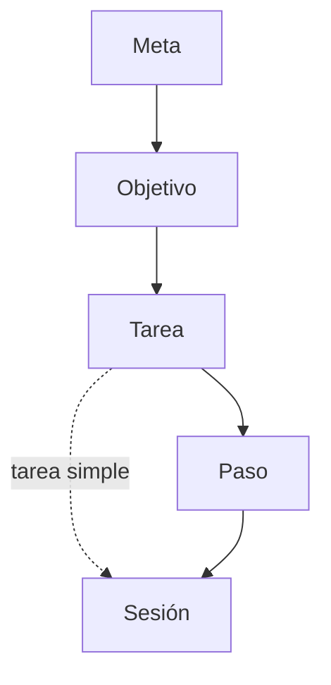

## 2. Meta

A dónde se quiere llegar, en general. Tiene fecha límite, que es el tope de sus objetivos.

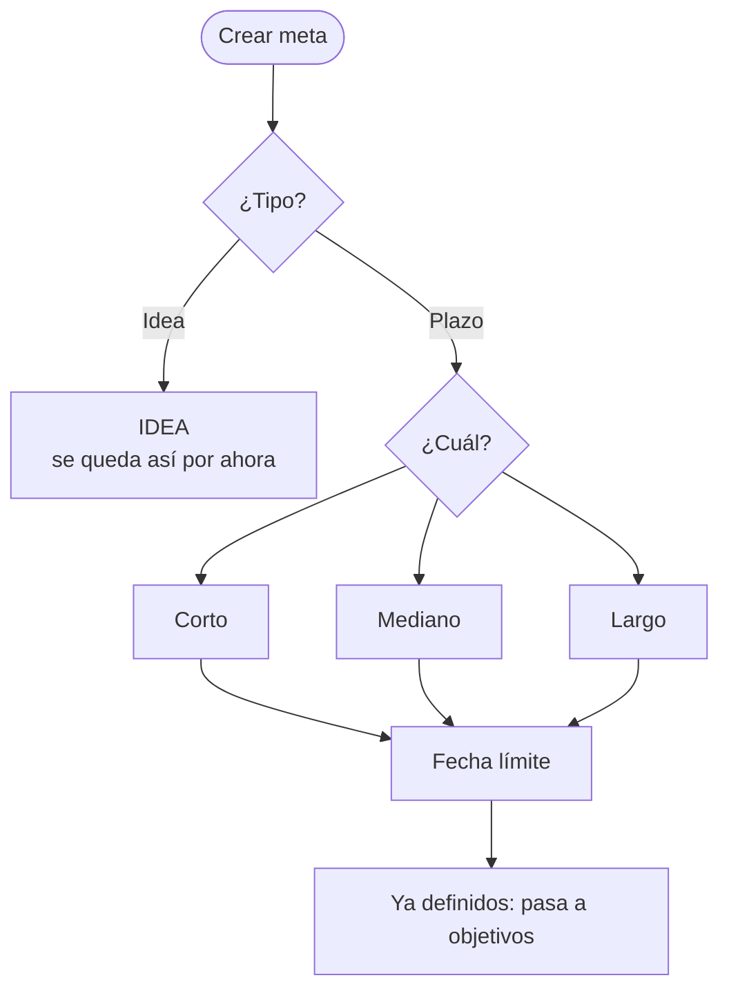

## 3. Fecha límite

Meta, objetivo, tarea, paso y sesión tienen fecha límite, en cascada: cada uno tiene la suya y conoce la de su padre, que es su tope: la del hijo puede ser igual o menor. La de la sesión es el día en que se va a realizar.

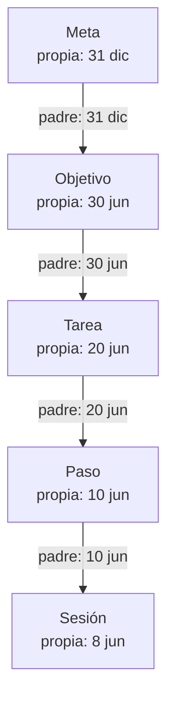

La tarea simple no tiene pasos; la compuesta sí.

## 4. Qué lleva cada nivel

La meta y el objetivo solo llevan su fecha límite. La tarea simple y el paso, además, llevan un patrón semanal o fechas específicas. La sesión lleva la fecha en que se realiza y su tiempo.

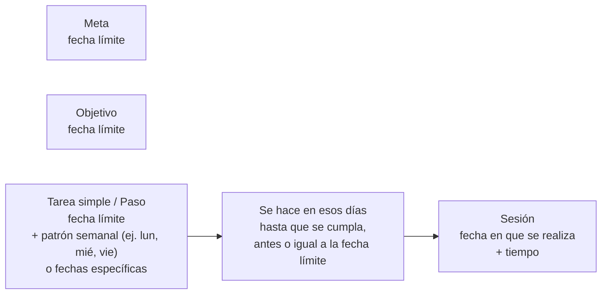

## 4.1 Otras propiedades

Como las tenemos hoy, solo añadidas.

| Nivel | Propiedades |
|-------|-------------|
| Meta | título, horizonte (corto, mediano o largo plazo) |
| Objetivo | título, naturaleza (personal, profesional, salud, finanzas, aprendizaje, hábito, bienestar u otro) |
| Tarea | título, tipo (simple o compuesta), prioridad (alta, media, baja), criticidad (vital, esencial recurrente, flexible), complejidad (baja, media, alta) |
| Tarea simple | además: plan de ejecución y recurrencia (única, patrón semanal o fechas específicas), que se determina sola según el plan |
| Tarea compuesta | sin plan ni recurrencia; los llevan sus pasos |
| Paso | título, complejidad, plan de ejecución (no tiene recurrencia) |

El **plan de ejecución** es un patrón semanal (con sus días) o fechas específicas, más la duración de cada sesión.

## 5. Tarea simple o compuesta

La compuesta solo lleva su fecha límite; el patrón y el tiempo los llevan sus pasos.

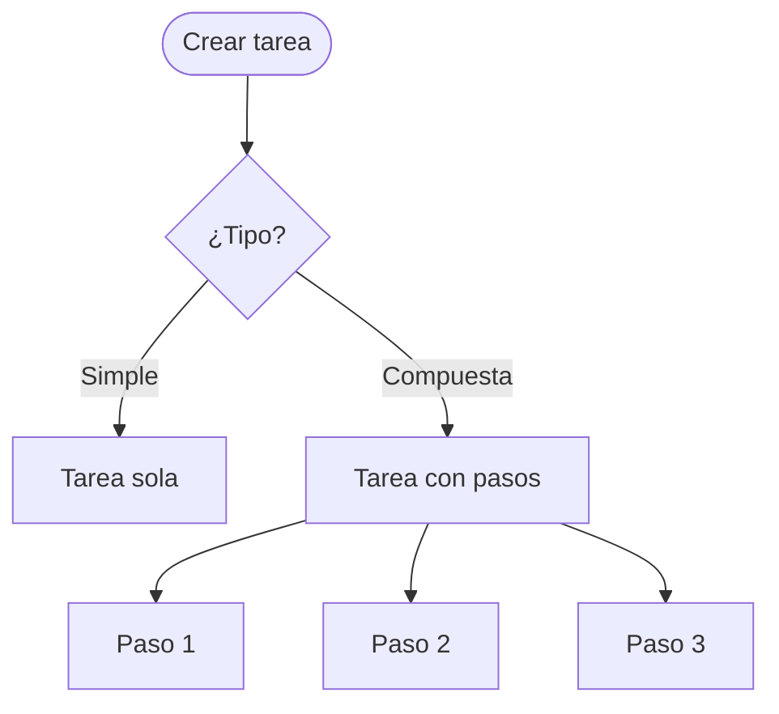

## 6. Qué se puede hacer (CRUD)

Cada nivel se puede crear solo si existe el de arriba.

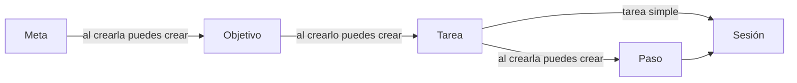

En cada nivel:

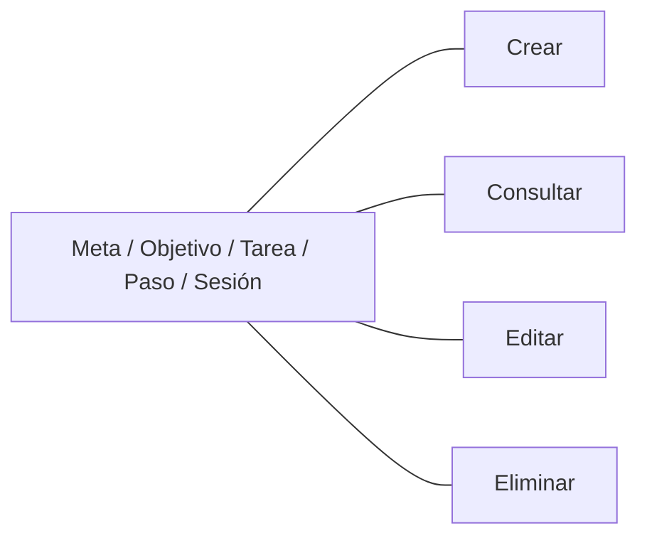

## 7. Estados

Meta, objetivo, tarea, paso y sesión comparten estas tres propiedades, independientes entre sí.

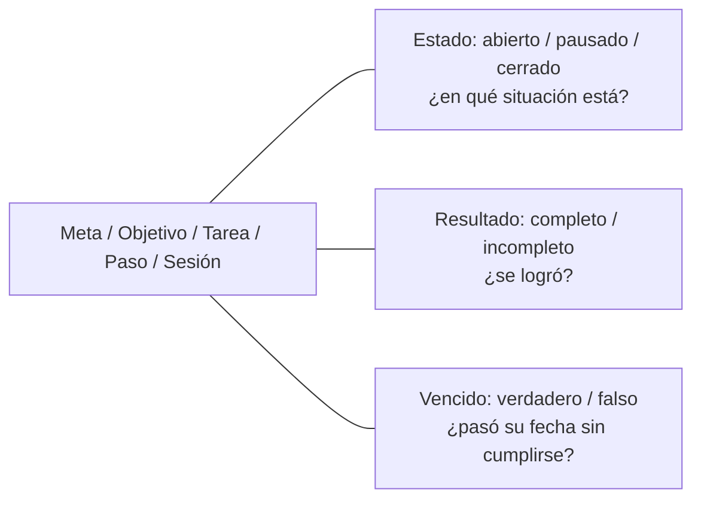

Cuando se cambia el estado de un padre, sus hijos cambian igual: cerrar, reabrir o pausar.

Vencido se apaga extendiendo la fecha límite:

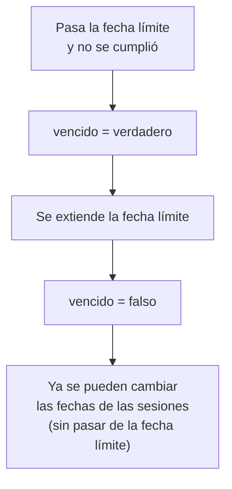

## 8. Calendario y sesiones

El calendario solo muestra las fechas de las sesiones de cada tarea simple o paso. No guarda nada propio.

La **sesión** es su propio modelo, hija de una tarea simple o de un paso. Tiene su identificador, **fecha**, **tiempo** (ej. 45 min), **tiempo realizado** (se llena al marcarla) y **notas**. Comparte con los demás niveles estado, resultado, vencido y productividad. No tiene constancia, porque no tiene sentido en una sola sesión. Se crean al elegir en el calendario (fechas específicas o patrón semanal), sin pasar de la fecha límite:

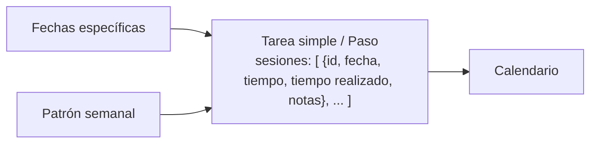

Cada sesión puede tener el mismo tiempo que las demás o el suyo. En pantalla, al crear o editar, un check decide cómo se reparte:

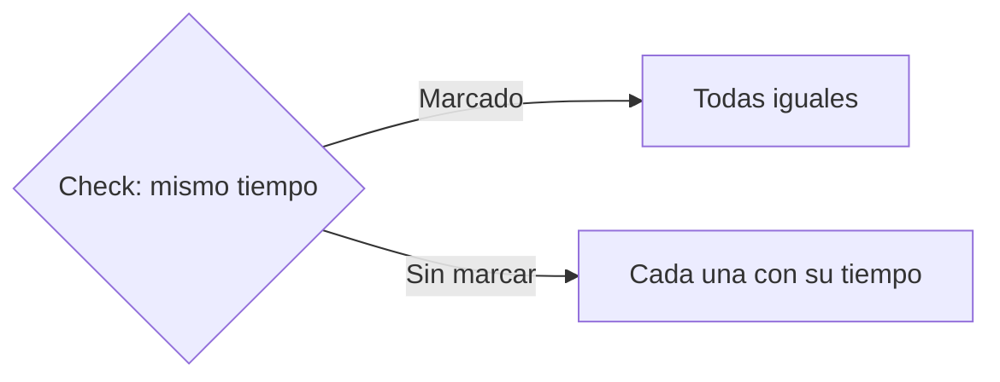

En pantalla se ve como el calendario actual: mes y año navegables, y se marca hoy.

Ejemplo: "Estudiar inglés" con patrón lun, mié, vie.

| Lun | Mar | Mié | Jue | Vie | Sáb | Dom |
|-----|-----|-----|-----|-----|-----|-----|
| Estudiar inglés | | Estudiar inglés | | Estudiar inglés | | |

### La sesión en cada momento

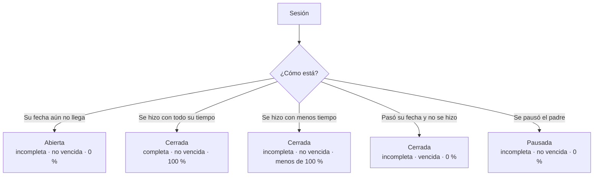

Si no se hizo, la sesión vale 0 %. Si se hizo, vale el promedio entre 100 % y su productividad. Como todos, solo es completa al llegar a 100 %, es decir, hecha con todo su tiempo.

## 9. Cálculos

Meta, objetivo, tarea y paso tienen dos medidas (la sesión solo la segunda):

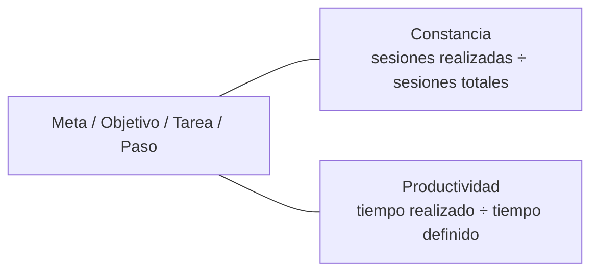

Ejemplo: 3 de 4 sesiones realizadas = 75 % de constancia.

En la sesión, la productividad es su tiempo realizado ÷ su tiempo (ej. 45 de 45 min = 100 %). No tiene constancia.

Ejemplo: se hizo la sesión pero solo 30 de 45 min. Productividad 67 %, avance (100 + 67) ÷ 2 = 83 %, así que queda incompleta. Si no se hizo, 0 %.

El **avance** es el promedio de las dos. Con él se decide el resultado:

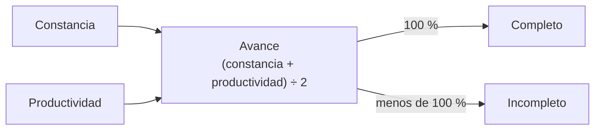

## 10. Historial diario

Cada día del calendario guarda un registro diario con las sesiones de ese día.

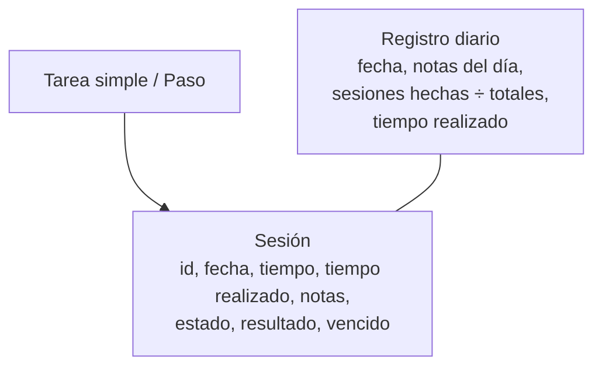

En la misma agenda, el calendario sirve para viajar a cualquier fecha y ver cómo estuvo ese día. Esto reemplaza la pantalla de historial actual:

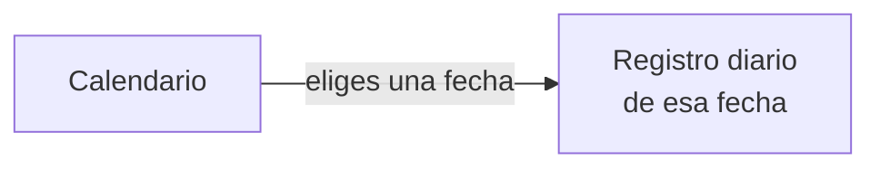

Al marcar cada sesión con su check se ponen su tiempo realizado y su nota. Al cerrar el día se escribe la nota del día y se guarda el registro.

## 11. Métricas

Con los datos de las secciones anteriores se puede evaluar cómo voy. Para cada nivel (metas, objetivos, tareas, pasos y sesiones) se cuenta cuántos hay en cada caso, más sus medidas:

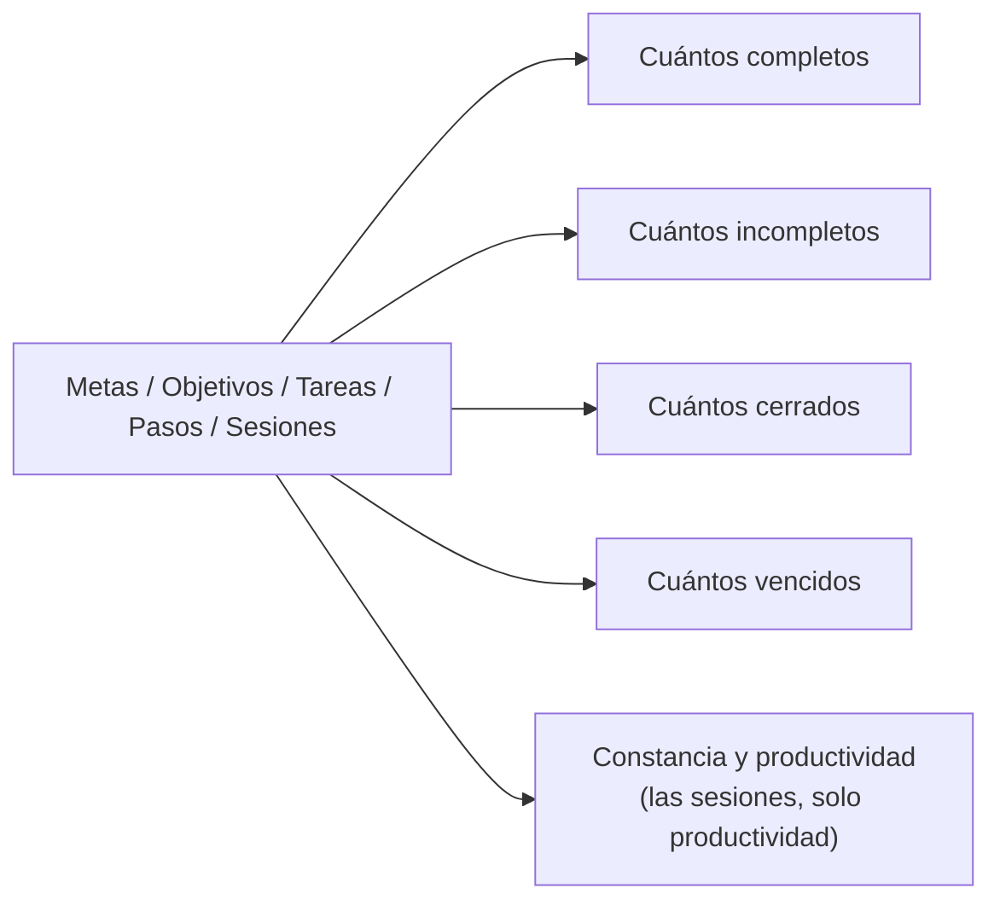

Ejemplo: de mis 5 metas, 2 completas, 3 incompletas, 4 cerradas y 1 vencida.

## 12. Todo junto

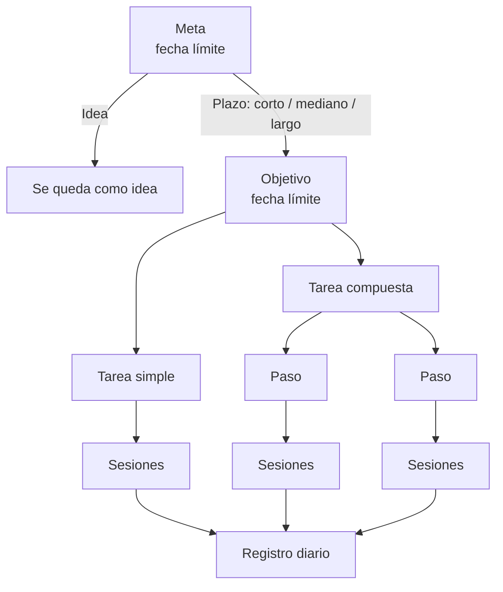